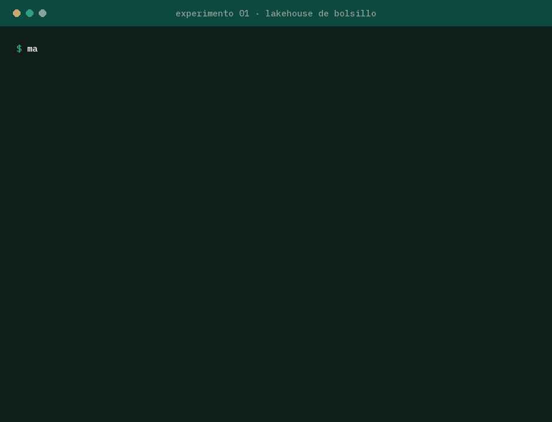
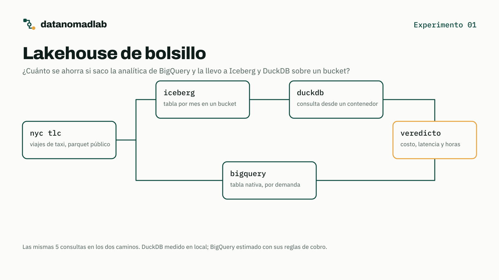
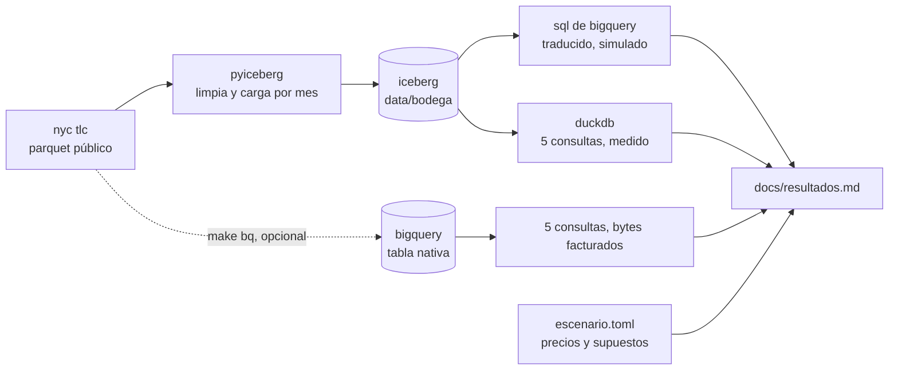

# Experimento 01 · Lakehouse de bolsillo

> **Pregunta:** ¿cuánto se ahorra si saco la analítica de BigQuery y la llevo a Iceberg y DuckDB sobre un bucket?
>
> **Veredicto:** Depende. Conviene cuando la cuenta de BigQuery ya duele y viene de consultas repetidas sobre tablas grandes; no si los datos caben en la capa gratuita. Sigue sin medirse BigQuery y un bucket de verdad (ver [Qué falta](#qué-falta)).





## Qué hace

Toma tres meses de viajes de taxi de Nueva York (datos públicos, 9,5 millones de filas) y recorre dos caminos con las mismas cinco consultas:

1. **Lakehouse:** los datos quedan en una tabla Apache Iceberg particionada por mes y DuckDB la consulta directamente desde los archivos.
2. **BigQuery:** los mismos datos en una tabla nativa, cobrada por demanda.

Sin cuenta de GCP, el lado BigQuery se **simula**: su SQL se traduce y se corre sobre la misma tabla para comprobar que es válido y da lo mismo que DuckDB. Al final escribe [docs/resultados.md](docs/resultados.md) con los tiempos, los bytes que cobraría BigQuery y un modelo de costo mensual para tres tamaños de empresa.



## Correrlo

Necesitas [uv](https://docs.astral.sh/uv/) y unos 400 MB de disco. No hace falta ninguna cuenta en la nube.

```bash
make setup    # instala dependencias (Python 3.12, DuckDB, PyIceberg)
make demo     # descarga los datos, crea la tabla, mide, simula BigQuery y escribe docs/resultados.md
make simular  # vuelve a simular BigQuery sin medir de nuevo
make test     # pruebas del modelo de costos, la carga y las consultas
make destroy  # borra data/ (y el dataset de BigQuery si definiste GCP_PROYECTO)
```

`make demo` tarda menos de un minuto con buena conexión y termina con un resumen en la terminal: cada cifra con su etiqueta (medido, estimado, simulado o modelo). Para cambiar los meses: `MESES=2024-01,2024-02 make demo`.

### Medir BigQuery de verdad (opcional)

Con una cuenta propia de GCP. Las cinco consultas escanean unos 735 MB en total, muy por debajo del TiB gratuito del mes.

```bash
gcloud auth application-default login
GCP_PROYECTO=mi-proyecto make bq       # carga la tabla, corre las consultas sin caché
GCP_PROYECTO=mi-proyecto make destroy  # borra el dataset
```

`make bq` agrega dos columnas a la tabla de resultados: bytes facturados y segundos reales.

## Cómo está armado

| Pieza | Qué hace |
|---|---|
| [src/lakehouse/datos.py](src/lakehouse/datos.py) | Descarga los Parquet de NYC TLC. No se versionan |
| [src/lakehouse/tabla.py](src/lakehouse/tabla.py) | Crea la tabla Iceberg (catálogo SQLite local) y carga cada mes, descartando viajes con fechas fuera del mes |
| [src/lakehouse/consultas.py](src/lakehouse/consultas.py) | Corre las consultas en DuckDB y calcula los bytes lógicos que leería BigQuery |
| [src/lakehouse/costos.py](src/lakehouse/costos.py) | Modelo de costos: funciones puras, sin acceso a datos |
| [src/lakehouse/simulacion.py](src/lakehouse/simulacion.py) | Simula BigQuery sin cuenta: lee su SQL con el dialecto de BigQuery (sqlglot), lo traduce y lo corre sobre la misma tabla, y saca del SQL las columnas y particiones que leería |
| [src/lakehouse/bigquery.py](src/lakehouse/bigquery.py) | Carga y mide en BigQuery. Solo corre con `make bq`. Todavía no se ha ejecutado contra una cuenta real |
| [src/lakehouse/reporte.py](src/lakehouse/reporte.py) | Escribe `docs/resultados.md` y `docs/tablas.toml` (las tablas del post, que se dibujan con `tools/tabla.py`) |
| [consultas.toml](consultas.toml) y [sql/](sql/) | Las cinco consultas, con una versión por motor |
| [escenario.toml](escenario.toml) | Precios, supuestos y escenarios. Cámbialos por los tuyos |
| [docs/diagrama.toml](docs/diagrama.toml) | Definición del diagrama (se dibuja con `tools/diagrama.py`) |
| [docs/demo.toml](docs/demo.toml) | Guion de la demo animada: qué comandos se graban (con `tools/demo.py`) |

## Resultados

Medidos el 19 de noviembre de 2026 en un Mac con M4 Pro, con DuckDB limitado a 4 hilos y 8 GB. La tabla completa y los supuestos están en [docs/resultados.md](docs/resultados.md).

| Métrica | Lakehouse (Iceberg + DuckDB) | BigQuery por demanda |
|---|---|---|
| Las 5 consultas, una vez | 0,33 s (medido, disco local) | sin medir |
| El SQL de BigQuery da el mismo resultado | | 5 de 5 (simulado) |
| Datos leídos por ejecución | solo las columnas y particiones necesarias | 735 MB (estimado) |
| Almacenamiento que se paga | 164 MB (Parquet comprimido) | 1.378 MB (bytes lógicos, estimado) |
| Costo mensual, datos medidos y refresco cada hora | USD 0,003 (modelo) | USD 0 (cabe en la capa gratuita) |
| Costo mensual, 100 veces más datos y refresco cada 15 min | USD 10 (modelo) | USD 1.200 (modelo) |
| Horas invertidas | por completar | |

Qué significa cada etiqueta:

- **Medido:** salió de correr el código en esta máquina.
- **Estimado:** calculado sobre los datos reales con las reglas públicas de cobro de BigQuery (8 bytes por número o fecha no nulo, solo las columnas que toca la consulta).
- **Simulado:** el SQL de BigQuery traducido y corrido sobre la misma tabla, sin cuenta de GCP. Comprueba el SQL y el resultado; no mide tiempos ni bytes facturados de BigQuery.
- **Modelo:** proyección con los supuestos de `escenario.toml`. El más fuerte: que tiempo y bytes crecen en proporción a los datos.

## Lo que aprendí armándolo

- La escritura particionada de PyIceberg falla si no instalas el extra `pyiceberg-core`. El error lo dice, pero recién al escribir, no al crear la tabla.
- Los archivos de TLC traen viajes con fechas imposibles (el más antiguo dice 2002). Son 56 de 9,5 millones, y si los cargas tal cual crean particiones basura. Se filtran en la carga.
- La consulta que filtra un solo mes lee 1 de los 3 archivos en DuckDB, y en BigQuery bajaría de 153 MB a 47 MB. La partición hace el mismo trabajo en ambos lados.
- BigQuery cobra el almacenamiento por bytes lógicos (sin comprimir): 8,4 veces lo que pesa la misma tabla en Parquet.

## Qué falta

- [ ] Medir BigQuery con `make bq` y comparar contra la estimación.
- [ ] Repetir la medición con la tabla en un bucket real (GCS o S3) y DuckDB en un contenedor. Hoy la bodega es una carpeta local, así que la latencia del bucket no está medida.
- [ ] Revisar los precios de `escenario.toml` contra las páginas oficiales.
- [ ] Anotar las horas invertidas y escribir el veredicto.

## Cuándo sí / cuándo no

Por completar junto con el veredicto.

## Vocabulario

Términos de este experimento explicados desde cero en [vocabulario/](../vocabulario/): [Parquet](../vocabulario/parquet.md), [Apache Iceberg](../vocabulario/iceberg.md), [DuckDB](../vocabulario/duckdb.md), [BigQuery](../vocabulario/bigquery.md) y [bucket](../vocabulario/bucket.md).
