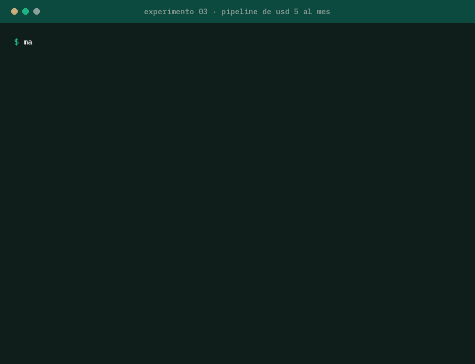
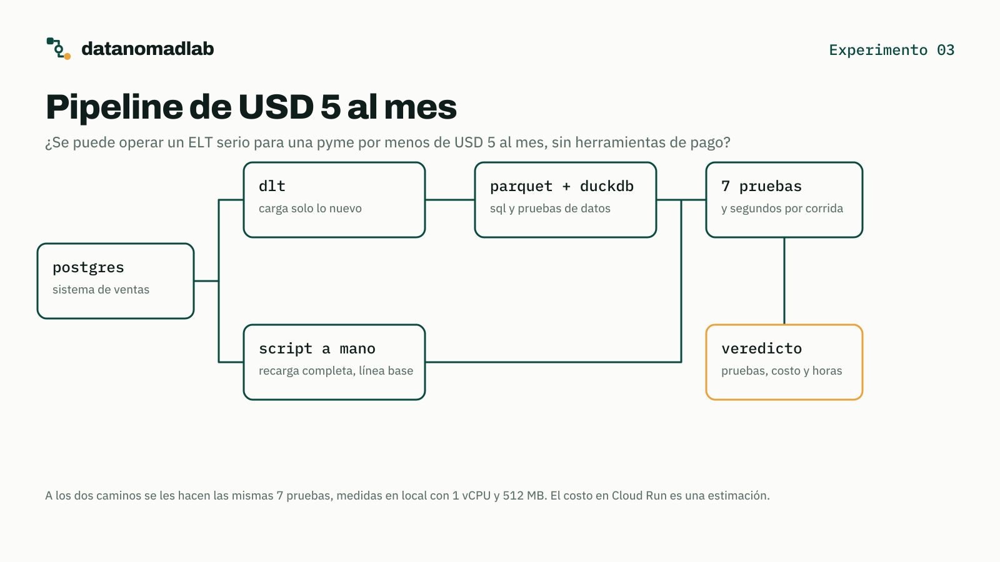
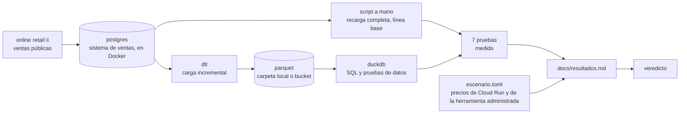
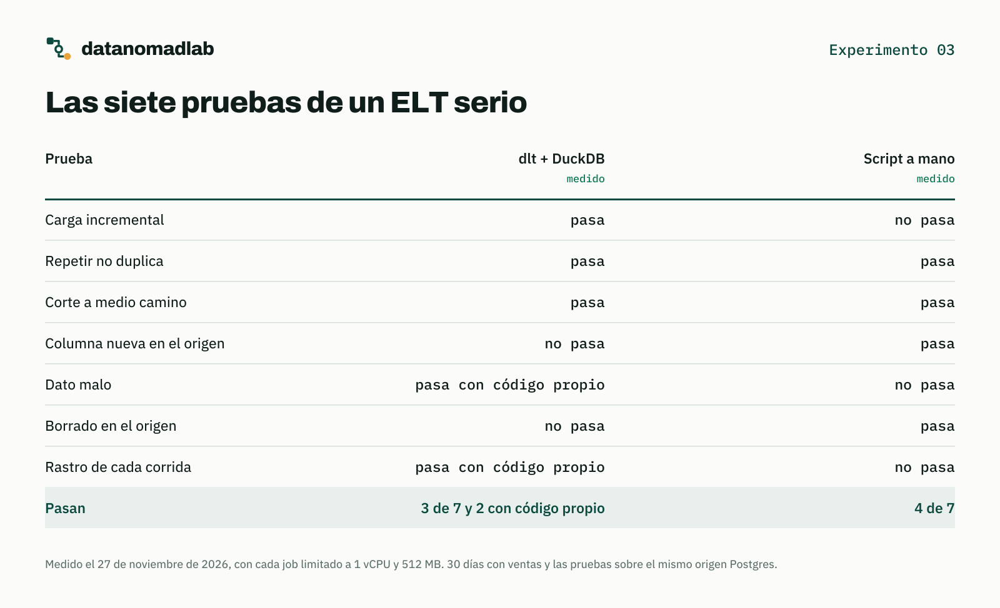
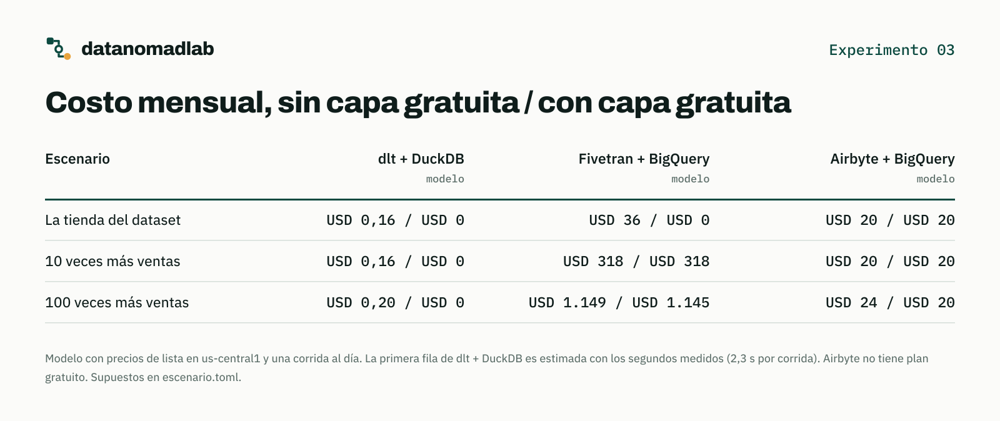

# Experimento 03 · Pipeline de USD 5 al mes

> **Pregunta:** ¿Se puede operar un ELT serio para una pyme por menos de USD 5 al mes, sin herramientas de pago?
>
> **Veredicto:** No todavía. El costo no es el problema: la corrida diaria sale USD 0,16 al mes sin capa gratuita (estimado). Lo que falla es lo "serio": dlt con DuckDB no ve los borrados ni las columnas nuevas con valor por defecto, y detener un dato malo y dejar rastro pidió Python propio. Para una pyme sin un ingeniero de datos que mantenga eso, sigue siendo difícil de operar. Medido en local con 1 vCPU y 512 MB; no se corrió en Cloud Run (ver [Qué falta](#qué-falta)).





## Qué hace

**La situación de origen.** Una empresa de 20 a 50 personas vende por internet. Sus ventas viven en la base Postgres del sistema de ventas, y los reportes se arman a mano: cada lunes alguien exporta un CSV y lo pega en una planilla. Quieren los números de ayer cada mañana. Les recomendaron una herramienta administrada de carga y una bodega en la nube, pero nadie en la empresa se dedica a datos y no quieren partir con una cuenta mensual que crece con las filas.

**La línea base.** Lo que esa empresa haría sola: un script de unas 15 líneas, corrido cada noche por cron, que copia las tablas completas a archivos. Contra eso se compara qué tan serio es el camino que se prueba. La herramienta administrada (carga administrada más BigQuery) entra solo como referencia de precio: no se corre, su costo se calcula con la lista de precios pública y las filas del mismo dataset.

**Lo que se prueba.** El camino más corto que conozco sin pagar por herramientas: [dlt](https://dlthub.com) lee Postgres y deja solo lo nuevo en archivos Parquet, DuckDB arma las tablas de reporte con SQL y revisa los datos, y todo corre una vez al día como un job de Cloud Run que se apaga al terminar.

"Serio" quiere decir que pasa estas siete pruebas. `make demo` se las hace a los dos caminos, el script a mano y dlt con DuckDB:

1. **Carga incremental:** la corrida diaria mueve solo lo nuevo y lo que cambió, no la tabla entera.
2. **Repetir no duplica:** correr dos veces el mismo día deja las mismas filas.
3. **Corte a medio camino:** se mata la corrida durante la carga; la siguiente termina sin filas repetidas ni faltantes.
4. **Columna nueva en el origen:** la corrida no se cae y la columna queda registrada.
5. **Dato malo:** un precio negativo o una cantidad imposible detiene la publicación del día, y las tablas de ayer siguen disponibles.
6. **Borrado en el origen:** una fila que se borra en Postgres, ¿desaparece del destino?
7. **Rastro:** cada corrida deja cuántas filas movió, cuánto tardó y cómo terminó, y una corrida fallida sale con error para que el job quede marcado.

`make demo` levanta Postgres en Docker, carga un año de ventas como historia y después simula 30 días con ventas: cada día entran las ventas de ese día y corren los dos caminos, cada uno en un contenedor con el mismo límite que tendría el job (1 vCPU, 512 MB y sin disco propio). Después le hace las pruebas 2 a 7 a los dos caminos. De los días simulados salen la prueba 1 y los segundos por corrida con los que se estima la cuenta de Cloud Run.



### Por qué estas piezas y no otras

| Pieza | Por qué está |
|---|---|
| Postgres 18 | Es el origen de la situación: la base del sistema de ventas. Corre en Docker y recibe las ventas día a día. Va la 18 y no la 19, que salió el 19 de noviembre de 2026: una empresa chica no tiene en producción una versión de una semana |
| Script a mano | La línea base. Muestra cuáles de las siete pruebas pasa lo que una empresa escribiría sola |
| dlt | Hace la carga: lee solo lo nuevo, guarda en el propio destino hasta dónde llegó y registra los cambios de esquema. Es una librería de Python, no un servicio que haya que mantener prendido |
| Parquet en una carpeta | El destino. En local es una carpeta; en la nube, un bucket. No hay bodega que pagar ni servidor que cuidar |
| DuckDB | Transforma con SQL y corre las pruebas de datos sobre los Parquet, en el mismo proceso. También se queda con la última versión de cada fila: sobre archivos Parquet sueltos dlt solo agrega, así que una fila que cambió llega como fila nueva ([documentación del destino](https://dlthub.com/docs/dlt-ecosystem/destinations/filesystem)) |
| Contenedor con 1 vCPU y 512 MB | Pone a la corrida el límite más chico que acepta un job de Cloud Run, para que los segundos medidos sirvan para estimar el costo |

Descartadas: **dbt**, porque para cinco tablas de reporte suma un proyecto y una dependencia más, y lo que se prueba cabe en archivos SQL con sus pruebas (entra cuando las tablas empiezan a depender unas de otras); **Delta o DuckLake como destino**, que dejarían a dlt actualizar filas en vez de solo agregarlas, porque suman un formato o un catálogo que alguien tiene que entender, y el destino DuckLake de dlt 1.32 todavía pide DuckDB 1.x; **Airbyte instalado por cuenta propia**, porque necesita un servidor prendido todo el día y eso ya no cuesta USD 5; **un archivo DuckDB guardado en el bucket**, porque un job sin disco propio tendría que bajarlo y subirlo entero en cada corrida; **MotherDuck**, porque es un servicio de pago aunque tenga capa gratuita.

Dos cosas que la documentación ya adelanta y que el experimento va a comprobar, no a dar por sabidas: la carga por cursor de dlt no ve las filas borradas en el origen (prueba 6), y el plan gratuito de la herramienta administrada cubre hasta 500.000 filas activas al mes, así que en este tamaño su cuenta también puede ser cero.

### Qué se mide

| Métrica | Unidad | Cómo se obtiene |
|---|---|---|
| Pruebas pasadas | de 7, por camino | Medido: cada prueba termina en pasa, pasa con código propio o no pasa |
| Corrida diaria | segundos y filas movidas | Medido en el contenedor limitado, en los 30 días simulados. Se informa la mediana y el peor día |
| Costo mensual en la nube | USD al mes | Estimado: segundos medidos por la lista de precios pública de Cloud Run (que cobra un minuto como mínimo por corrida), más el bucket, el programador y el registro de la imagen, cuyo tamaño se mide. Con y sin capa gratuita. Con 10 y 100 veces más datos, modelo |
| Costo mensual de la herramienta administrada | USD al mes | Modelo: filas nuevas y cambiadas por mes del dataset (medido) por su lista de precios pública, con el plan gratuito y con el plan pagado más barato |
| Lo que hay que mantener | líneas de Python y SQL | Medido: se cuentan en el repo, por camino. No cuenta el Dockerfile, que es el mismo para los dos, ni la configuración del despliegue, que no existe todavía |
| Horas invertidas | horas | Las anota quien arma el experimento |

### El criterio del veredicto

Escrito antes de medir.

- **Lo usaría:** dlt con DuckDB pasa las siete pruebas sin código propio más allá de configuración y SQL; la corrida diaria cuesta menos de USD 5 al mes con los datos medidos y también con 10 veces más, sin contar la capa gratuita; y armarlo cabe en las 10 horas del experimento.
- **Depende:** pasa las pruebas, pero una o dos necesitan código propio o una pieza más que el equipo tiene que conocer; o el costo se pasa de USD 5 con 10 veces más datos; o la herramienta administrada sale gratis en ese tamaño y la diferencia queda solo en quién opera qué.
- **No todavía:** duplica o pierde filas al repetir o después de un corte sin que se arregle con configuración; o cuesta más que la herramienta administrada en el mismo tamaño.

**Nota del 27 de noviembre de 2026, después de la primera medición.** El criterio de arriba no se tocó. Lo que cambió, después de una revisión independiente, es cómo se califican tres pruebas:

- **Prueba 4.** En la primera versión la columna nueva se llenaba solo en los clientes de ese día, que la carga iba a leer de todos modos: dlt no podía fallarla. Ahora la columna se agrega con valor por defecto, como se hace en una base real, y se llena en todas las filas. Pasa si llegan todos los valores.
- **Pruebas 5 y 7.** Lo que las hace pasar en el camino de dlt es Python escrito para el experimento (detener la publicación y dejar el rastro), no configuración de dlt ni SQL. Se califican "pasa con código propio".
- **Prueba 3.** Se aplica a los dos caminos tal como está escrita: la corrida siguiente tiene que quedar completa. Lo que pasa entre el corte y esa corrida (los reportes de ayer o un CSV a medias) va en el detalle, no en la calificación.

**Cómo se aplicó.** Leído al pie de la letra, el criterio cae en Depende: dos pruebas piden código propio y Fivetran sale gratis en este tamaño. Pero no dice qué pasa si una prueba falla, y fallaron dos. En la 4 llegan 3 de los 4.453 valores de la columna nueva y en la 6 la fila borrada sigue en el destino: son datos que se pierden o sobran sin que lo arregle la configuración, que es la condición de No todavía. El veredicto es No todavía por eso y por quién tendría que operarlo: las recargas completas para los borrados y las columnas, el Python que detiene un dato malo y la limpieza de archivos quedan a cargo de alguien que una pyme sin ingeniero de datos no tiene. Pasaría a Depende si los borrados y las columnas nuevas se resuelven con configuración de dlt y las dos piezas de código propio dejan de hacer falta.

### Los datos

[Online Retail II](https://archive.ics.uci.edu/dataset/502/online+retail+ii), del repositorio de UCI: las facturas de una tienda en línea británica de artículos de regalo entre diciembre de 2009 y diciembre de 2011. Es un archivo Excel de 43,5 MB con 1.067.371 líneas de factura, con licencia CC BY 4.0 (Chen, D., 2012, [doi.org/10.24432/C5CG6D](https://doi.org/10.24432/C5CG6D)). Se descarga con un script y no se versiona.

El experimento lo reparte en cuatro tablas de Postgres (clientes, productos, facturas y líneas de factura), como las tendría un sistema de ventas. Los productos cambian de precio en el tiempo, así que hay filas que se actualizan y no solo filas nuevas. Es el tamaño real de una empresa chica; los escenarios con 10 y 100 veces más datos son un modelo, no una medición.

### El límite

- Una sola fuente, una base Postgres. No prueba conectores a aplicaciones (pagos, publicidad, CRM), que es donde más ayuda una herramienta administrada.
- La corrida se mide en un computador, en un contenedor con el límite del job. La red entre el job, la base y el bucket no está medida; el costo de Cloud Run es una estimación hasta correrlo con una cuenta.
- El job escribe en una carpeta. En Cloud Run el bucket se montaría como carpeta con Cloud Storage FUSE, lo que no está probado y también ocupa memoria de los 512 MB.
- Supone que el job llega a Postgres por internet, con usuario y clave. Si la base solo acepta direcciones conocidas, Cloud Run necesita una IP de salida fija, que no está en el modelo y puede costar más que todo lo demás.
- Llega hasta las tablas de reporte en Parquet. No incluye el tablero, los permisos por persona ni las alertas.
- Una persona, una corrida al día. No prueba varias cargas a la vez ni datos que tengan que estar en minutos.

## Correrlo

Necesitas [uv](https://docs.astral.sh/uv/), Docker corriendo y cerca de 1 GB de disco para las imágenes. No hace falta ninguna cuenta en la nube.

```bash
make setup    # instala dependencias y baja la imagen de Postgres
make demo     # descarga los datos, simula 30 días, corre las 7 pruebas y escribe docs/resultados.md
make reporte  # rehace el reporte y los costos sin medir de nuevo (por ejemplo, después de cambiar escenario.toml)
make test     # pruebas
make destroy  # borra los contenedores, la imagen del job y data/. En la nube no se crea nada
```

`make demo` termina con un resumen en la terminal: cada cifra con su etiqueta (medido, estimado o modelo). Para simular otro período, copia [.env.example](.env.example) a `.env` y cambia `HISTORIA_HASTA` o `DIAS`.

## Cómo está armado

| Pieza | Qué hace |
|---|---|
| [src/pipeline/datos.py](src/pipeline/datos.py) | Descarga el Excel, junta sus dos hojas y descarta lo que no es una venta, contando cada descarte |
| [src/pipeline/origen.py](src/pipeline/origen.py) | El sistema de ventas: cuatro tablas en Postgres que reciben las ventas día a día, y lo que les pasa en las pruebas |
| [src/pipeline/job_dlt.py](src/pipeline/job_dlt.py) | **El camino que se prueba.** dlt carga lo nuevo a Parquet, DuckDB corre las pruebas de datos y, si pasan, publica los reportes. Deja un rastro de cada corrida |
| [src/pipeline/job_script.py](src/pipeline/job_script.py) | **La línea base.** Copia las cuatro tablas completas a CSV |
| [src/pipeline/vistas.py](src/pipeline/vistas.py) y [sql/vigente.sql](sql/vigente.sql) | La versión vigente de cada fila sobre lo que cargó dlt, que sobre archivos sueltos solo agrega |
| [sql/pruebas/](sql/pruebas/) y [sql/reportes/](sql/reportes/) | Las pruebas de datos (cada fila que devuelven es un error) y los cinco reportes |
| [Dockerfile](Dockerfile) | La imagen de los dos jobs, la que se subiría a Cloud Run con el bucket montado como carpeta (sin probar) |
| [src/pipeline/contenedores.py](src/pipeline/contenedores.py) | Postgres y las corridas en Docker, con 1 vCPU, 512 MB y disco de solo lectura |
| [src/pipeline/corte.py](src/pipeline/corte.py) | Prueba 3: mata el job de dlt en un punto exacto de la carga |
| [src/pipeline/pruebas.py](src/pipeline/pruebas.py) y [src/pipeline/medir.py](src/pipeline/medir.py) | Las siete pruebas y la medición completa |
| [src/pipeline/costos.py](src/pipeline/costos.py) y [escenario.toml](escenario.toml) | El modelo de costos: funciones puras, y los precios con su fuente y fecha |
| [src/pipeline/reporte.py](src/pipeline/reporte.py) | Escribe `docs/resultados.md`, `docs/tablas.toml` y el resumen de la terminal |
| [docs/diagrama.toml](docs/diagrama.toml) y [docs/demo.toml](docs/demo.toml) | El diagrama y el guion de la demo animada (se dibujan con `make imagenes` en la raíz) |

## Resultados

Medidos el 27 de noviembre de 2026 en un Mac con M4 Pro, con cada job en un contenedor limitado a 1 vCPU y 512 MB. Las pruebas una por una, las versiones y los supuestos están en [docs/resultados.md](docs/resultados.md).

| Métrica | dlt + DuckDB | Script a mano |
|---|---|---|
| Pruebas que pasa | 3 de 7, y 2 más con código propio (dato malo y rastro). No pasa la columna nueva ni el borrado (medido) | 4 de 7: no es incremental, copia el dato malo sin avisar y no deja rastro (medido) |
| Corrida diaria, mediana de 30 días | 2,3 s (medido) | 0,3 s (medido) |
| Filas movidas por corrida, mediana | 2.236 (medido) | 574.556, las tablas completas (medido) |
| Memoria máxima de las corridas diarias | 278 MB de 512 (medido) | sin medir |
| Código que hay que mantener | 104 líneas, más 51 de los cinco reportes (medido) | 16 líneas, sin reportes (medido) |
| Costo mensual en la nube, con los datos medidos | USD 0,16 sin capa gratuita, USD 0 con ella (estimado) | |
| Lo mismo con 10 y con 100 veces más ventas | USD 0,16 y USD 0,20 (modelo) | |
| Horas invertidas | por completar | |

La referencia administrada, con las mismas filas: Fivetran más BigQuery cuesta USD 0 en el plan gratuito, porque el mes simulado tiene 63.229 filas activas y el límite son 500.000, y USD 36 en el plan pagado. Con 10 veces más ventas ya no cabe en el plan gratuito y sale USD 318. Airbyte Cloud no tiene plan gratuito y parte en USD 20 (todo modelo). Los montos de los dos lados son infraestructura: no incluyen las horas de quien opera ni las alertas.





Qué significa cada etiqueta:

- **Medido:** salió de correr el código en esta máquina.
- **Estimado:** los segundos medidos por la lista de precios publicada de cada servicio.
- **Modelo:** proyección con los supuestos de [escenario.toml](escenario.toml). El más fuerte: que la corrida sigue cabiendo en 1 vCPU y 512 MB con 10 y 100 veces más datos, algo que no se midió.

## Lo que aprendí armándolo

- **El Excel trae dos hojas que se pisan nueve días**, del 1 al 9 de diciembre de 2010: 22.523 líneas repetidas que, cargadas tal cual, duplican las ventas de esos días. Además hay 6 ajustes contables y 3.393 movimientos de bodega con cantidad negativa, que no son ventas. Se descartan en la carga y se cuentan.
- **`read_xlsx` de DuckDB falla adivinando tipos**: la columna de factura mezcla números con códigos como C489449. Leyendo todo como texto funciona, pero entonces las fechas llegan como número de serie de Excel (días desde el 30 de diciembre de 1899).
- **dlt guarda su avance en el mismo destino**, así que el job parte cada vez sin disco y retoma donde quedó, sin configurar nada. Lo que sí costó: aunque la telemetría esté apagada, dlt escribe un identificador en la carpeta del usuario, y con el disco de solo lectura del contenedor llenaba el registro de errores; se arregla corriendo como usuario normal con la carpeta personal en `/tmp`. Y SQLAlchemy 2.1 entiende `postgresql://` como psycopg 3, que dlt no instala: hay que escribir `postgresql+psycopg2://`.
- **Una columna nueva con valor por defecto no llega a las filas viejas.** dlt registra la columna sin caerse, pero la carga por fecha de actualización solo lee las filas que cambiaron de fecha, y agregar una columna no cambia la fecha de nadie: llegaron 3 de los 4.453 valores. La primera versión de esta prueba la llenaba solo en filas nuevas, y así no podía fallar; la encontró la revisión independiente. Arreglarlo pide una recarga completa de esa tabla.
- **El corte peligroso no lo encuentra un `docker kill` a ciegas.** dlt escribe todo al final, en milisegundos, así que el job se mata a sí mismo en puntos exactos de la carga. Si el corte cae entre guardar el avance y registrar la carga, la corrida siguiente cree que ya cargó esas filas. Una vista que leyera solo las cargas registradas, la forma obvia de no mostrar cargas a medias, escondería para siempre 1.500 filas. Por eso la vista de este experimento lee todos los archivos y se queda con la última versión de cada fila. Y un detalle para quien lo repita: dentro de un contenedor el proceso 1 no puede matarse a sí mismo con SIGKILL; los primeros cortes no ocurrían hasta correr con `--init`.
- **La cuenta de Cloud Run la decide el minuto mínimo, no el tiempo.** Con corridas de 2,3 s se cobra un minuto igual, y el script de 0,3 s costaría lo mismo. Sin capa gratuita, lo más caro es el programador que dispara la corrida: USD 0,10 de los USD 0,16.
- **Los archivos se acumulan.** Cada corrida agrega 4 Parquet a las tablas crudas (122 después del mes simulado) y DuckDB los lee todos en cada corrida. En un año serían unos 1.500: juntarlos de vez en cuando es una tarea que hereda el equipo, y aquí no está medida.

## Qué falta

- [ ] Medir la corrida con 10 y 100 veces más datos. El modelo supone que sigue cabiendo en 1 vCPU y 512 MB.
- [ ] Correr el job en Cloud Run con un bucket y una cuenta propia, y comparar contra la estimación: arranque, red y operaciones del bucket.
- [ ] Probar una salida para los borrados y las columnas nuevas: una recarga completa periódica de las tablas afectadas, o un formato de tabla (Delta) con la estrategia `cdc` de dlt, que pide una foto completa en cada carga.
- [ ] Montar el bucket con Cloud Storage FUSE y medir cuánta memoria suma a los 512 MB.
- [ ] Averiguar cuánto cuesta una IP de salida fija para Cloud Run, por si la base solo acepta direcciones conocidas.
- [ ] Configurar el job sin reintentos automáticos: una corrida detenida por un dato malo se repetiría sobre el mismo dato.
- [ ] Probar cambios que se confirman en el origen con una fecha anterior a la última carga: la carga por cursor se los salta (dlt tiene un margen, `lag`, para eso).
- [ ] Juntar los archivos del destino cuando pasen de unos cientos, y medir cuánto cambia la corrida.
- [ ] Mirar en un navegador los precios de Google Cloud y la tabla de consumo de Fivetran: se leyeron como texto.
- [ ] Escribir los posts de vocabulario de ELT, Postgres, dlt y Cloud Run.
- [ ] Anotar las horas invertidas.

## Cuándo sí / cuándo no

**Cuándo sí:**

- Hay alguien en el equipo que escribe Python y SQL y puede dedicar unas horas al mes a operarlo: revisar las corridas detenidas, programar recargas completas y juntar archivos.
- El origen no borra filas, o las marca como borradas con una columna en vez de eliminarlas, y las columnas nuevas llegan pocas veces y con aviso.
- El volumen ya no cabe en el plan gratuito de Fivetran (500.000 filas activas al mes). Con 10 veces las ventas de este experimento, Fivetran pagado sale USD 318 al mes y este camino USD 0,16 (modelo).

**Cuándo no:**

- Si no hay un ingeniero de datos. Mientras las filas que cambian quepan en el plan gratuito de Fivetran (este caso usa 63.229 de 500.000), una herramienta administrada sale gratis y lo opera el proveedor. No se verificó si Fivetran captura los borrados.
- Si las tablas son chicas y lo que importa es ver borrados y columnas nuevas: el script que copia todo cada noche las pasa, con 16 líneas. Le faltan detener un dato malo y dejar rastro de cada corrida.
- Si el origen borra filas seguido y nadie va a programar recargas: el destino acumula filas que ya no existen y los totales se desvían sin avisar.

**Dónde cabe.** Reemplaza a una herramienta de carga administrada, no al warehouse: el destino son archivos Parquet que se consultan con DuckDB. Lo que antes hacía el proveedor queda en el equipo: las actualizaciones de dlt, los permisos del bucket y de la base, las alertas cuando una corrida se detiene y la limpieza de los archivos del destino.

## Vocabulario

Términos de este experimento explicados desde cero en [vocabulario/](../vocabulario/): [ELT](../vocabulario/elt.md), [Postgres](../vocabulario/postgres.md), [Docker](../vocabulario/docker.md), [dlt](../vocabulario/dlt.md), [Parquet](../vocabulario/parquet.md), [DuckDB](../vocabulario/duckdb.md), [bucket](../vocabulario/bucket.md), [Cloud Run](../vocabulario/cloud-run.md) y [BigQuery](../vocabulario/bigquery.md). La lista está en [vocabulario.txt](vocabulario.txt).
