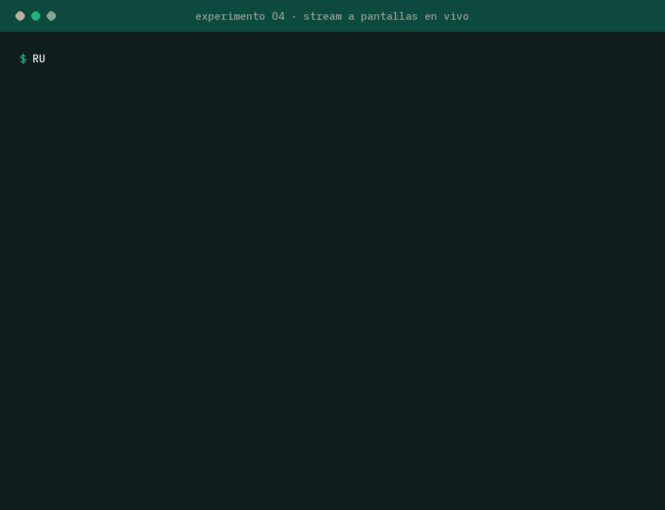
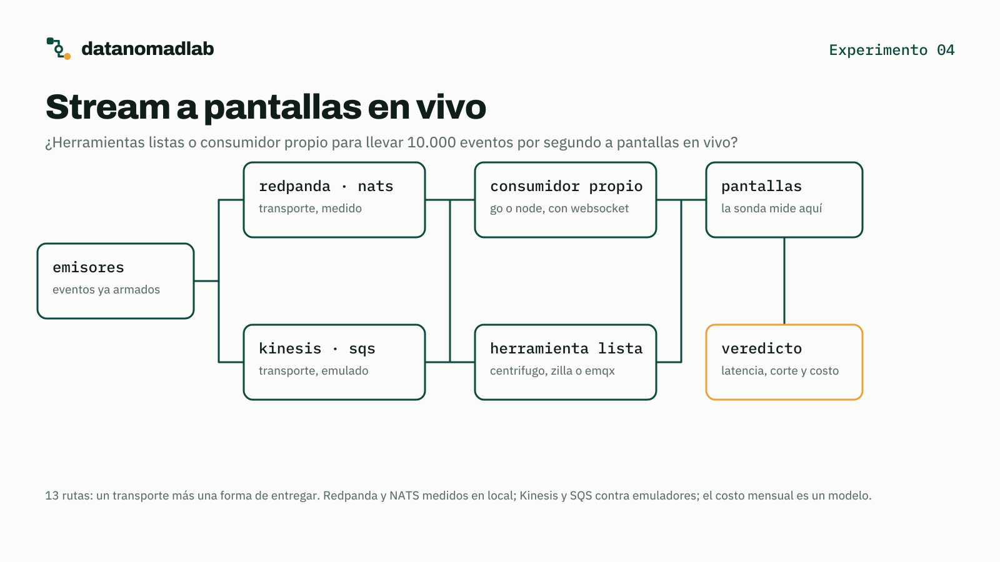
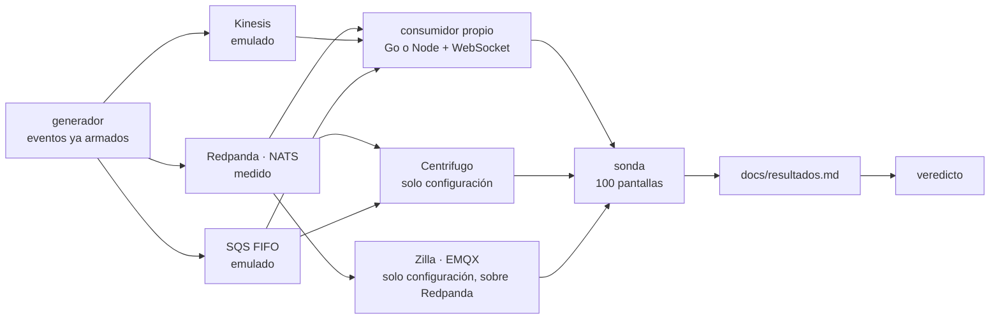

# Experimento 04 · Stream a pantallas en vivo

> **Pregunta:** ¿Herramientas listas o consumidor propio para llevar 10.000 eventos por segundo a pantallas en vivo?
>
> **Veredicto:** pendiente.





## Qué hace

**La situación de origen.** Una empresa recibe eventos chicos de muchos emisores (medidores, terminales, aplicaciones). Una pieza de procesamiento ya los entrega armados en un stream de Kinesis, y tres equipos de producto tienen que mostrarlos en pantallas en vivo. La recomendación habitual para leer Kinesis bien es Flink o Beam, pero esos equipos trabajan en Node y Go, no operan Flink, y cada hora con las pantallas caídas tiene una multa.

**La línea base.** Kinesis con una aplicación de Flink administrado por cada equipo. Es lo que se recomendaría hoy, y contra eso se compara el costo.

**Lo que se prueba.** Si cambiar el transporte, la pieza que entrega a las pantallas, o ambos, deja a esos equipos con algo que puedan operar. Una ruta es un transporte más una forma de entregar:

- **Transportes:** Redpanda (API de Kafka) y NATS JetStream, que corren de verdad en Docker; Kinesis y SQS FIFO, contra emuladores locales.
- **Entrega:** un consumidor escrito a mano con su servidor WebSocket, en Go y en Node, o una herramienta que lee el transporte y empuja a las pantallas solo con configuración: [Centrifugo](https://centrifugal.dev) (WebSocket), [Zilla](https://github.com/aklivity/zilla) (Server-Sent Events) o [EMQX](https://github.com/emqx/emqx) (MQTT sobre WebSocket).

`make demo` levanta cada una de las 13 rutas, de a una, con 2 núcleos y 2 GB por pieza, y le hace tres pruebas:

1. **Carga nominal:** 10.000 eventos por segundo durante 30 segundos, de 100.000 emisores, hacia 100 pantallas.
2. **Corte:** mata sin aviso la pieza que entrega, la levanta de inmediato y mira qué vio la pantalla. Dos veces por ruta; de cada dato se informa el peor valor.
3. **Rampa:** sube a 20.000, 40.000 y 80.000 eventos por segundo hasta que la ruta deja de cumplir.

Todo se mide en un solo lugar: una sonda que hace de pantallas. Cada emisor numera sus eventos, así que la sonda sabe cuántos llegaron, cuáles se repitieron, cuáles llegaron fuera de orden y cuánto tardó cada uno desde que se emitió.



### Por qué estas piezas y no otras

| Pieza | Por qué está |
|---|---|
| Generador | Reemplaza a la pieza que entrega los eventos armados. Emite a tasa fija y numera cada evento por emisor |
| Redpanda | Un registro particionado con la API de Kafka: el broker reparte particiones y guarda el avance de cada lector |
| NATS JetStream | La alternativa más liviana con persistencia y consumidores durables |
| Kinesis (emulado) | El transporte de la situación de origen. Muestra cuánto código pide leerlo sin Flink ni KCL |
| SQS FIFO (emulado) | La cola administrada más simple que conserva el orden por emisor |
| Consumidor propio | Lo que el equipo escribiría: leer, saber qué pantalla mira qué, empujar por WebSocket |
| Centrifugo | La herramienta lista: trae consumidores para Kafka, NATS y SQS, y recuperación para la pantalla que se desconecta |
| Zilla | Otra herramienta lista, con otra idea: un proxy sin grupo de consumidores que reparte un tópico de Kafka por Server-Sent Events. La pantalla dice desde dónde seguir |
| EMQX | La tercera: un broker MQTT que lee de Kafka con una regla. La pantalla se suscribe por MQTT sobre WebSocket |
| Sonda | La única pieza que mide, y lo hace donde importa: en lo que recibe la pantalla |

Descartadas: **LocalStack**, porque desde la versión 2026.03 exige cuenta y token incluso para la imagen comunitaria (por eso los emuladores son kinesis-mock y ElasticMQ); **SQS estándar**, porque no conserva el orden por emisor; **Flink en local**, porque la versión estable (2.3) todavía no tiene conectores publicados de Kinesis ni de Kafka, y medirlo en una versión anterior es otro experimento.

### El criterio del veredicto

Escrito antes de la corrida completa, después de pruebas cortas para comprobar que todo levantaba.

- **Lo usaría:** al menos una ruta sin código propio entrega la carga nominal con p99 bajo 1 segundo, sin pérdida ni desorden; aguanta 4 veces esa carga; después de un corte la pantalla vuelve en menos de 10 segundos sin perder eventos; y su costo mensual no supera al de la línea base en más de lo que vale una hora caída.
- **Depende:** cumple con carga estable, pero el corte deja pérdida o un congelamiento de más de 10 segundos que solo se arregla con configuración o piezas adicionales que el equipo tiene que conocer.
- **No todavía:** ninguna ruta sin código propio cumple la carga nominal, o pierde eventos sin que nada falle.

### Los datos

No hay dataset: la carga es sintética y la genera el propio experimento, porque lo que se mide es el camino y no el contenido. Cada evento es un JSON de 300 bytes con emisor, cuenta, número de secuencia y hora de emisión. Tasa, emisores, cuentas, pantallas y tamaño se cambian en `.env` (ver [.env.example](.env.example)).

### El límite

- Un computador, un nodo por pieza. No mide alta disponibilidad, réplicas ni un corte del transporte: solo el de la pieza que entrega.
- Kinesis y SQS son emuladores. Dicen si la ruta funciona, qué hace el código del consumidor frente a un corte y cuánto código pide; no dicen cuánto tarda ni cuánto aguanta el servicio real.
- Con 100.000 emisores, cada uno emite cada 10 segundos: el orden por emisor solo queda a prueba para desórdenes más largos que eso, y en las rutas simuladas no queda a prueba.
- Dos cortes por ruta. Lo que pasa al matar un consumidor depende de en qué estaba en ese instante.
- 100 pantallas que se reconectan a los 100 ms. Con miles de conexiones, o con pantallas que tardan más en volver, el reparto pesa más y la pérdida en el corte crece.
- Redpanda corre en modo de desarrollo, sin `fsync`. Sirve para comparar rutas en la misma máquina, no como cifra de un broker durable.
- Zilla y EMQX se midieron solo sobre Redpanda y no están en el modelo de costos. Con Zilla, la sonda espera a que termine de llegar el histórico antes de medir, y abre un flujo SSE por cuenta: 10 por pantalla.
- Flink no se midió: su costo en el modelo depende de un supuesto de capacidad por KPU.
- Las horas de personas para construir y operar cada camino no están en el modelo.

## Correrlo

Necesitas [uv](https://docs.astral.sh/uv/) y Docker con al menos 8 núcleos y 8 GB asignados. No hace falta ninguna cuenta en la nube.

```bash
make setup    # instala dependencias
make demo     # construye las imágenes, mide cada ruta, calcula costos y muestra el resumen
make costos   # recalcula solo el modelo de costos sobre la última medición
make test     # pruebas
make destroy  # baja los contenedores y borra volúmenes, imágenes propias y data/
```

`make demo` completo tarda cerca de dos horas: son 13 rutas y los cortes sobre Kafka demoran en recuperarse. Para probar que todo levanta: `RAPIDO=1 RUTAS=redpanda-go,nats-centrifugo make demo` (las cifras de una corrida rápida no se publican). Termina con un resumen en la terminal: cada cifra con su etiqueta (medido, simulado o modelo).

Para correr el modelo de costos con tus cifras sin subirlas, copia `escenario.toml` a `escenario.local.toml`, cámbialo y corre `make local`. El resultado sale a la terminal y a `data/`; git ignora ambos.

## Cómo está armado

| Pieza | Qué hace |
|---|---|
| [rutas.toml](rutas.toml) | Las rutas que se comparan: transporte, entrega y etiqueta |
| [compose.yaml](compose.yaml) | Todas las piezas, con versiones fijadas y el tope de 2 núcleos y 2 GB |
| [servicios/go/cmd/generador](servicios/go/cmd/generador) | Emite a tasa fija a cualquiera de los cuatro transportes |
| [servicios/go/cmd/sonda](servicios/go/cmd/sonda) | Hace de pantallas (WebSocket, SSE o MQTT) y mide latencia, pérdida, repetidos y orden |
| [servicios/go/cmd/consumidor](servicios/go/cmd/consumidor) | El consumidor propio en Go: un lector por transporte y el reparto a pantallas |
| [servicios/node/src](servicios/node/src) | El mismo consumidor en Node y TypeScript, para Redpanda y NATS |
| [servicios/centrifugo](servicios/centrifugo) | La configuración de Centrifugo para cada transporte |
| [servicios/zilla](servicios/zilla) | La configuración de Zilla: de un tópico de Kafka a un flujo SSE por cuenta |
| [servicios/emqx](servicios/emqx) | La configuración de EMQX: la lectura de Kafka y la regla que publica en el tema de cada cuenta |
| [src/stream/medir.py](src/stream/medir.py) | Las tres pruebas de cada ruta |
| [src/stream/analisis.py](src/stream/analisis.py) | Qué pasó en un corte, si una ruta aguanta una tasa y cuántas líneas de código pide |
| [src/stream/costos.py](src/stream/costos.py) | El modelo de costos, en funciones puras |
| [escenario.toml](escenario.toml) | Precios con su fuente y fecha, y supuestos marcados |
| [src/stream/reporte.py](src/stream/reporte.py) | Escribe `docs/resultados.md`, `docs/tablas.toml` y el resumen de la terminal |

## Resultados

Todos los números salen de [docs/resultados.md](docs/resultados.md), que escribe `make demo`. Medido el 21 de noviembre de 2026 en un Apple M4 Pro, con Docker (12 núcleos y 7,7 GB) y cada pieza limitada a 2 núcleos y 2 GB. La ruta de Kinesis se volvió a medir aparte el mismo día, a 200 eventos por segundo. Las rutas con Zilla y EMQX se sumaron después y se midieron aparte, también el mismo día.

### Con carga estable, a 10.000 eventos por segundo

| Ruta | p99 en pantalla (medido) | Aguanta hasta (medido) | Núcleos (medido) | Código propio (medido) |
|---|---|---|---|---|
| Redpanda + Go | 16 ms | ≥ 80.000/s | 0,10 + 0,20 | 135 líneas |
| Redpanda + Go, 6 s | 16 ms | ≥ 80.000/s | 0,12 + 0,25 | 135 líneas |
| Redpanda + Node | 20 ms | ≥ 80.000/s | 0,09 + 0,26 | 88 líneas |
| Redpanda + Centrifugo | 17 ms | ≥ 80.000/s | 0,10 + 0,19 | 28 de config. |
| Redpanda + Zilla | 22 ms | 20.000/s | 0,08 + 0,64 | 57 de config. |
| Redpanda + EMQX | 18 ms | 40.000/s | 0,12 + 0,57 | 27 de config. |
| NATS + Go | 3,7 ms | ≥ 80.000/s | 0,31 + 0,26 | 138 líneas |
| NATS + Node | 3,3 ms | 40.000/s | 0,31 + 0,25 | 85 líneas |
| NATS + Centrifugo | 3,9 ms | ≥ 80.000/s | 0,25 + 0,22 | 29 de config. |
| NATS + Centrifugo/Redis | 8,8 ms | 10.000/s | 0,45 + 0,75 | 44 de config. |

Aguanta: la mayor tasa con p99 bajo 1 segundo y sin pérdida, en escalones de 12 segundos; la rampa llega hasta 80.000/s. Núcleos: los del transporte más los de la entrega; en la ruta con Redis no cuentan los de Redis, que corre aparte con 1 núcleo y 1 GB. «6 s» es el tiempo de sesión del grupo de Kafka; de fábrica son 45 s en el cliente de Go y 30 s en el de Node. El código propio y la configuración de las herramientas no hacen lo mismo: el consumidor propio no guarda historial ni recupera lo que una pantalla se perdió. En la ruta con Zilla el productor escribe a Kafka sin comprimir, porque Zilla no entregó ningún evento de los lotes comprimidos con snappy.

### Al matar la pieza que entrega

| Ruta | Congelada (medido) | Atraso máx. (medido) | No llegaron (medido) | Repetidos (medido) | Sin orden (medido) |
|---|---|---|---|---|---|
| Redpanda + Go | 45 s | 45 s | 0 | 23.600 | 0 |
| Redpanda + Go, 6 s | 5,7 s | 5,9 s | 0 | 24.100 | 0 |
| Redpanda + Node | 30 s | 33 s | 0 | 22.700 | 0 |
| Redpanda + Centrifugo | 45 s | 45 s | 0 | 24.100 | 0 |
| Redpanda + Zilla | 19 s | 56 s | 28.669 | 0 | 0 |
| Redpanda + EMQX | 29 s | 30 s | 0 | 34.900 | 0 |
| NATS + Go | < 0,4 s | 30 s | 2.121 | 0 | 100 |
| NATS + Node | 0,3 s | 30 s | 3.159 | 1 | 98 |
| NATS + Centrifugo | < 0,4 s | 30 s | 4.016 | 1 | 96 |
| NATS + Centrifugo/Redis | < 0,4 s | 30 s | 0 | 1 | 80 |

Dos cortes por ruta; cada columna muestra su peor valor. Congelada: tiempo sin que llegue nada a la pantalla. Atraso máx.: lo que tardó el evento más demorado. No llegaron: eventos que ninguna pantalla recibió hasta 20 segundos después de terminar la carga. Sin orden: eventos que llegaron después de uno posterior del mismo emisor; como cada emisor emite cada 10 segundos, solo se ve un desorden mayor que eso. Las pantallas de la sonda se reconectan a los 100 ms, que es un caso favorable.

### Las rutas sobre servicios de AWS, contra emuladores

| Ruta | Tasa (simulado) | Congelada (simulado) | Atraso máx. (simulado) | No llegaron (simulado) | Código propio (medido) |
|---|---|---|---|---|---|
| Kinesis + Go | 200/s | 0,3 s | 2,3 s | 66 | 201 líneas |
| SQS FIFO + Go | 1.000/s | < 0,4 s | 30 s | 190 | 149 líneas |
| SQS FIFO + Centrifugo | 1.000/s | 13 s | 51 s | 60.589 | 29 de config. |

Con carga estable, las tres entregaron todo. El orden no se pudo comprobar: a estas tasas cada emisor emite a lo más una vez por corrida. Son emuladores: dicen si la ruta funciona y qué hace el código del consumidor frente a un corte, no cuánto tarda ni cuánto aguanta el servicio real. El emulador de Kinesis se pone lento a medida que acumula registros, por eso esa ruta corre a 200/s. Los 60.589 eventos de SQS FIFO + Centrifugo ocurrieron en uno de los dos cortes, y la ruta seguía atrasada cuando la sonda dejó de escuchar.

### Costo mensual de cada camino

| Camino | 1.000 eventos/s (modelo) | 10.000 eventos/s (modelo) | 100.000 eventos/s (modelo) |
|---|---|---|---|
| Kinesis + Flink | USD 703 | USD 2.428 | USD 22.319 |
| Kinesis + propio | USD 303 | USD 2.219 | USD 22.174 |
| SQS FIFO + Centrifugo | USD 1.013 | USD 9.705 | USD 97.569 |
| SQS FIFO empaquetado | USD 161 | USD 1.190 | USD 12.422 |
| MSK + Centrifugo | USD 997 | USD 1.505 | USD 8.426 |
| Redpanda + Centrifugo | USD 303 | USD 1.001 | USD 8.923 |
| NATS + Centrifugo | USD 303 | USD 1.001 | USD 9.459 |

Modelo, no una factura: precios por demanda de us-east-1 revisados el 21 de noviembre de 2026 y supuestos escritos en [escenario.toml](escenario.toml). Incluye el transporte, la transferencia entre zonas y el cómputo de la entrega para 3 consumidores. No incluye el disco de los brokers propios, Redis para Centrifugo, la salida a internet hacia las pantallas, el balanceador ni horas de personas.

- **Kinesis + Flink** es la línea base: Kinesis aprovisionado con enhanced fan-out, una aplicación de Flink administrado por consumidor y la pieza que habla WebSocket. Flink no se midió: su costo supone 1 MB por segundo por KPU, la cifra con que AWS dimensiona sus ejemplos.
- **Kinesis + propio** registra cada réplica del consumidor como lector de fan-out, porque cada una tiene que leer el stream completo.
- **SQS FIFO** lleva un tema SNS FIFO que reparte a 3 colas. **Empaquetado** junta 10 eventos por mensaje, y entonces hace falta un consumidor propio que desarme el paquete.
- **MSK** es Kafka administrado (brokers Express). **Redpanda** y **NATS** son 3 nodos propios, uno por zona; a 100.000/s su tamaño sale de la CPU medida en modo de desarrollo, que no es la de un broker durable.

Los tres supuestos que más mueven el resultado a 10.000/s: usar enhanced fan-out en Kinesis (unos USD 800 de la línea base), la capacidad de Flink por KPU (unos USD 500 si rinde el doble o la mitad) y que 2 de cada 3 GB crucen de zona en los caminos con brokers (unos USD 420).

### Cuántas horas caídas vale la diferencia, a 10.000 eventos por segundo

| Camino | Diferencia (modelo) | Hora a USD 100 (modelo) | Hora a USD 1.000 (modelo) | Hora a USD 10.000 (modelo) |
|---|---|---|---|---|
| Kinesis + propio | −USD 208 | −2,1 h | −0,2 h | igual |
| SQS FIFO + Centrifugo | +USD 7.277 | +72,8 h | +7,3 h | +0,7 h |
| SQS FIFO empaquetado | −USD 1.237 | −12,4 h | −1,2 h | −0,1 h |
| MSK + Centrifugo | −USD 922 | −9,2 h | −0,9 h | −0,1 h |
| Redpanda + Centrifugo | −USD 1.426 | −14,3 h | −1,4 h | −0,1 h |
| NATS + Centrifugo | −USD 1.426 | −14,3 h | −1,4 h | −0,1 h |

Contra la línea base (USD 2.428 al mes). Cada columna supone un costo distinto de la hora caída. Con signo −, el camino es más barato y sigue conviniendo aunque sume hasta esas horas caídas al mes; con signo +, es más caro y solo conviene si evita al menos esas horas.

| | |
|---|---|
| Horas invertidas | por completar |

Qué significa cada etiqueta:

- **Medido:** salió de correr el código en esta máquina.
- **Simulado:** el código de un servicio corrido en local, sin la cuenta. Comprueba que funciona y qué daría; no cuánto tarda ni cuánto cobra.
- **Modelo:** proyección con supuestos escritos.

## Lo que aprendí armándolo

- **Con carga estable, estos dos transportes rinden parecido.** Las diez rutas medidas entregan 10.000 eventos por segundo con p99 de 22 ms o menos, y ocho aguantan al menos 4 veces esa carga. Es un solo nodo, 30 segundos y Redpanda sin `fsync`.
- **La diferencia aparece en el corte, y la deciden valores de fábrica.** Sobre Kafka, la pantalla quedó congelada 45 segundos con el cliente de Go y con Centrifugo, y 30 con el de Node. En Go lo comprobé cambiando el tiempo de sesión del grupo a 6 segundos: el congelamiento bajó a 5,7. En Node y en Centrifugo no lo cambié; el congelamiento coincide con su valor de fábrica. La documentación del consumidor de Kafka de Centrifugo no lista una opción para cambiarlo.
- **Volver rápido no es lo mismo que no perder.** Sobre NATS la pantalla vuelve en menos de medio segundo, pero entre 2.090 y 4.016 eventos, según la ruta y el corte, no llegaron a ninguna pantalla: el consumidor retoma antes de que las pantallas se reconecten, entrega al aire y confirma igual. Esa pérdida es del consumidor, no del transporte, y crece con la tasa y con lo que tarden las pantallas en volver. Además, los mensajes que estaban entregados sin confirmar vuelven 30 segundos después (el `AckWait` de fábrica de JetStream) y llegan fuera de orden.
- **Con grupo de consumidores sobre Kafka no se perdió nada en los 10 cortes, y no es una garantía.** Son las rutas con consumidor propio, Centrifugo y EMQX. El grupo tarda al menos 5 segundos en reasignar las particiones y las pantallas alcanzan a volver antes. El consumidor retoma desde el último avance guardado y repite entre 7.000 y 34.900 eventos.
- **Centrifugo con Redis fue la única ruta que volvió de inmediato sin perder nada**, porque las pantallas le piden el historial al reconectarse. En el corte Redis siguió vivo: lo que se mató fue Centrifugo. Esa configuración aguantó 10.000/s y no 20.000/s; no identifiqué si el límite es Centrifugo, Redis con su núcleo o el consumidor de NATS. Sin Redis, Centrifugo guarda el historial en su memoria y lo pierde al reiniciarse; al menos le avisa a la pantalla que no pudo recuperar.
- **EMQX se comportó como Centrifugo sobre Kafka, con otro protocolo.** Son 27 líneas de configuración y la pantalla habla MQTT sobre WebSocket. Aguantó 40.000/s; a 80.000 ocupó sus 2 núcleos y el p99 pasó de 1 segundo. En el corte congeló 29 y 27 segundos y no perdió nada: otra vez el grupo de Kafka. La página de su fuente de Kafka no documenta una opción para el tiempo de sesión. Su licencia (BSL 1.1 desde la versión 5.9) deja usar gratis un solo nodo; un clúster pide licencia comercial.
- **Zilla trae la idea que faltaba y en el corte no alcanzó.** No usa grupo de consumidores: lee el tópico a una caché y cada pantalla le dice desde qué evento seguir. En un corte no perdió nada, con 8 segundos de congelamiento y 56 para ponerse al día. En el otro congeló 19 segundos y 28.669 eventos no llegaron: de los 1.000 flujos SSE, 44 no volvieron a abrirse en los 85 segundos siguientes, y la pérdida coincide con lo que esos flujos habrían recibido. La sonda, igual que `EventSource` en el navegador, no corta la espera de una respuesta.
- **Zilla pone tres condiciones que no están a la vista.** No entregó ningún evento de los lotes comprimidos con snappy, que es como escriben de fábrica el generador y muchos clientes de Kafka, y no registró ningún error. Una pantalla nueva recibe primero todo lo que la caché tiene de su cuenta, y por SSE no hay opción para partir en vivo: con un tópico de eventos, eso es la retención completa. Y aguantó 20.000/s, no 40.000, con 1,1 GB de memoria contra 365 MB de EMQX.
- **Leer Kinesis a mano pide más código y deja fuera lo difícil.** Son 201 líneas contra 135 a 149 en los otros transportes, y aun así no reparte shards entre instancias, no sigue un resharding y guarda el avance en un archivo local. Eso es lo que traen KCL o Flink.
- **SQS cobra por solicitud, y a este volumen se nota.** Con un evento por mensaje el modelo da USD 9.705 al mes contra USD 2.428 de la línea base. Empaquetar 10 eventos por mensaje lo baja a USD 1.190, pero entonces Centrifugo ya no sirve directo.
- **En los brokers propios, la factura del modelo es la transferencia entre zonas.** Con clientes repartidos en 3 zonas y sin lectura desde la réplica más cercana, de los USD 1.001 son USD 736 de datos cruzando de zona y USD 179 de las tres instancias.
- **A 10.000 eventos por segundo, la infraestructura modelada pesa poco frente a la hora caída.** Salvo SQS sin empaquetar, la mayor diferencia con la línea base es de USD 1.426 al mes: una hora y media caída a USD 1.000. Faltan en esa cuenta el disco y las horas de personas, que pesan justo en los caminos que salen más baratos. Cuántas horas cae cada camino es lo que decide, y este experimento no lo mide.
- **La CPU creció menos que la carga.** Con 8 veces más eventos, el consumidor en Go pasó de 0,20 a 0,44 núcleos y Redpanda no subió. El modelo supone crecimiento proporcional, así que el cómputo propio está del lado caro.
- **El entorno también enseñó cosas.** LocalStack exige cuenta y token desde 2026.03. El emulador kinesis-mock se degrada al acumular registros. El cliente de Kafka de Confluent para Node (1.11.0) no publica binario para Node 26, el LTS vigente, así que el consumidor corre en Node 24. Flink 2.3 no tiene conectores publicados de Kinesis ni de Kafka. Redpanda pasó a una licencia propia, gratis hasta 50 núcleos.

## Qué falta

- [ ] Medir Kinesis (con enhanced fan-out) y SQS FIFO en una cuenta real de AWS: latencia, límite y comportamiento en el corte.
- [ ] Medir un consumidor en Flink para reemplazar el supuesto de capacidad por KPU.
- [ ] Repetir con menos emisores (por ejemplo 1.000), para que cada uno emita varias veces por segundo y el orden quede a prueba de verdad, también en SQS FIFO.
- [ ] Medir la CPU de Redis y encontrar qué limita a Centrifugo con Redis sobre 10.000/s. Probarlo también sobre Redpanda y con dos nodos de Centrifugo.
- [ ] Cortar el transporte y Redis, no solo la pieza que entrega.
- [ ] Repetir con miles de pantallas en vez de 100, y con reconexión más lenta que 100 ms.
- [ ] En NATS, acortar `AckWait` y hacer que el consumidor espere a las pantallas antes de leer, para ver si bajan la pérdida y el atraso de 30 segundos.
- [ ] Redpanda Connect como puente de Kinesis a Centrifugo, sin tocar a quien produce.
- [ ] En Zilla, encontrar por qué algunos flujos no vuelven después del corte, y repetir con un cliente que corte la espera, con HTTP/2, con retención corta en el tópico y con otras compresiones (lz4, zstd).
- [ ] En EMQX, probar sesiones durables y dos nodos (pide licencia comercial, sin precio publicado).
- [ ] Sumar Zilla y EMQX al modelo de costos, y medirlas sobre NATS o con un puente desde Kinesis.
- [ ] Otras formas de no escribir el lector que quedaron sin medir: la pantalla conectada directo a NATS por WebSocket, Lightstreamer con su conector de Kafka y Mercure.
- [ ] El consumidor de Kinesis y de SQS en Node.
- [ ] Más de dos cortes por ruta: lo que pasa al matar un consumidor depende de en qué estaba en ese instante.
- [ ] Confirmar tres cosas de AWS que el modelo deja fuera o supone: si SNS cobra transferencia al entregar a SQS en la misma región, qué cuota de SNS FIFO aplica sobre unos miles de mensajes por segundo, y si Centrifugo borra de SQS por lote o de a un mensaje.
- [ ] Sumar al modelo el disco, Redis, la salida a internet y las horas de personas para construir y operar cada camino.
- [ ] Grabar la demo animada: `make imagenes` vuelve a medir y tarda cerca de dos horas.

## Cuándo sí / cuándo no

Borrador, por revisar junto con el veredicto. Aplicando el criterio escrito antes de medir, ninguna ruta sin código propio cumple todo: Redpanda + Centrifugo congela 45 segundos y Redpanda + EMQX 29, Redpanda + Zilla perdió eventos en uno de sus dos cortes y no aguantó 4 veces la carga, NATS + Centrifugo pierde eventos, y NATS + Centrifugo con Redis no perdió pero, con Redis en un núcleo, no aguantó 4 veces la carga. Eso cae en **Depende**.

**Cuándo sí usar una herramienta lista para entregar a pantallas (Centrifugo, EMQX o Zilla):**

- El equipo no quiere mantener un servidor WebSocket propio ni la lógica de reconexión: son 27 a 57 líneas de configuración en vez de 85 a 149 de código, y la recuperación de la pantalla viene resuelta.
- Las pantallas necesitan recuperar lo que se perdieron al reconectarse. Entonces va con Redis, y se dimensiona para eso.
- El volumen deja holgura: con Redis, mide la capacidad antes de comprometerte.

**Cuándo no:**

- Si no vas a operar Redis y perder eventos en pantalla no es aceptable: un consumidor propio sobre Kafka con el tiempo de sesión en 6 segundos volvió en menos de 6 y no perdió nada en 2 cortes. No es una garantía: guarda su avance sin esperar a que la pantalla reciba.
- Si necesitas más de un nodo y no vas a pagar licencia: EMQX gratis es un solo nodo.
- Si no controlas a quien produce: Zilla pide lotes sin comprimir y un tópico con poca retención.
- Si el transporte se queda en Kinesis y no quieres tocar a quien produce: Centrifugo no lee Kinesis. Hace falta un puente o un consumidor con KCL o Flink.
- Si piensas en SQS para simplificar: con un evento por mensaje el modelo da USD 9.705 al mes contra USD 2.428 de la línea base.

**Dónde cabe.** Centrifugo reemplaza la última pieza, la que habla con las pantallas; no reemplaza al transporte ni al procesamiento que arma los eventos. Con Kafka o NATS propios, el equipo pasa a operar brokers, discos y actualizaciones que con Kinesis eran de AWS; con Kafka administrado, no.

## Vocabulario

Términos de este experimento explicados desde cero en [vocabulario/](../vocabulario/). La lista está en [vocabulario.txt](vocabulario.txt).
