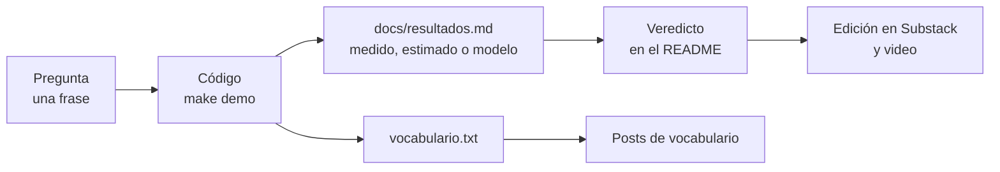

# Experimentos de Data Nomad Lab

Cada carpeta numerada es un experimento: una herramienta de datos o IA puesta a trabajar en un caso real, con su código, sus números y un veredicto. Se publican en [datanomadlab.substack.com](https://datanomadlab.substack.com) y se resumen en [datanomadlab.com](https://www.datanomadlab.com).

## Experimentos

| # | Experimento | Pregunta | Estado | Veredicto |
|---|---|---|---|---|
| 01 | [Lakehouse de bolsillo](01-lakehouse-de-bolsillo/) | ¿Cuánto se ahorra si saco la analítica de BigQuery y la llevo a Iceberg y DuckDB sobre un bucket? | En construcción | Pendiente |

Los veredictos posibles son tres: **Lo usaría**, **Depende** y **No todavía**.

## Vocabulario

Si un experimento nombra una herramienta que no conoces, busca su post en [vocabulario/](vocabulario/): qué es, qué problema resuelve, un ejemplo para correr en cinco minutos y con qué se suele confundir. Son los mismos posts que se publican en la sección Vocabulario del newsletter.

## Pasar un post a Substack

Nunca se copia desde la vista previa del editor: los enlaces relativos llegan rotos. Cada post de vocabulario se exporta a una página HTML con un botón para copiar el título, el subtítulo, la descripción, la dirección y el cuerpo con formato:

```bash
uv run --no-project --with markdown tools/vocabulario.py html duckdb
```

## Cómo está armado cada experimento

```
NN-nombre-del-experimento/
├── README.md          pregunta, veredicto, diagrama, cómo correrlo, resultados, cuándo sí y cuándo no
├── Makefile           make setup | make demo | make test | make destroy
├── .env.example       variables que se pueden cambiar. Nunca credenciales
├── vocabulario.txt    términos del experimento, uno por línea (alimenta vocabulario/)
├── escenario.toml     precios y supuestos, si el experimento compara costos
├── src/               el código
├── sql/               las consultas, si hay
├── tests/             pruebas
├── data/              se crea al correr la demo. No se versiona
└── docs/
    ├── diagrama.toml      definición del diagrama
    ├── arquitectura.svg   diagrama con el estilo de la marca (y su .png)
    └── resultados.md      lo escribe `make demo`. No se edita a mano
```



### Reglas

1. Una pregunta por experimento. Si no cabe en una frase, es demasiado grande.
2. Datos públicos y cuentas propias. El dataset se descarga con un script; no se sube al repo.
3. `make demo` corre en una máquina limpia y `make destroy` no deja nada cobrando en la nube.
4. Cada número dice de dónde viene: **medido** (salió de correr el código), **estimado** (calculado sobre los datos con reglas públicas) o **modelo** (proyección con supuestos escritos).
5. El veredicto se escribe aunque sea "no todavía".

### Partir un experimento nuevo

1. Crea la carpeta `NN-nombre/` con la estructura de arriba. El [experimento 01](01-lakehouse-de-bolsillo/) sirve de molde.
2. Escribe la pregunta en el README antes que el código.
3. Verifica la versión vigente de cada herramienta en su página oficial.
4. Lista los términos en `vocabulario.txt` y corre `python3 tools/vocabulario.py estado` para ver qué posts de vocabulario faltan. Cómo se escriben está en [vocabulario/README.md](vocabulario/README.md).
5. Dibuja el diagrama: edita `docs/diagrama.toml` y corre el comando de abajo.
6. Agrega la fila a la tabla de este README.

### Diagramas

El diagrama de cada experimento se define en `docs/diagrama.toml` (cajas, conectores y textos) y se dibuja con las fuentes y colores de la marca, que viven en el repo del sitio:

```bash
uv run --no-project --with fonttools --with brotli --with cairosvg --with pillow \
  tools/diagrama.py 01-lakehouse-de-bolsillo
```

Para la imagen de un post de vocabulario, el mismo comando recibe el archivo: `tools/diagrama.py vocabulario/imagenes/docker.toml`.

Necesita la librería cairo (`brew install cairo`) y el repo `datanomadlab` clonado al lado de este. Si está en otra ruta, indícala con `DNL_SITIO=/ruta/al/sitio`. El README de cada experimento lleva además un diagrama Mermaid, que GitHub muestra sin generar nada.

## Archivo

Experimentos anteriores a la numeración (2025). Se conservan como referencia; no siguen la estructura de arriba.

| Carpeta | Tema |
|---|---|
| [asist-poc](asist-poc/) | Preguntas en lenguaje natural a SQL con un modelo local y DuckDB |
| [dbtbetweenbbdds](dbtbetweenbbdds/) | Mover datos entre bases con dbt |
| [dbtpsql](dbtpsql/) | dbt sobre Postgres |
| [duckdbpoc](duckdbpoc/) | Metabase leyendo DuckDB |
| [etl1](etl1/) | ETL con PySpark de Postgres a MySQL |
| [kafkainfluxmetabase](kafkainfluxmetabase/) | Kafka, InfluxDB y Metabase |
| [psqlpower](psqlpower/) | Postgres con extensiones |
| [psqlvector](psqlvector/) | Búsqueda semántica con pgvector |
| [ragwith](ragwith/) | RAG con DuckDB |
| [rustpoc](rustpoc/) | ETL en Rust (Polars, Rayon) comparado con pandas y Spark |
| [session2](session2/) | Ventanas de sesión con Flink |
| [space](space/) | Análisis de lanzamientos espaciales |
