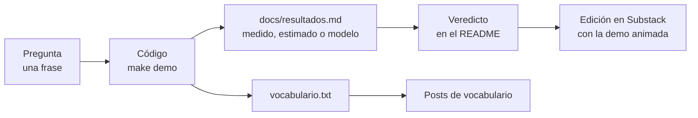

# Experimentos de Data Nomad Lab

Cada carpeta numerada es un experimento: una herramienta de datos o IA puesta a trabajar en un caso real, con su código, sus números y un veredicto. Se publican en [datanomadlab.substack.com](https://datanomadlab.substack.com) y se resumen en [datanomadlab.com](https://www.datanomadlab.com).

## Experimentos

| # | Experimento | Pregunta | Estado | Veredicto |
|---|---|---|---|---|
| 01 | [Lakehouse de bolsillo](01-lakehouse-de-bolsillo/) | ¿Cuánto se ahorra si saco la analítica de BigQuery y la llevo a Iceberg y DuckDB sobre un bucket? | Publicado | Depende |
| 02 | [Stream a pantallas en vivo](02-stream-a-pantallas-en-vivo/) | ¿Herramientas listas o consumidor propio para llevar 10.000 eventos por segundo a pantallas en vivo? | En construcción | Depende |

Los veredictos posibles son tres: **Lo usaría**, **Depende** y **No todavía**.

## Vocabulario

Si un experimento nombra una herramienta que no conoces, busca su post en [vocabulario/](vocabulario/): qué es, qué problema resuelve, un ejemplo para correr en cinco minutos y con qué se suele confundir. Son los mismos posts que se publican en la sección Vocabulario del newsletter.

## Pasar un post a Substack

Nunca se copia desde la vista previa del editor: los enlaces relativos llegan rotos. Cada post de vocabulario se exporta a una página HTML con un botón para copiar el título, el subtítulo, la descripción, la dirección y el cuerpo con formato:

```bash
uv run --no-project --with markdown tools/vocabulario.py html duckdb
```

## Cómo está armado cada experimento

```
NN-nombre-del-experimento/
├── README.md          pregunta, veredicto, diagrama, cómo correrlo, resultados, cuándo sí y cuándo no
├── Makefile           make setup | make demo | make test | make destroy
├── .env.example       variables que se pueden cambiar. Nunca credenciales
├── vocabulario.txt    términos del experimento, uno por línea (alimenta vocabulario/)
├── escenario.toml     precios y supuestos, si el experimento compara costos
├── src/               el código
├── sql/               las consultas, si hay
├── tests/             pruebas
├── data/              se crea al correr la demo. No se versiona
└── docs/
    ├── diagrama.toml      definición del diagrama
    ├── arquitectura.svg   diagrama con el estilo de la marca (y su .png)
    ├── demo.toml          guion de la demo animada (y el demo.gif que se graba con él)
    ├── resultados.md      lo escribe `make demo`. No se edita a mano
    └── tablas.toml        las tablas del post, también de `make demo` (y sus tabla-<id>.png)
```



### Reglas

1. Una pregunta por experimento. Si no cabe en una frase, es demasiado grande.
2. Datos públicos y cuentas propias. El dataset se descarga con un script; no se sube al repo.
3. `make demo` corre en una máquina limpia y `make destroy` no deja nada cobrando en la nube.
4. Cada número dice de dónde viene: **medido** (salió de correr el código), **estimado** (calculado sobre los datos con reglas públicas), **simulado** (el código de un servicio corrido en local, sin la cuenta: comprueba que funciona y qué daría, no cuánto tarda ni cuánto cobra) o **modelo** (proyección con supuestos escritos).
5. El veredicto se escribe aunque sea "no todavía".

### Partir un experimento nuevo

```bash
make nuevo NN=02
```

Crea `NN-titulo/` desde [_plantilla/](_plantilla/), con el título y la pregunta de `lab.json`; si el número no está ahí, `python3 tools/nuevo.py NN --titulo "..." --pregunta "..."`. Agrega la fila a la tabla de este README y pasa el experimento a `en-construccion` en `lab.json`. La plantilla trae el README con sus secciones, los cuatro comandos del Makefile, un código mínimo que ya corre (`make setup && make demo`), pruebas, el diagrama y el guion de la demo.

Después, en este orden:

1. **Diseño.** La pregunta, la línea base, la arquitectura mínima, qué se mide y el criterio del veredicto van en el README antes que el código.
2. **Versiones.** Revisa la vigente de cada herramienta en su página oficial antes de fijarla en `pyproject.toml`.
3. **Código y medición.** `make demo` descarga, mide, escribe `docs/resultados.md` y `docs/tablas.toml`, y termina con un resumen corto en la terminal (cada cifra con su etiqueta, 68 columnas como máximo, números en formato 1.234,5). Ese resumen es lo que se ve en la demo animada.
4. **Vocabulario.** Lista los términos en `vocabulario.txt` y corre `make vocabulario` para ver qué posts faltan. Cómo se escriben está en [vocabulario/README.md](vocabulario/README.md).
5. **Imágenes.** `make imagenes EXP=NN-titulo` graba la demo, dibuja las tablas y el diagrama. Revisa cada imagen antes de usarla.
6. **Cifras.** Las del README del experimento y las de la edición tienen que ser las de `docs/resultados.md`. Si la grabación volvió a medir y algo cambió, se corrigen los textos; nunca se repite la medición buscando un número más bonito.
7. **Veredicto** y "Cuándo sí / cuándo no" en el README del experimento.

### Imágenes

Se dibujan con las fuentes y colores de la marca, que viven en el repo del sitio. Necesitan la librería cairo (`brew install cairo`) y el repo `datanomadlab` clonado al lado de este; si está en otra ruta, indícala con `DNL_SITIO=/ruta/al/sitio`.

| Comando | Lee | Escribe |
|---|---|---|
| `make diagrama EXP=…` | `docs/diagrama.toml` (cajas, conectores y textos) | `docs/arquitectura.svg` y `.png` |
| `make tablas EXP=…` | `docs/tablas.toml`, que escribe `make demo` | `docs/tabla-<id>.png`. Substack no tiene tablas, así que el post las lleva como imagen |
| `make demo-gif EXP=…` | `docs/demo.toml`, el guion | `docs/demo.gif` |
| `make imagenes EXP=…` | los tres, en orden: demo, tablas, diagrama | |

La demo animada es un GIF de terminal grabado con la salida real de los comandos del guion: nada se escribe a mano. Solo se acortan las esperas largas, y si el GIF acorta más de unos segundos lo dice en pantalla. Como la grabación corre `make demo`, vuelve a medir; por eso `make imagenes` dibuja las tablas después del GIF. Lo que se graba es público: ningún comando del guion debe imprimir rutas del equipo ni nombres de usuario (por eso `make test` no va en el guion, ya que pytest imprime la carpeta).

Para la imagen de un post de vocabulario, el dibujo del diagrama recibe el archivo: `tools/diagrama.py vocabulario/imagenes/docker.toml`, con las opciones de `uv run` del [Makefile](Makefile). El README de cada experimento lleva además un diagrama Mermaid, que GitHub muestra sin generar nada.

## Archivo

Experimentos anteriores a la numeración (2025). Se conservan como referencia; no siguen la estructura de arriba.

| Carpeta | Tema |
|---|---|
| [asist-poc](asist-poc/) | Preguntas en lenguaje natural a SQL con un modelo local y DuckDB |
| [dbtbetweenbbdds](dbtbetweenbbdds/) | Mover datos entre bases con dbt |
| [dbtpsql](dbtpsql/) | dbt sobre Postgres |
| [duckdbpoc](duckdbpoc/) | Metabase leyendo DuckDB |
| [etl1](etl1/) | ETL con PySpark de Postgres a MySQL |
| [kafkainfluxmetabase](kafkainfluxmetabase/) | Kafka, InfluxDB y Metabase |
| [psqlpower](psqlpower/) | Postgres con extensiones |
| [psqlvector](psqlvector/) | Búsqueda semántica con pgvector |
| [ragwith](ragwith/) | RAG con DuckDB |
| [rustpoc](rustpoc/) | ETL en Rust (Polars, Rayon) comparado con pandas y Spark |
| [session2](session2/) | Ventanas de sesión con Flink |
| [space](space/) | Análisis de lanzamientos espaciales |
