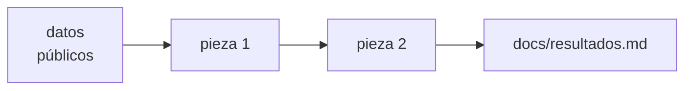

# Experimento {{numero}} · {{titulo}}

> **Pregunta:** {{pregunta}}
>
> **Veredicto:** pendiente.


## Qué hace

Por completar: la situación de origen, la línea base contra la que se compara y lo que hace `make demo`, en un párrafo y una lista corta.



## Correrlo

Necesitas [uv](https://docs.astral.sh/uv/). No hace falta ninguna cuenta en la nube.

```bash
make setup    # instala dependencias
make demo     # descarga los datos, corre el experimento, escribe docs/resultados.md y muestra el resumen
make test     # pruebas
make destroy  # borra data/ y lo que se haya creado en la nube
```

`make demo` termina con un resumen en la terminal: cada cifra con su etiqueta (medido, estimado, simulado o modelo).

## Cómo está armado

| Pieza | Qué hace |
|---|---|
| [src/{{paquete}}/config.py](src/{{paquete}}/config.py) | Rutas y lo configurable |
| [src/{{paquete}}/formato.py](src/{{paquete}}/formato.py) | Números en formato español (1.234,5), milisegundos, MB y dólares |
| [src/{{paquete}}/reporte.py](src/{{paquete}}/reporte.py) | Escribe `docs/resultados.md`, `docs/tablas.toml` y el resumen de la terminal |
| [docs/diagrama.toml](docs/diagrama.toml) | Definición del diagrama (se dibuja con `make diagrama` en la raíz) |
| [docs/demo.toml](docs/demo.toml) | Guion de la demo animada (se graba con `make demo-gif` en la raíz) |

## Resultados

Por completar con los números de [docs/resultados.md](docs/resultados.md).

| Métrica | Opción A | Opción B |
|---|---|---|
| | | |
| Horas invertidas | por completar | |

Qué significa cada etiqueta:

- **Medido:** salió de correr el código en esta máquina.
- **Estimado:** calculado sobre los datos reales con reglas públicas.
- **Simulado:** el código de un servicio corrido en local, sin la cuenta. Comprueba que funciona y qué daría; no cuánto tarda ni cuánto cobra.
- **Modelo:** proyección con supuestos escritos.

## Lo que aprendí armándolo

Por completar.

## Qué falta

- [ ] Por completar.

## Cuándo sí / cuándo no

Por completar junto con el veredicto.

## Vocabulario

Términos de este experimento explicados desde cero en [vocabulario/](../vocabulario/). La lista está en [vocabulario.txt](vocabulario.txt).
