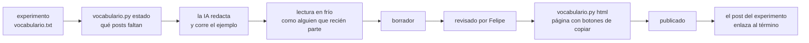

# Vocabulario del Lab

Posts sobre las herramientas y conceptos que los experimentos dan por sabidos: qué es cada uno, qué problema resuelve, un ejemplo para correr en cinco minutos, los errores típicos y con qué se suele confundir. Están pensados para alguien que recién parte o que nunca usó esa herramienta en particular.

Se publican en el newsletter, en la sección Vocabulario. El post de cada experimento enlaza hacia ellos, así quien no conoce un término lo entiende sin salir del newsletter y vuelve al experimento.

Los redacta una IA siguiendo una plantilla fija, y cada post lo dice al final. Los comandos se ejecutan de verdad antes de escribirlo; cuando un ejemplo no se pudo correr, el post lo avisa.

<!-- indice:inicio -->
| Término | Qué es | Categoría | Estado |
|---|---|---|---|
| [BigQuery](bigquery.md) | Warehouse de Google Cloud sin servidores que administrar, donde consultas con SQL y pagas por los datos que lee cada consulta. | base de datos | borrador |
| [Bucket](bucket.md) | Carpeta en la nube donde se guardan archivos de cualquier tamaño y se pagan por lo que pesan, sin servidor que mantener. | infraestructura | borrador |
| [Docker](docker.md) | Empaqueta un programa con todo lo que necesita para correr igual en cualquier máquina. | infraestructura | borrador |
| [DuckDB](duckdb.md) | Motor SQL para análisis que corre dentro de tu programa y lee archivos directamente, sin servidor. | motor de consulta | borrador |
| [Apache Iceberg](iceberg.md) | Formato de tabla abierto que convierte un montón de archivos Parquet en una tabla con versiones, particiones y cambios seguros. | formato | borrador |
| [Parquet](parquet.md) | Formato de archivo que guarda las tablas por columnas, comprimidas, para que las consultas lean solo lo que necesitan. | formato | borrador |
<!-- indice:fin -->

## Un término, un post

El vocabulario no se duplica a medida que salen experimentos. Cada término tiene un solo post y los experimentos nuevos enlazan al que ya existe. Un post se actualiza, en el mismo archivo y con la misma URL, solo cuando la herramienta trae una característica nueva que cambia lo que dice, o cuando un experimento la usa de una forma o en una combinación que el post no cubría.

## Cómo se hace un post

1. **Declarar.** Cada experimento lista sus términos en `vocabulario.txt`, uno por línea, en minúsculas y con guiones (`docker`, `apache-polaris`). También se puede escribir un post de un concepto que no pertenece a ningún experimento.
2. **Ver qué falta.** `python3 tools/vocabulario.py estado`.
3. **Generar.** La IA redacta el post con la estructura de [_plantilla.md](_plantilla.md), corre el ejemplo, comprueba los enlaces, pide una lectura en frío como la haría alguien que recién parte y deja el post como `borrador`.
4. **Revisar.** Con la lista de abajo. Al terminar, cambia `estado: revisado` en el encabezado.
5. **Exportar.** `uv run --no-project --with markdown tools/vocabulario.py html docker` crea `vocabulario/_substack/docker.html` y lo abre en el navegador. No copies desde la vista previa del editor de código: sus enlaces apuntan a tu disco.
6. **Publicar.** En esa página, cada botón copia un campo: título, subtítulo, descripción para redes, dirección del post y cuerpo. Pégalos en Substack (sección Vocabulario) y pon la dirección indicada (`que-es-docker`) en los ajustes del post antes de publicar. Luego copia la URL en `substack:`, cambia `estado: publicado` y corre `python3 tools/vocabulario.py indice`.
7. **Enlazar desde el experimento.** En el post principal, la primera mención del término lleva el enlace al post de vocabulario en Substack.

### Orden de publicación

La dirección de cada post está decidida de antemano (`https://datanomadlab.substack.com/p/que-es-<termino>`), así que los enlaces entre posts ya apuntan al newsletter aunque el otro post no exista todavía. Mientras no se publique, ese enlace da error: conviene publicar la tanda completa el mismo día, o partir por los que otros enlazan (Parquet y bucket, después DuckDB, después Apache Iceberg y BigQuery).

### Lista de revisión

- [ ] Corrí el ejemplo yo mismo y la salida coincide.
- [ ] La frase inicial la entendería alguien que nunca usó la herramienta.
- [ ] Los errores típicos son cosas que he visto pasar, no relleno.
- [ ] "Cuándo no usarlo" nombra una alternativa concreta.
- [ ] Los enlaces abren y los externos son documentación oficial.
- [ ] No hay datos, nombres ni casos de mi trabajo.
- [ ] La versión de `probado_con` sigue vigente.

### Estados

| Estado | Significa |
|---|---|
| `borrador` | Generado, con el ejemplo ejecutado (o marcado como no ejecutado) y con su lectura en frío. Nadie más lo ha revisado |
| `revisado` | Felipe lo leyó, corrió el ejemplo y lo corrigió |
| `publicado` | Está en Substack y su URL quedó en `substack:` |

### Imágenes

Cada post lleva una imagen de 1600×900 con el estilo de la marca, definida en `imagenes/<termino>.toml` y dibujada con `tools/diagrama.py` (ver el README de la raíz). Sirve dentro del post y como imagen para redes. Al exportar, la imagen no va en el cuerpo que se copia: la página de exportación la muestra aparte para arrastrarla al editor de Substack.

### Formato

Los posts no usan tablas, porque el editor de Substack no las tiene. Sí usan títulos, listas, negritas, enlaces y bloques de código.
