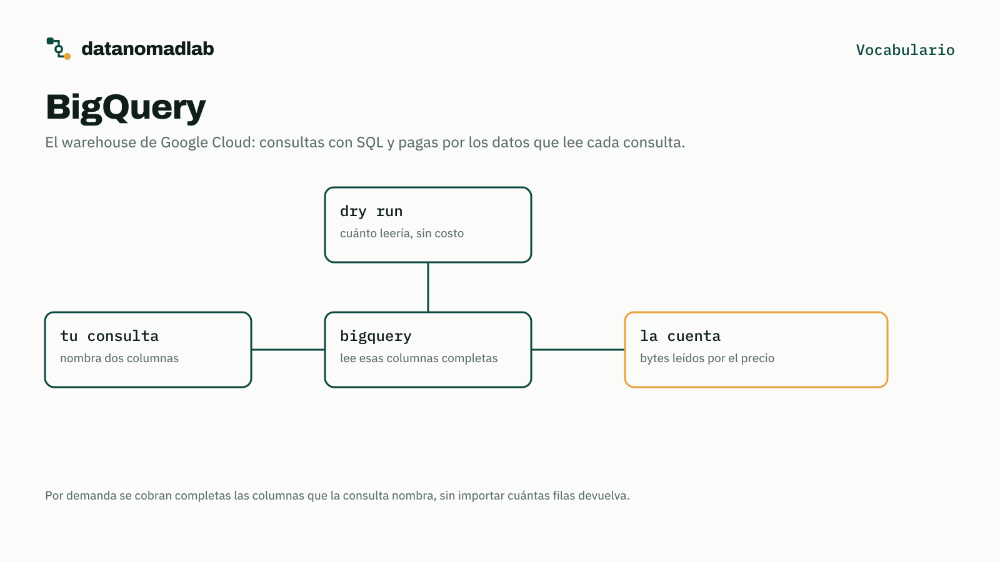

# BigQuery: el warehouse que cobra por lo que lee cada consulta

*Qué es un warehouse, cómo se paga BigQuery y los hábitos que evitan una factura sorpresa.*

> Este post es parte del **Vocabulario del Lab**: explicaciones cortas de las herramientas que aparecen en los experimentos, pensadas para quien recién parte o nunca usó esa herramienta en particular. Si llegaste desde un experimento, aquí está lo necesario para seguirlo.



## En una frase

BigQuery es la base de datos para análisis (warehouse) de Google Cloud: subes tablas, las consultas con SQL y Google pone las máquinas, sin que tengas que crear ni apagar un servidor.

## El problema que resuelve

Una base de datos como [Postgres](postgres.md) está hecha para la aplicación: guardar un pedido, buscar un cliente, de a un registro y muy rápido. Cuando le pides resumir cientos de millones de filas para un informe, se demora y además frena a la aplicación que depende de ella.

Un **warehouse** (bodega de datos) es una base aparte, pensada solo para análisis. Ahí se copian los datos de las aplicaciones y se consultan sin molestar a nadie.

Lo que distingue a BigQuery es que esconde la infraestructura. No eliges cuántas máquinas ni de qué tamaño. Mandas la consulta, Google reparte el trabajo entre muchas máquinas y te devuelve el resultado. A eso se le dice *serverless*: los servidores existen, pero no los administras tú.

## Cómo se cobra

Esto hay que entenderlo desde el primer día, porque es distinto a casi todo lo demás.

- **Las consultas, por demanda.** BigQuery guarda cada columna por separado. Si tu consulta nombra dos columnas, lee esas dos completas y cobra por lo que pesan, aunque filtres filas. No importa cuántas filas devuelva ni cuánto tarde.
- **El almacenamiento, aparte.** Se paga por lo que pesan las tablas cada mes.
- **Hay un tramo gratuito mensual** para ambas cosas. Los montos y precios vigentes están en la [página oficial de precios](https://cloud.google.com/bigquery/pricing); cambian, así que conviene mirarlos ahí y no confiar en un número copiado.

Existe otro modo, por capacidad reservada, en que se paga por tener máquinas disponibles y no por consulta. Lo usan empresas con mucho uso constante.

## Las tres palabras que vas a oír siempre

- **Proyecto y dataset.** El proyecto es la cuenta donde se factura. Un dataset es una carpeta de tablas dentro del proyecto.
- **Por demanda.** El modo de cobro por bytes leídos en cada consulta.
- **Simulación (`dry run`).** Preguntarle a BigQuery cuánto leería una consulta, sin ejecutarla y sin costo.

## Pruébalo en 5 minutos

**Este ejemplo no se ejecutó.** El post se generó en un equipo sin cuenta de Google Cloud, así que no hay salida real que mostrar. Los comandos siguen la documentación oficial, pero nadie los ha corrido para este post.

Necesitas una cuenta de Google y la herramienta `bq`, que viene con [Google Cloud CLI](https://cloud.google.com/sdk/docs/install). BigQuery tiene un [modo de prueba](https://cloud.google.com/bigquery/docs/sandbox) (sandbox) que no pide tarjeta de crédito.

Paso 0: iniciar sesión y elegir tu proyecto.

```bash
gcloud auth login
gcloud config set project TU_PROYECTO
```

Paso 1: preguntar cuánto leería la consulta, sin correrla. La tabla es pública y tiene los nombres registrados en Estados Unidos. `--use_legacy_sql=false` le pide usar el SQL estándar en vez de un dialecto antiguo.

```bash
bq query --use_legacy_sql=false --dry_run \
  'SELECT name, SUM(number) AS total
   FROM `bigquery-public-data.usa_names.usa_1910_2013`
   GROUP BY name ORDER BY total DESC LIMIT 5'
```

La respuesta dice cuántos bytes procesaría la consulta.

Paso 2: comparar ese número con el tramo gratuito del mes, que está en la página de precios. Si es una fracción chica, córrela de verdad quitando `--dry_run`.

```bash
bq query --use_legacy_sql=false \
  'SELECT name, SUM(number) AS total
   FROM `bigquery-public-data.usa_names.usa_1910_2013`
   GROUP BY name ORDER BY total DESC LIMIT 5'
```

El hábito que vale la pena llevarse es el paso 1: mirar cuánto va a leer una consulta antes de correrla sobre una tabla grande.

## Dónde lo vas a ver en el Lab

- [Experimento 01 · Lakehouse de bolsillo](../01-lakehouse-de-bolsillo/): BigQuery es el punto de comparación. La pregunta es cuánto se ahorra sacando el análisis de BigQuery y llevándolo a archivos en un [bucket](bucket.md) consultados con [DuckDB](duckdb.md). Las cinco consultas del experimento, sobre 9,5 millones de viajes, leerían 735 MB en total. Esa cifra es una estimación calculada con las reglas públicas de cobro; la medición real está pendiente.

## Errores típicos cuando partes

- **`SELECT *` sobre una tabla grande.** Pagas por todas las columnas aunque mires dos. Pide solo las que necesitas.
- **Creer que `LIMIT 10` abarata la consulta.** Limita las filas que ves, no los bytes que se leen.
- **No particionar.** Particionar es dividir la tabla en trozos según una columna, por ejemplo la fecha. Así una consulta de un mes lee solo ese trozo. En el experimento 01, la consulta de un solo mes bajaría de 153 MB a 47 MB gracias a la partición (estimado).
- **Un tablero que se refresca cada pocos minutos.** Cada refresco es una consulta que se cobra. Ahí es donde la factura crece sin que nadie escriba SQL.
- **No poner un tope.** Se puede fijar un máximo de bytes por consulta y cuotas por usuario. Conviene hacerlo antes del primer susto.

## Lo que suele confundirse

**BigQuery y Postgres.** Postgres atiende a una aplicación: muchas operaciones chicas y rápidas. BigQuery atiende al análisis: pocas consultas grandes. Una empresa suele tener los dos.

**BigQuery, Snowflake y Redshift.** Son warehouses de distintas empresas y resuelven el mismo problema. Cambian la forma de cobro y cómo se administran.

**BigQuery y DuckDB.** BigQuery reparte el trabajo entre muchas máquinas de Google y atiende a muchos usuarios con permisos. DuckDB corre en una sola máquina, la tuya. El experimento 01 explora desde qué tamaño de datos vale la pena cada uno.

**BigQuery y los archivos en un bucket.** BigQuery guarda las tablas en su propio formato interno, pero también puede leer archivos [Parquet](parquet.md) y tablas [Apache Iceberg](iceberg.md) que estén en un bucket.

## Cuándo no usarlo

Para la base de datos de una aplicación, que necesita leer y escribir registros de a uno en milisegundos: eso es Postgres. Y si tus datos son chicos y los consulta una sola persona, DuckDB sobre archivos resuelve lo mismo sin cuenta ni factura.

## Para seguir aprendiendo

- [Documentación de BigQuery](https://cloud.google.com/bigquery/docs), el punto de entrada oficial.
- [Precios vigentes](https://cloud.google.com/bigquery/pricing), con el detalle de cada modo de cobro.
- [Modo de prueba sin tarjeta](https://cloud.google.com/bigquery/docs/sandbox), para partir sin costo.
- [Buenas prácticas para controlar costos](https://cloud.google.com/bigquery/docs/best-practices-costs).

## Sigue con

- [DuckDB](duckdb.md): la alternativa de una sola máquina.
- [Parquet](parquet.md): el formato de archivo que usan casi todas las alternativas.
- [Apache Iceberg](iceberg.md): cómo esos archivos se organizan en tablas.

---

*Este post lo redactó una IA a partir de los experimentos de Data Nomad Lab. El ejemplo no se ejecutó: falta correrlo con una cuenta de Google Cloud antes de publicar.*
