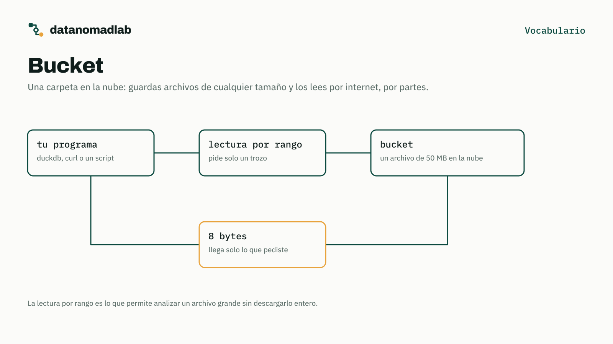

# Bucket: la carpeta en la nube donde viven los datos

*Qué es el almacenamiento de objetos, por qué sirve para analizar datos y cómo leer 8 bytes de un archivo de 50 MB.*

> Este post es parte del **Vocabulario del Lab**: explicaciones cortas de las herramientas que aparecen en los experimentos, pensadas para quien recién parte o nunca usó esa herramienta en particular. Si llegaste desde un experimento, aquí está lo necesario para seguirlo.



## En una frase

Un bucket es una carpeta en la nube donde guardas archivos de cualquier tamaño, pagas por lo que pesan y los lees por internet, sin tener un servidor ni un disco que administrar.

## El problema que resuelve

Un disco tiene un tamaño fijo y está conectado a una máquina. Si los datos crecen más de lo previsto, hay que comprar otro. Si la máquina se apaga, nadie más lee el disco. Y si dos sistemas necesitan los mismos archivos, hay que copiarlos.

El almacenamiento de objetos funciona distinto. Es el nombre técnico del servicio, y cada nube tiene el suyo: S3 en Amazon, Cloud Storage en Google, Blob Storage en Azure. Creas un bucket, subes archivos y cada uno queda disponible en una dirección. No reservas espacio por adelantado, no hay máquina que cuidar, y cualquier programa con permiso lo lee desde cualquier parte.

Por eso se volvió el lugar por defecto para guardar datos de análisis: es lo más barato que ofrece la nube para guardar mucho. Además, los datos quedan en un lugar y los programas que los analizan corren en otro, así que puedes cambiar o apagar el programa sin mover los datos.

## Las tres palabras que vas a oír siempre

- **Objeto.** Un archivo dentro del bucket, con su contenido y algunos datos sobre él, como el tamaño y la fecha.
- **Clave.** El nombre completo del objeto, por ejemplo `viajes/2024/enero.parquet`. Parece una ruta con carpetas, pero es solo un nombre largo. Decir que un bucket es una carpeta sirve para partir; adentro no hay subcarpetas de verdad.
- **Lectura por rango.** Pedir un trozo del archivo en vez de bajarlo entero. Esta es la capacidad que hace que un bucket sirva para análisis y no solo para respaldos.

## Pruébalo en 5 minutos

No necesitas cuenta en ninguna nube. Los viajes de taxi de Nueva York que usa el Lab están publicados en un bucket, así que puedes mirarlo con `curl`, que viene instalado en Mac y Linux.

Paso 1: preguntar por el archivo sin bajarlo. La opción `-I` pide solo la descripción del archivo, no su contenido.

```bash
curl -sI https://d37ci6vzurychx.cloudfront.net/trip-data/yellow_tripdata_2024-01.parquet
```

Entre las líneas de la respuesta vas a encontrar estas:

```text
HTTP/2 200
content-length: 49961641
server: AmazonS3
accept-ranges: bytes
```

El `200` significa que el archivo existe. Pesa 50 MB (`content-length` está en bytes), lo sirve Amazon S3, y `accept-ranges: bytes` dice que acepta lecturas por rango.

Paso 2: pedir solo los primeros 4 bytes, y después solo los últimos 4. `-r 0-3` pide los bytes del 0 al 3, y `-r -4`, los últimos cuatro.

```bash
curl -s -r 0-3 https://d37ci6vzurychx.cloudfront.net/trip-data/yellow_tripdata_2024-01.parquet
curl -s -r -4  https://d37ci6vzurychx.cloudfront.net/trip-data/yellow_tripdata_2024-01.parquet
```

```text
PAR1
PAR1
```

Bajaste 8 bytes de un archivo de 50 MB. `PAR1` es la marca con que empieza y termina todo archivo [Parquet](parquet.md).

Así trabaja [DuckDB](duckdb.md) cuando consulta un archivo remoto. Un archivo Parquet guarda al final un índice de su contenido; DuckDB lee primero ese índice y después pide solo los trozos que la consulta necesita. Por eso puede responder sobre un archivo grande sin descargarlo.

## Dónde lo vas a ver en el Lab

- [Experimento 01 · Lakehouse de bolsillo](../01-lakehouse-de-bolsillo/): la pregunta del experimento es cuánto cuesta dejar una tabla en un bucket y consultarla desde ahí, en vez de tenerla en un warehouse (una base de datos de pago hecha para análisis, como [BigQuery](bigquery.md)). En la primera medición la tabla está en una carpeta local que hace las veces de bucket; la medición con uno real está pendiente.

## Errores típicos cuando partes

- **Tratarlo como un disco.** No se puede abrir un objeto y cambiarle una línea: se reemplaza entero. Tampoco hay carpetas de verdad; las barras son parte del nombre.
- **Dejarlo público sin querer.** Es una de las fugas de datos más repetidas de la nube. Un bucket nuevo debe partir privado.
- **Poner las llaves de acceso en el código.** Van en variables de entorno o en el sistema de identidad de la nube, nunca en el repositorio.
- **Olvidar el costo de salida.** Guardar es barato. Sacar datos hacia internet o hacia otra región se cobra aparte.
- **Miles de archivos chicos.** Cada lectura es una petición por red, con su demora y, según el proveedor, su cobro.

## Lo que suele confundirse

**Bucket y Google Drive o Dropbox.** Esos son productos para personas, con carpetas compartidas y edición en línea. Un bucket es una pieza de infraestructura pensada para que la usen programas.

**"Compatible con S3".** S3 fue el primero y su forma de hablar se volvió un estándar. Muchos servicios de otras empresas, y programas que puedes correr en tu propia máquina, entienden las mismas órdenes. Cuando una herramienta dice que lee "desde S3", casi siempre funciona también con esos.

**Bucket y data lake.** Un data lake es un bucket, o varios, con datos de análisis guardados con cierto orden. El bucket es el lugar; el data lake es lo que armas adentro. Si además usas un formato de tabla como [Apache Iceberg](iceberg.md), se habla de lakehouse.

## Cuándo no usarlo

Para datos que una aplicación lee y escribe muchas veces por segundo, un bucket es lento, porque cada operación viaja por la red. Eso es trabajo para una base de datos o un disco local.

## Para seguir aprendiendo

- [Amazon S3: guía de usuario](https://docs.aws.amazon.com/AmazonS3/latest/userguide/Welcome.html).
- [Google Cloud Storage: documentación](https://cloud.google.com/storage/docs).
- [La cabecera `Range` de HTTP](https://developer.mozilla.org/es/docs/Web/HTTP/Reference/Headers/Range), la explicación de MDN sobre lo que hizo `curl -r`.

## Sigue con

- [Parquet](parquet.md): el formato de archivo que aprovecha la lectura por rango.
- [Apache Iceberg](iceberg.md): cómo se ordenan muchos archivos de un bucket en una tabla.
- [DuckDB](duckdb.md): un motor que consulta archivos directamente en un bucket.

---

*Este post lo redactó una IA a partir de los experimentos de Data Nomad Lab. Los comandos se corrieron el 17 de noviembre de 2026 y las salidas que ves son las reales.*
