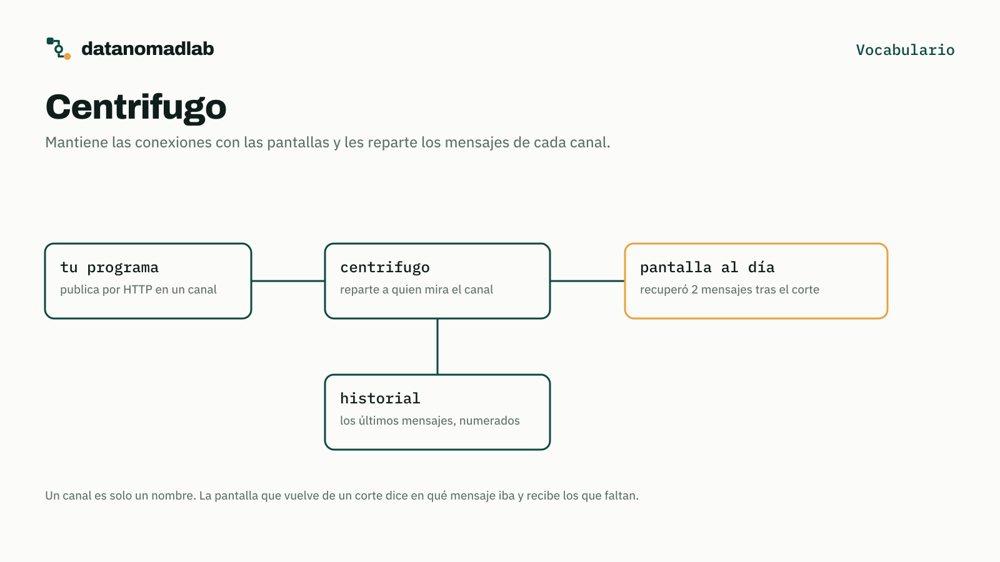

# Centrifugo: cómo poner al día una pantalla que se desconectó

*Qué es un canal y cómo publicar un dato, verlo llegar a una pantalla y recuperar lo que se perdió en un corte.*

> Este post es parte del **Vocabulario del Lab**: explicaciones cortas de las herramientas que aparecen en los experimentos, pensadas para quien recién parte o nunca usó esa herramienta en particular. Si llegaste desde un experimento, aquí está lo necesario para seguirlo.



## En una frase

Centrifugo es un servidor (un programa que queda corriendo y espera que otros se conecten) que mantiene abiertas las conexiones con las pantallas y le entrega a cada una, apenas ocurren, los mensajes de los canales que está mirando.

## El problema que resuelve

Tienes un tablero con la temperatura de una bodega y quieres que cambie solo, sin que nadie apriete "actualizar". Para eso la pantalla deja una conexión abierta con tu sistema, casi siempre un [WebSocket](websocket.md), y por ahí le llegan los datos nuevos.

Abrir esa conexión es lo fácil. Lo que escribes y mantienes tú es saber qué pantalla mira qué, mandar cada mensaje solo a quien corresponde y decidir qué pasa con la que estuvo diez segundos sin wifi.

Con Centrifugo, tu programa solo dice "publica esto en tal canal": él mantiene las conexiones, reparte y, si guarda historial, devuelve a la pantalla que reconecta lo que se perdió.

## Las cuatro palabras que vas a oír siempre

- **Canal:** un nombre, como `sensores:bodega`. Quien publica y quien mira usan el mismo nombre, como la frecuencia de una radio.
- **Espacio de nombres** (*namespace*): lo que va antes de los dos puntos. Ahí defines las reglas de los canales que parten igual: quién puede mirarlos y cuánto historial guardan.
- **Historial y recuperación:** Puede guardar los últimos mensajes de cada canal, numerados. La pantalla que vuelve de un corte dice en qué número iba y recibe los que faltan.
- **Consumidor:** una pieza de Centrifugo que lee desde [Kafka](kafka.md), [NATS](nats.md) y otros sistemas por donde los programas se pasan eventos (mensajes que avisan que algo pasó) y publica lo que llega.

## Pruébalo en 5 minutos

Necesitas [Docker](docker.md) abierto, dos terminales y Node 22 o posterior, que corre JavaScript fuera del navegador y trae `npm`, que descarga librerías.

Paso 1: crear una carpeta con la configuración; el bloque se pega entero y crea `config.json`. `client` deja conectarse sin identificarse y `http_api.key` es la clave de quien publica. El espacio de nombres `sensores` guarda hasta 100 mensajes por canal durante 300 segundos; con `force_recovery`, la pantalla que reconecta pide lo que le falta.

```bash
mkdir vocab-centrifugo && cd vocab-centrifugo
cat > config.json <<'EOF'
{
  "client": {
    "allow_anonymous_connect_without_token": true,
    "allowed_origins": ["*"]
  },
  "http_api": {"key": "clave-de-prueba"},
  "channel": {
    "namespaces": [
      {
        "name": "sensores",
        "allow_subscribe_for_client": true,
        "allow_subscribe_for_anonymous": true,
        "history_size": 100,
        "history_ttl": "300s",
        "force_recovery": true
      }
    ]
  }
}
EOF
```

Paso 2: levantar Centrifugo. `-p 18140:8000` deja el puerto 8000 del contenedor en el 18140 de tu máquina.

```bash
docker run -d --name vocab-centrifugo-servidor -p 18140:8000 \
  -v "$PWD/config.json:/centrifugo/config.json:ro" \
  centrifugo/centrifugo:v6.10.3 centrifugo --config config.json
```

Paso 3: escribir la pantalla. `npm init -y` prepara la carpeta, `npm install` descarga `centrifuge`, el cliente oficial, y el resto, que se pega entero, crea y corre `pantalla.mjs`: se suscribe a `sensores:bodega` (pide los mensajes de ese canal) y los muestra.

```bash
npm init -y > /dev/null
npm install centrifuge@5.8.0
cat > pantalla.mjs <<'EOF'
import { Centrifuge } from "centrifuge";

const pantalla = new Centrifuge("ws://localhost:18140/connection/websocket");
const canal = pantalla.newSubscription("sensores:bodega");

canal.on("publication", (ctx) => console.log("llegó", ctx.offset, JSON.stringify(ctx.data)));
canal.on("subscribed", (ctx) =>
  console.log("suscrita. venía de un corte:", ctx.wasRecovering, "| recuperó todo:", ctx.recovered));
pantalla.on("disconnected", () => console.log("desconectada"));

canal.subscribe();
pantalla.connect();

// Cada Enter corta o devuelve la conexión, como una pantalla que pierde el wifi.
let conectada = true;
process.stdin.on("data", () => {
  conectada ? pantalla.disconnect() : pantalla.connect();
  conectada = !conectada;
});
EOF
node pantalla.mjs
```

```text
suscrita. venía de un corte: false | recuperó todo: false
```

La terminal queda ocupada, esperando. Los dos `false` son lo normal la primera vez: no había nada que recuperar.

Paso 4: en la otra terminal, publicar un mensaje con `curl`.

```bash
curl -s -X POST http://localhost:18140/api/publish \
  -H "X-API-Key: clave-de-prueba" \
  -d '{"channel": "sensores:bodega", "data": {"sensor": "bodega", "temperatura": 4.2}}'
```

```text
{"result":{"offset":1,"epoch":"kCtSYvpq"}}
```

Es el mensaje 1 del canal (`offset`); `epoch` lo usa Centrifugo y se puede ignorar. En la primera terminal apareció:

```text
llegó 1 {"sensor":"bodega","temperatura":4.2}
```

Paso 5: el corte. Aprieta Enter en la terminal de la pantalla para desconectarla, repite el `curl` en la otra con `4.6` y con `5.1`, y aprieta Enter de nuevo.

```text
desconectada
suscrita. venía de un corte: true | recuperó todo: true
llegó 2 {"sensor":"bodega","temperatura":4.6}
llegó 3 {"sensor":"bodega","temperatura":5.1}
```

Al volver, Centrifugo le entregó en orden el 2 y el 3, que se publicaron mientras no estaba.

Paso 6: cortar la pantalla con Ctrl+C y borrar todo:

```bash
docker rm -f vocab-centrifugo-servidor
cd .. && rm -r vocab-centrifugo
```

## Dónde lo vas a ver en el Lab

En el [experimento 02, Stream a pantallas en vivo](../02-stream-a-pantallas-en-vivo/), Centrifugo es la principal de las herramientas que entregan a pantallas sin que escribas código. Lee desde [Redpanda](redpanda.md) (que se usa igual que Kafka), NATS y [SQS](sqs.md).

- **Con carga estable** de 10.000 eventos por segundo, 99 de cada 100 llegaron a la pantalla en 17 ms o menos sobre Redpanda y en 3,9 ms sobre NATS (medido: salió de correr el experimento).
- **Historial en memoria.** Al apagar de golpe Centrifugo y levantarlo de inmediato sobre NATS, la pantalla volvió en menos de 0,4 segundos, pero 4.016 eventos no llegaron (medido, el peor de dos cortes).
- **Historial en [Redis](redis.md)**, una base de datos en memoria que corre aparte. No perdió nada en 7 de 8 cortes; en uno se congeló 30 segundos y no llegaron 208 eventos. Aguantó 10.000 eventos por segundo y no 20.000; sin Redis, al menos 80.000 (medido).

## Errores típicos cuando partes

- **"Reinicié Centrifugo y las pantallas quedaron con un hueco."** De fábrica, el historial vive en la memoria de Centrifugo y se borra al reiniciarlo. La pantalla que reconecta recibe `recuperó todo: false` y tiene que cargar los datos de nuevo, como al abrir la página. Para evitarlo, guárdalo en Redis.
- **El corte duró más que el historial.** Solo se recupera lo que todavía cabe en `history_size` y `history_ttl`.
- **`unknown channel` (código 102).** Publicaste en `alarmas:bodega` y el espacio de nombres `alarmas` no está en la configuración.
- **Dejar la configuración de prueba.** Con `allow_anonymous_connect_without_token` entra cualquiera. En un sistema real, cada pantalla presenta un token, un pase firmado por tu sistema.

## Lo que suele confundirse

**Centrifugo y WebSocket.** WebSocket es el tubo entre una pantalla y un servidor. Centrifugo es el servidor que administra miles de esos tubos.

**Centrifugo y Kafka o NATS.** Kafka y NATS mueven eventos entre los programas de tu sistema, que son pocos y estables. Centrifugo los lleva hasta las pantallas, que son muchas y se desconectan a cada rato.

## Cuándo no usarlo

- **Los eventos están en [Kinesis](kinesis.md).** Centrifugo no trae consumidor para él: hace falta un programa propio.
- **Son pocas pantallas y perder un mensaje no importa.** Basta con que tu aplicación los empuje por [SSE](sse.md).

## Para seguir aprendiendo

- [Quickstart](https://centrifugal.dev/docs/getting-started/quickstart), la guía oficial de primeros pasos.
- [History and recovery](https://centrifugal.dev/docs/server/history_and_recovery): cuándo una pantalla recupera y cuándo no.
- [Consumers](https://centrifugal.dev/docs/server/consumers), los sistemas desde los que puede leer.

## Sigue con

- [WebSocket](websocket.md): la conexión por la que Centrifugo le habla a cada pantalla.
- [NATS](nats.md): de dónde lee en la prueba del historial.
- [Redis](redis.md): dónde guardar el historial para que sobreviva a un reinicio.

---

*Este post lo redactó una IA a partir de los experimentos de Data Nomad Lab. Los comandos se corrieron el 25 de noviembre de 2026 y las salidas que ves son las reales.*
