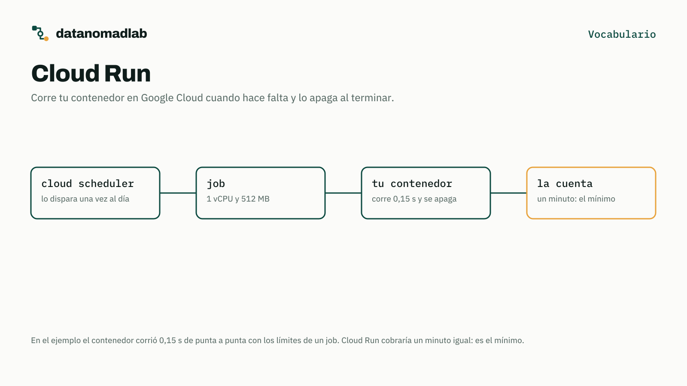

# Cloud Run: correr un contenedor solo el rato que trabaja

*Qué es serverless, en qué se diferencia un servicio de un job y cómo probar en tu máquina un contenedor con los límites de un job.*

> Este post es parte del **Vocabulario del Lab**: explicaciones cortas de las herramientas que aparecen en los experimentos, pensadas para quien recién parte o nunca usó esa herramienta en particular. Si llegaste desde un experimento, aquí está lo necesario para seguirlo.



Conviene leer antes el post de [Docker](docker.md).

## En una frase

Cloud Run es el servicio de Google Cloud que corre tu contenedor (un programa empaquetado con todo lo que necesita): lo prende cuando hay trabajo, lo apaga al terminar y cobra el rato que estuvo prendido.

## El problema que resuelve

Tienes un script de segundos que debe correr cada mañana, aunque tu computador esté apagado. Lo de siempre es arrendar un servidor, un computador en la nube que queda prendido, y programarlo con cron, el reloj de Linux que lanza comandos a una hora fija. Pagas las 24 horas por segundos de trabajo.

Cloud Run es *serverless*: los servidores existen, pero los elige, prende y apaga Google, y tú entregas solo el contenedor.

## Las tres palabras que vas a oír siempre

- **Servicio.** Un contenedor que espera pedidos por internet, como una página web. Corre más copias si llegan muchos y se apaga si no llega ninguno.
- **Job.** Un contenedor que no espera pedidos: arranca, hace su trabajo y termina. Si termina con código de salida 0 (el número que todo programa devuelve al terminar), salió bien; con otro, falló. Paga la CPU y la memoria que le asignas por segundo prendido, con **un minuto mínimo** por corrida y una capa gratuita mensual ([precios](https://cloud.google.com/run/pricing)).
- **Cloud Scheduler.** El cron de Google Cloud: lanza el job a la hora que le digas y se cobra aparte, por horario programado ([precios](https://cloud.google.com/scheduler/pricing)).

## Pruébalo en 5 minutos

### Parte 1: un job en tu máquina

Necesitas Docker Desktop abierto.

Paso 1: pega el bloque completo; crea una carpeta con dos archivos. `trabajo.py` suma un millón de ventas inventadas. El `Dockerfile` es la receta de la imagen, el paquete que después corre como contenedor.

```bash
mkdir vocab-cloudrun && cd vocab-cloudrun
cat > trabajo.py <<'EOF'
import time

inicio = time.perf_counter()
print("partió el trabajo del día")

ventas = [10 + i % 7 for i in range(1_000_000)]
with open("/tmp/resumen.csv", "w") as archivo:
    archivo.write(f"ventas,total\n{len(ventas)},{sum(ventas)}\n")

print(f"{len(ventas)} ventas, total {sum(ventas)}, guardado en /tmp/resumen.csv")
print(f"terminó en {time.perf_counter() - inicio:.2f} s")
EOF
cat > Dockerfile <<'EOF'
FROM python:3.12-slim
COPY trabajo.py /app/trabajo.py
CMD ["python", "/app/trabajo.py"]
EOF
```

Paso 2: construir la imagen con el nombre `vocab-cloudrun` (`-t`) a partir de esta carpeta (el `.`). `-q` deja solo su identificador en la salida.

```bash
docker build -q -t vocab-cloudrun .
```

```text
sha256:84c803d79b2cefd9a81733862e7d6573e7f280dca9539f2041919b83bc8242aa
```

Paso 3: correrlo como el job más chico de Cloud Run: 1 vCPU (un procesador virtual) y 512 MB. Allá el disco vive en la memoria y lo escrito descuenta de esos 512 MB; aquí se imita con `--read-only`, que bloquea el disco, y `--tmpfs /tmp`, una carpeta hecha de memoria. `--rm` borra el contenedor al terminar, `--init` se explica en "Errores típicos" y `/usr/bin/time -p` mide el tiempo.

```bash
/usr/bin/time -p docker run --rm --name vocab-cloudrun \
  --cpus 1 --memory 512m --read-only --tmpfs /tmp --init vocab-cloudrun
echo "código de salida: $?"
```

```text
partió el trabajo del día
1000000 ventas, total 12999997, guardado en /tmp/resumen.csv
terminó en 0.03 s
real 0.15
user 0.01
sys 0.00
código de salida: 0
```

El script tardó 0,03 s; con el arranque y el apagado del contenedor, 0,15 s (`real`). Terminó con código 0 y, como job, se cobraría un minuto entero.

### Parte 2: el mismo job en Cloud Run

**Este ejemplo no se ejecutó.** El post se generó en un equipo sin `gcloud` ni cuenta de Google Cloud; los comandos siguen la documentación oficial. Necesitas una cuenta con facturación activa, aunque una corrida de este job cabe de sobra en la capa gratuita de Cloud Run, y [Google Cloud CLI](https://docs.cloud.google.com/sdk/docs/install-sdk).

Paso 1: desde la carpeta `vocab-cloudrun`, iniciar sesión, elegir tu proyecto (donde se factura) y crear el job. `--region` es la zona del mundo donde corre. `--source .` construye la imagen con tu `Dockerfile` y la guarda en Artifact Registry, la bodega de imágenes de Google. `512Mi` son 512 MB. `--max-retries 0` evita que una corrida fallida se repita (por defecto, hasta 3 veces).

```bash
gcloud auth login
gcloud config set project TU_PROYECTO
gcloud run jobs deploy vocab-cloudrun --source . --region us-central1 \
  --cpu 1 --memory 512Mi --max-retries 0
```

Paso 2: ejecutarlo y esperar a que termine. Lo que imprime el script queda en los registros del job, en la consola de Google Cloud.

```bash
gcloud run jobs execute vocab-cloudrun --region us-central1 --wait
```

Para que corra cada día falta Cloud Scheduler: [Ejecutar jobs según un horario](https://docs.cloud.google.com/run/docs/execute/jobs-on-schedule).

### Al terminar, limpiar

Prueba antes los errores típicos de más abajo. Los dos primeros comandos, solo si hiciste la Parte 2, borran el job y el depósito de imágenes que creó `--source .` (si no lo usas para otra cosa); los otros, la imagen y la carpeta.

```bash
gcloud run jobs delete vocab-cloudrun --region us-central1
gcloud artifacts repositories delete cloud-run-source-deploy --location us-central1
docker rmi vocab-cloudrun
cd .. && rm -rf vocab-cloudrun
```

```text
Untagged: vocab-cloudrun:latest
```

## Dónde lo vas a ver en el Lab

- [Experimento 03 · Pipeline de USD 5 al mes](../03-pipeline-de-usd-5-al-mes/): el [ELT](elt.md) diario, en que [dlt](dlt.md) copia lo nuevo de [Postgres](postgres.md) a un [bucket](bucket.md), se pensó como job. Se midió en local, como la Parte 1; nunca corrió en Cloud Run.
  - La corrida diaria tardó 2,3 s y un script que copia todo, 0,3 s (mediana de 30 días, medido). Con el minuto mínimo, cuestan lo mismo (estimado).
  - Sin capa gratuita, el mes completo (job, programador, bucket e imagen) sale USD 0,16, y USD 0,10 de eso es Cloud Scheduler; con ella, USD 0 (estimado).
  - Para simular un corte de luz, el job se mata a sí mismo, y no lo logró hasta correr con `--init`.

## Errores típicos cuando partes

Usan la imagen del paso 2 de la Parte 1.

- **Un contenedor que no oye las señales.** Sin `--init`, tu programa es el proceso 1, el primero que arranca dentro del contenedor, y Linux lo protege de las señales (avisos como "detente") que no sabe manejar. Este ignora el "detente" de `docker stop`; Docker espera y lo mata a la fuerza (código 137).

  ```bash
  docker run -d --name vocab-cloudrun-espera vocab-cloudrun python -c "import time; time.sleep(300)"
  /usr/bin/time -p docker stop vocab-cloudrun-espera
  docker inspect -f 'código de salida: {{.State.ExitCode}}' vocab-cloudrun-espera
  docker rm vocab-cloudrun-espera
  ```

  ```text
  real 3.10
  código de salida: 137
  ```

  Repite con `docker run -d --init` en el primer comando: `--init` pone delante tini, un programa chico que sí le entrega el aviso, y se detiene al instante. El 143 significa "terminó por el aviso", lo esperado.

  ```text
  real 0.05
  código de salida: 143
  ```

  Desde dentro, el proceso 1 ni siquiera puede matarse a sí mismo: eso le pasó al experimento 03. Cloud Run manda el aviso al cancelar una ejecución o vencer su tiempo máximo; allá no hay `--init` y tini se pone en la imagen.

- **Dejar los reintentos por defecto.** Un job detenido por un dato malo sale con error, y Cloud Run lo repetiría sobre el mismo dato.

  ```bash
  docker run --rm vocab-cloudrun python -c "import sys; print('dato malo'); sys.exit(1)"
  echo "código de salida: $?"
  ```

  ```text
  dato malo
  código de salida: 1
  ```

## Lo que suele confundirse

**Cloud Run y una máquina virtual.** Una máquina virtual (Compute Engine, en Google) es un computador arrendado que pagas mientras exista. Cloud Run cobra solo mientras el contenedor corre.

**Cloud Run y BigQuery.** Ambos son serverless, pero [BigQuery](bigquery.md) solo corre SQL.

## Cuándo no usarlo

Si el programa tiene que quedar prendido todo el día, una máquina virtual pequeña es más simple. Y si tu base de datos solo acepta direcciones IP conocidas, Cloud Run necesita una fija, que se paga aparte.

## Para seguir aprendiendo

- [Qué es Cloud Run](https://docs.cloud.google.com/run/docs/overview/what-is-cloud-run): servicios y jobs.
- [Crear jobs](https://docs.cloud.google.com/run/docs/create-jobs): todas las opciones.
- [Contrato del contenedor](https://docs.cloud.google.com/run/docs/container-contract): disco, códigos de salida y señales.

## Sigue con

- [ELT](elt.md): el trabajo diario que corre como job en el experimento 03.
- [Docker](docker.md): cómo se arma un contenedor.
- [dlt](dlt.md): la carga que corre dentro del job.
- [Bucket](bucket.md): dónde quedan sus archivos.
- [BigQuery](bigquery.md): otro servicio serverless.

---

*Este post lo redactó una IA a partir de los experimentos de Data Nomad Lab. Los comandos de Docker se corrieron el 27 de noviembre de 2026 y las salidas que ves son las reales. La parte de Google Cloud no se ejecutó: falta correrla con una cuenta de Google Cloud antes de publicar.*
