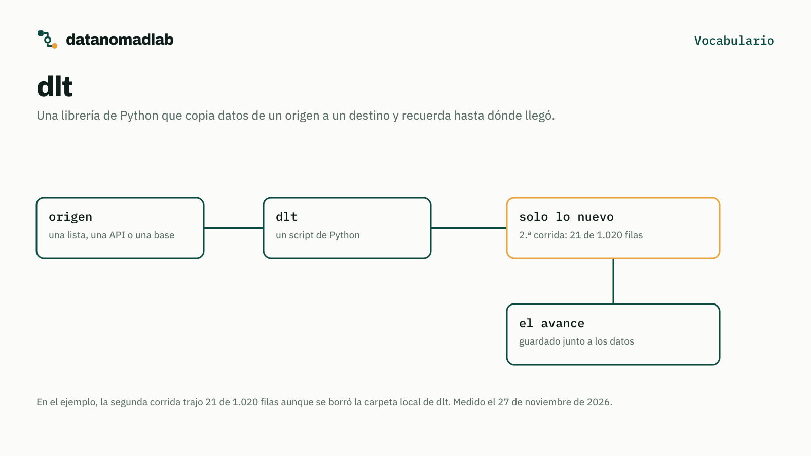

# dlt: copiar datos con Python y traer solo lo nuevo en cada corrida

*Qué es dlt, qué son un recurso, un cursor y el estado, y un ejemplo que carga ventas a Parquet trayendo solo lo nuevo.*

> Este post es parte del **Vocabulario del Lab**: explicaciones cortas de las herramientas que aparecen en los experimentos, pensadas para quien recién parte o nunca usó esa herramienta en particular. Si llegaste desde un experimento, aquí está lo necesario para seguirlo.



Conviene leer antes el post de [ELT](elt.md): dlt hace la E y la L de un ELT.

## En una frase

dlt (*data load tool*, de dltHub) es una librería de Python gratuita: código que importas en tu script, no un programa prendido. Copia datos a un destino y recuerda hasta dónde llegó, para traer solo lo nuevo la próxima vez.

## El problema que resuelve

Un script de quince líneas copia cada noche las ventas de [Postgres](postgres.md) a archivos. Traer solo lo nuevo le pide guardar la fecha de la última carga, sobrevivir a una corrida cortada y crear las columnas que aparezcan: más código propio.

Con dlt escribes de dónde leer y a dónde escribir; él crea tablas y columnas y lleva la cuenta de lo cargado.

## Las cuatro palabras que vas a oír siempre

- **Recurso:** una función que entrega filas, que terminan en una tabla. Una **fuente** agrupa recursos, como `sql_database`, que lee una base de datos y da uno por tabla.
- **Pipeline:** une el recurso con un destino: [DuckDB](duckdb.md), un warehouse (base de datos en la nube para análisis) o una carpeta de archivos [Parquet](parquet.md), que en la nube sería un [bucket](bucket.md).
- **Cursor y estado:** el cursor es la columna que solo avanza, como la fecha de actualización. El estado es lo que dlt recuerda entre corridas, como el último valor del cursor. Se guarda en el destino.
- **Forma de escribir** (`write_disposition`): `append` agrega, `replace` reemplaza la tabla y `merge` actualiza cada fila según su llave (la columna que la identifica), salvo en una carpeta de Parquet, donde solo agrega.

## Pruébalo en 5 minutos

Necesitas [uv](https://docs.astral.sh/uv/), que instala Python y sus paquetes. No hace falta cuenta.

Antes, mira si ya tienes una carpeta `~/.dlt` (`ls -a ~/.dlt`); importa al limpiar.

Paso 1: una carpeta de prueba; sigue en esta terminal hasta el final. `DLT_DATA_DIR` pone ahí la carpeta de trabajo de dlt (archivos temporales y una copia del estado), que suele ir en `~/.dlt`. La otra variable apaga la telemetría, datos anónimos de uso que dlt envía a dltHub.

```bash
mkdir dlt-prueba && cd dlt-prueba
export DLT_DATA_DIR="$PWD/datos-dlt" RUNTIME__DLTHUB_TELEMETRY=false
```

Paso 2: el script. `leer_origen` inventa las ventas del post de ELT: 1.000 el día 1 y, el día 2, 20 nuevas y la venta 7 corregida, con fecha nueva. `@dlt.resource` hace de `ventas` un recurso con llave `id`, y `dlt.sources.incremental("actualizado_en")` declara el cursor: el origen entrega todas las filas y dlt descarta las que no son más nuevas que lo ya cargado. `destino` es una carpeta local (en la nube, un bucket) y `crudo`, su subcarpeta de tablas.

```bash
cat > cargar.py <<'EOF'
import os
from datetime import datetime, timedelta

import dlt


def leer_origen(dia):
    """Hace de tabla de ventas. El día 2 trae 20 ventas nuevas y la venta 7 corregida."""
    inicio = datetime(2026, 11, 1, 9, 0)
    filas = [{"id": i, "producto": ["taza", "vela", "libreta"][i % 3], "monto": 10 + i % 7,
              "actualizado_en": inicio + timedelta(seconds=30 * i)} for i in range(1, 1001)]
    if dia == 2:
        filas[6] = {"id": 7, "producto": "vela", "monto": 99,
                    "actualizado_en": datetime(2026, 11, 2, 12, 0)}
        manana = datetime(2026, 11, 2, 9, 0)
        filas += [{"id": i, "producto": "taza", "monto": 12,
                   "actualizado_en": manana + timedelta(seconds=30 * (i - 1000))}
                  for i in range(1001, 1021)]
    return filas


@dlt.resource(primary_key="id", write_disposition="append")
def ventas(actualizado_en=dlt.sources.incremental("actualizado_en")):
    yield leer_origen(int(os.environ["DIA"]))


tuberia = dlt.pipeline("tienda", dataset_name="crudo",
                       destination=dlt.destinations.filesystem(bucket_url="destino"))
tuberia.run(ventas(), loader_file_format="parquet")
print("filas cargadas:", tuberia.last_trace.last_normalize_info.row_counts.get("ventas", 0))
EOF
```

Paso 3: la primera corrida. `DIA=1` le dice al script qué día simular, y `uv run --with` arma un entorno temporal con dlt 1.32.0, PyArrow (que escribe Parquet) y DuckDB.

```bash
DIA=1 uv run --no-project --with "dlt[parquet,duckdb]==1.32.0" python cargar.py
```

```text
filas cargadas: 1000
```

Paso 4: ver qué quedó en el destino.

```bash
find destino -type f | sort
```

```text
destino/crudo/_dlt_loads/tienda__1795801316.643007.jsonl
destino/crudo/_dlt_pipeline_state/tienda__1795801316.643007__fe02029fb64a37a83e12a9e6b1b23c6693cbff8e125f52c00811797d4f19bcca.jsonl
destino/crudo/_dlt_version/tienda__1795801316.742217__fe02029fb64a37a83e12a9e6b1b23c6693cbff8e125f52c00811797d4f19bcca.jsonl
destino/crudo/init
destino/crudo/ventas/1795801316.643007.2aec01d6c1.parquet
```

Las ventas están en `ventas/` y el estado, en `_dlt_pipeline_state`. El primer número de cada nombre identifica la carga.

Paso 5: un job en la nube pierde, al terminar, todo lo que escribió en su máquina. Para simularlo, borra la carpeta de trabajo y corre dos veces el día 2.

```bash
rm -rf datos-dlt
DIA=2 uv run --no-project --with "dlt[parquet,duckdb]==1.32.0" python cargar.py
DIA=2 uv run --no-project --with "dlt[parquet,duckdb]==1.32.0" python cargar.py
```

```text
filas cargadas: 21
filas cargadas: 0
```

Sin su copia local, dlt leyó el estado desde `destino` y cargó solo las 20 nuevas y la corregida. Repetida, no cargó nada.

Paso 6: contar con DuckDB las filas por carga (la columna `_dlt_load_id`, que agrega dlt) y buscar la venta 7.

```bash
uv run --no-project --with "dlt[parquet,duckdb]==1.32.0" python -c "
import duckdb
duckdb.sql(\"SELECT _dlt_load_id, count(*) AS filas FROM 'destino/crudo/ventas/*.parquet' GROUP BY 1 ORDER BY 1\").show()
duckdb.sql(\"SELECT id, monto, _dlt_load_id FROM 'destino/crudo/ventas/*.parquet' WHERE id = 7\").show()
"
```

```text
┌───────────────────┬───────┐
│   _dlt_load_id    │ filas │
│      varchar      │ int64 │
├───────────────────┼───────┤
│ 1795801316.643007 │  1000 │
│ 1795801317.019574 │    21 │
└───────────────────┴───────┘

┌───────┬───────┬───────────────────┐
│  id   │ monto │   _dlt_load_id    │
│ int64 │ int64 │      varchar      │
├───────┼───────┼───────────────────┤
│     7 │    10 │ 1795801316.643007 │
│     7 │    99 │ 1795801317.019574 │
└───────┴───────┴───────────────────┘
```

La venta 7 está dos veces: sobre archivos, dlt solo agrega. Quedarse con la más reciente de cada `id` le toca a la transformación (paso 6 del post de ELT).

Paso 7: dejar la máquina como estaba.

```bash
cd .. && rm -rf dlt-prueba
```

Aun con la telemetría apagada, dlt crea `~/.dlt/.anonymous_id`, un identificador al azar. Si `~/.dlt` no existía antes, bórrala: `rm -r ~/.dlt`.

## Dónde lo vas a ver en el Lab

- [Experimento 03 · Pipeline de USD 5 al mes](../03-pipeline-de-usd-5-al-mes/): ¿puede una pyme llevar cada día sus ventas a reportes por menos de USD 5 al mes? dlt 1.32.0 lee cuatro tablas de Postgres con `sql_database`, con cursor en `actualizado_en`, y escribe Parquet en una carpeta (destino `filesystem`). Movió 2.236 filas al día en vez de las 574.556 de un script que copia todo (mediana de 30 días, medido). Correría como job de [Cloud Run](cloud-run.md), aún sin probarse ahí. El veredicto, "No todavía", sale sobre todo de los dos primeros errores de abajo.

## Errores típicos cuando partes

- **Esperar que vea los borrados.** Una fila borrada no tiene fecha nueva y el cursor no la vuelve a leer. Experimento 03, prueba 6 (medido):

  ```text
  no pasa: la línea borrada sigue en el destino: la carga por fecha de actualización no ve lo que ya no está
  ```

- **Agregar una columna con valor por defecto.** Si en Postgres agregas una columna que se llena sola, las filas viejas no cambian de fecha y el cursor no las relee. Prueba 4 (medido):

  ```text
  no pasa: la columna llegó con 3 de sus 4.453 valores
  ```

  Lo arregla una recarga completa de la tabla, con `write_disposition="replace"`.

- **Escribir `postgresql://` al conectar `sql_database` a Postgres.** Con SQLAlchemy 2.1, la librería que usa para conectarse, esa dirección pide psycopg 3, un driver (el paquete que habla con Postgres) que dlt no instala:

  ```text
  ModuleNotFoundError: No module named 'psycopg'
  ```

  Agrega `--with psycopg2-binary` al `uv run` y escribe `postgresql+psycopg2://`.

- **Correrlo en un contenedor de solo lectura.** En un contenedor de [Docker](docker.md) sin disco donde escribir, dlt intenta guardar el identificador anónimo y llena la salida de advertencias, aunque la carga termine bien:

  ```text
  OSError: [Errno 30] Read-only file system: '/var/dlt'
  ```

  Como administrador del contenedor usa `/var/dlt`. El experimento 03 corre con un usuario normal y `HOME=/tmp`, donde sí puede escribir, más `DLT_DATA_DIR=/tmp/dlt`.

## Lo que suele confundirse

**dlt y dbt.** Nombres parecidos, trabajos distintos: dlt extrae y carga; dbt transforma con SQL lo ya cargado.

**dlt y una herramienta administrada.** Fivetran o Airbyte hacen lo mismo como servicio: lo opera el proveedor, que cobra por filas. dlt lo operas tú.

## Cuándo no usarlo

- Si nadie en el equipo escribe Python, una herramienta administrada: en el experimento 03, el plan gratuito de Fivetran cubría las 63.229 filas que cambiaron en el mes (límite: 500.000).
- Si las tablas son chicas y te importan borrados y columnas nuevas, una carga completa cada noche, con `write_disposition="replace"` o un script simple.

## Para seguir aprendiendo

- [Carga incremental con cursor](https://dlthub.com/docs/general-usage/incremental/cursor): todas las opciones de `dlt.sources.incremental`.
- [La fuente `sql_database`](https://dlthub.com/docs/dlt-ecosystem/verified-sources/sql_database), para leer tablas de Postgres y otras bases.
- [El destino `filesystem`](https://dlthub.com/docs/dlt-ecosystem/destinations/filesystem): carpetas, buckets y formas de escribir.

## Sigue con

- [ELT](elt.md): la forma de trabajar que dlt implementa, y qué significa una carga incremental.
- [Postgres](postgres.md): el origen del experimento 03.
- [Parquet](parquet.md): el formato de los archivos que escribe.
- [DuckDB](duckdb.md): con qué se consultan después.
- [Cloud Run](cloud-run.md): dónde correría la carga cada día, como job.

---

*Este post lo redactó una IA a partir de los experimentos de Data Nomad Lab. Los comandos se corrieron el 27 de noviembre de 2026 y las salidas que ves son las reales.*
