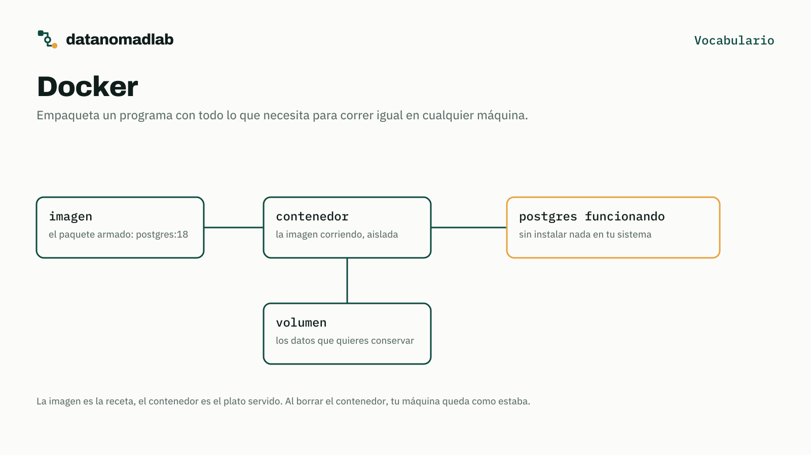

# Docker: cómo probar una base de datos sin instalarla

*Qué es un contenedor, para qué sirve y cómo levantar un Postgres en un minuto y borrarlo sin dejar rastro.*

> Este post es parte del **Vocabulario del Lab**: explicaciones cortas de las herramientas que aparecen en los experimentos, pensadas para quien recién parte o nunca usó esa herramienta en particular. Si llegaste desde un experimento, aquí está lo necesario para seguirlo.



## En una frase

Docker empaqueta un programa con todo lo que necesita (sistema, librerías, configuración) para que corra igual en tu computador, en el de tu colega y en un servidor.

## El problema que resuelve

Quieres probar [Postgres](postgres.md). Sin Docker, lo instalas en tu sistema, eliges una versión, queda un servicio corriendo de fondo y, cuando ya no lo quieres, te toca desinstalarlo con cuidado. Si mañana otro proyecto necesita otra versión, las dos se pisan.

Después viene el segundo problema: le pasas tu proyecto a alguien y no le funciona. Tiene otra versión, otro sistema operativo, le falta una librería. La frase "en mi máquina sí corre" nace ahí.

Con Docker pides el programa ya armado, lo echas a correr aislado del resto de tu sistema y, cuando terminas, lo borras. Tu máquina queda como estaba. Y como el paquete es el mismo para todos, lo que corre en tu computador corre igual en el de cualquiera.

## Las tres palabras que vas a oír siempre

- **Imagen:** el paquete ya armado, de solo lectura. Por ejemplo `postgres:18` es Postgres versión 18 con el sistema mínimo que necesita. Es la receta.
- **Contenedor:** una imagen corriendo. Es el plato servido: puedes tener varios platos de la misma receta, y cada uno se come y se bota por separado.
- **Volumen:** una carpeta que sobrevive al contenedor. Lo que un contenedor escribe adentro desaparece cuando lo borras, salvo que lo guarde en un volumen.

Hay una cuarta que aparece en casi todos los experimentos: **Docker Compose**. Es un archivo (`docker-compose.yml`) donde describes varios contenedores que trabajan juntos, por ejemplo una base de datos y una herramienta de gráficos, y los prendes todos con un solo comando.

## Pruébalo en 5 minutos

Necesitas [Docker Desktop](https://docs.docker.com/get-started/get-docker/) instalado y abierto. Vas a levantar un Postgres, usarlo y borrarlo.

Paso 1: levantar Postgres 18. El comando tiene cuatro partes: `-d` lo deja corriendo de fondo, `--name` le pone un nombre para referirte a él después, `-e` define la contraseña de la base y `-p 55432:5432` abre un puerto, que es una puerta numerada por la que tu máquina se conecta al contenedor.

```bash
docker run -d --name lab-postgres -e POSTGRES_PASSWORD=lab -p 55432:5432 postgres:18
```

La primera vez descarga la imagen, que pesa 701 MB. Las siguientes parte en un par de segundos.

Paso 2: ver que está corriendo.

```bash
docker ps
```

```text
NAMES          IMAGE         STATUS        PORTS
lab-postgres   postgres:18   Up 1 second   0.0.0.0:55432->5432/tcp
```

Paso 3: correr SQL dentro del contenedor. `docker exec` ejecuta un comando adentro; `psql` es el cliente de Postgres, que viene incluido en la imagen, y `-U postgres` es el usuario.

```bash
docker exec lab-postgres psql -U postgres -c \
  "CREATE TABLE viajes (id int, total numeric);
   INSERT INTO viajes VALUES (1, 12.5), (2, 30);
   SELECT count(*), sum(total) FROM viajes;"
```

```text
 count | sum
-------+------
     2 | 42.5
```

Tienes una base de datos funcionando y no instalaste Postgres.

Paso 4: borrar el contenedor. La tabla se va con él.

```bash
docker rm -f lab-postgres
```

Si además quieres recuperar los 701 MB de la imagen: `docker rmi postgres:18`.

## Dónde lo vas a ver en el Lab

Casi todos los experimentos antiguos del repositorio levantan sus servicios con Docker Compose, y por eso se pueden repetir en otra máquina sin instalar nada a mano:

- [psqlvector](../psqlvector/): Postgres con la extensión pgvector, para búsqueda por significado.
- [kafkainfluxmetabase](../kafkainfluxmetabase/): tres servicios (Kafka, InfluxDB y Metabase) conversando entre sí.
- [duckdbpoc](../duckdbpoc/): Metabase mostrando gráficos sobre una base [DuckDB](duckdb.md).

Cuando un experimento diga "levanta el entorno con `docker compose up`", es esto: prender todos los contenedores descritos en el archivo.

## Errores típicos cuando partes

- **"Borré el contenedor y perdí los datos."** Lo que se escribe dentro del contenedor muere con él. Si quieres conservarlo, conecta un volumen a la carpeta donde el programa guarda sus datos (a eso se le dice montar). Cuál es esa carpeta depende de cada imagen y está en su documentación.
- **"El puerto ya está en uso."** Otro programa ocupa ese puerto en tu máquina. Cambia el número de la izquierda en `-p 55432:5432`.
- **"Desde un contenedor no llego a otro usando `localhost`."** Dentro de un contenedor, `localhost` es el propio contenedor. En Docker Compose, los servicios se llaman entre sí por su nombre (`postgres`, `kafka`).
- **Usar la etiqueta `latest`.** Hoy es una versión y en seis meses otra. Fija la versión (`postgres:18`) para que lo que haces hoy se pueda repetir.
- **El disco se llena.** Las imágenes y los contenedores detenidos se acumulan. `docker system df` muestra cuánto ocupan.

## Lo que suele confundirse

**Contenedor y máquina virtual.** Una máquina virtual simula un computador completo, con su propio sistema operativo, y tarda en partir. Un contenedor usa el sistema operativo de la máquina que lo aloja en vez de traer uno propio, y solo aísla el programa. Por eso parte en segundos y pesa menos. Un detalle: en Mac y Windows, Docker Desktop corre por debajo una máquina virtual Linux chica, porque los contenedores son una tecnología de Linux.

**Docker y Kubernetes.** Docker corre contenedores en una máquina. Kubernetes reparte y vigila contenedores en muchas máquinas. Para aprender y para experimentos, Docker basta.

## Cuándo no lo necesitas

Si tu herramienta es un solo ejecutable o una librería de Python, como [DuckDB](duckdb.md), basta con instalarla en una carpeta aislada de Python (un entorno virtual), y parte más rápido. Docker vale la pena cuando hay servicios que deben quedar corriendo, o cuando necesitas que el entorno sea idéntico en varias máquinas.

## Para seguir aprendiendo

- [Get started](https://docs.docker.com/get-started/), la guía oficial de primeros pasos.
- [Docker Compose](https://docs.docker.com/compose/), para describir varios contenedores en un archivo.
- [Imagen oficial de Postgres](https://hub.docker.com/_/postgres), con sus variables y la ruta para guardar los datos.

## Sigue con

- [DuckDB](duckdb.md): un motor de consultas que no necesita servidor ni contenedor.
- [Bucket](bucket.md): dónde se guardan los archivos cuando el experimento sale de tu computador.
- [Postgres](postgres.md): qué es la base de datos que levanta el ejemplo, y cómo cuida sus datos.

---

*Este post lo redactó una IA a partir de los experimentos de Data Nomad Lab. Los comandos se corrieron el 17 de noviembre de 2026 y las salidas que ves son las reales.*
