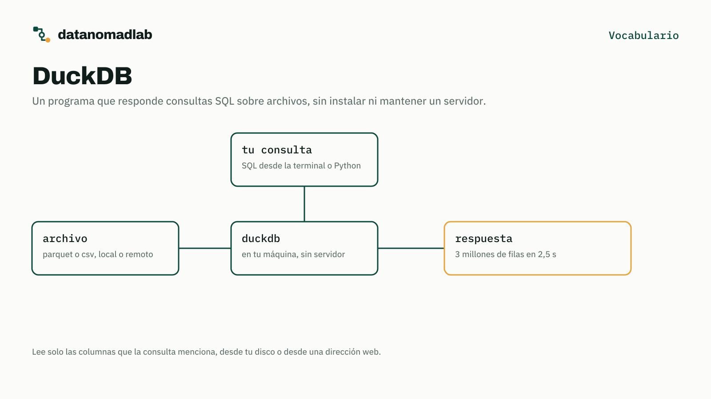

# DuckDB: SQL sobre un archivo de millones de filas, sin servidor

*Qué es, en qué se diferencia de Postgres y de pandas, y cómo consultar 3 millones de filas que están en internet sin descargarlas.*

> Este post es parte del **Vocabulario del Lab**: explicaciones cortas de las herramientas que aparecen en los experimentos, pensadas para quien recién parte o nunca usó esa herramienta en particular. Si llegaste desde un experimento, aquí está lo necesario para seguirlo.



## En una frase

DuckDB es un programa que responde consultas SQL de análisis sobre archivos, directo desde tu terminal o desde tu script de Python, sin instalar ni mantener un servidor.

## El problema que resuelve

Tienes un archivo con millones de filas y una pregunta simple: cuántas ventas hubo por mes. Las opciones de siempre son incómodas:

- Excel no lo abre.
- pandas lo carga entero en memoria, y si no cabe, se cae.
- Subirlo a una base de datos o a un warehouse (una base de datos en la nube hecha para análisis, como [BigQuery](bigquery.md)) significa crear cuentas, tablas y permisos para una sola pregunta.

DuckDB es un solo ejecutable. Le escribes SQL y le dices dónde está el archivo, en tu disco o en una dirección web. No hay nada que prender antes ni que apagar después.

## Cómo lo logra

- **No hay nada corriendo de fondo.** Con Postgres hay que dejar un programa prendido esperando conexiones, que es lo que se llama un servidor. Aquí abres la terminal, o lo importas desde Python, y ya estás consultando.
- **Lee por columnas.** Si la consulta menciona dos columnas de veinte, lee esas dos. Con archivos [Parquet](parquet.md), que ya vienen ordenados por columna, la diferencia es grande.
- **Usa todos los núcleos.** Reparte el trabajo entre los procesadores de tu máquina sin que configures nada.
- **Lee muchos formatos.** CSV, JSON, Parquet y tablas Apache Iceberg, entre otros, locales o remotos.

## Pruébalo en 5 minutos

Instálalo con `brew install duckdb` en Mac, o sigue la [guía de instalación](https://duckdb.org/docs/installation/) para otros sistemas.

Ahora hazle una pregunta a un archivo que está en internet, sin bajarlo. Son los viajes de taxi de Nueva York de enero de 2024, casi 3 millones de filas en un archivo de 50 MB:

```bash
duckdb -c "
  SELECT count(*) AS viajes, round(avg(total_amount), 2) AS total_promedio
  FROM 'https://d37ci6vzurychx.cloudfront.net/trip-data/yellow_tripdata_2024-01.parquet';
"
```

```text
┌─────────┬────────────────┐
│ viajes  │ total_promedio │
│  int64  │     double     │
├─────────┼────────────────┤
│ 2964624 │           26.8 │
└─────────┴────────────────┘
```

La segunda línea del resultado (`int64`, `double`) es el tipo de dato de cada columna: un entero y un decimal. Tardó 2,5 segundos con una conexión doméstica. No descargó los 50 MB: pidió solo el trozo del archivo donde está la columna `total_amount`.

Para ver qué columnas trae un archivo antes de consultarlo:

```bash
duckdb -c "DESCRIBE SELECT * FROM 'https://d37ci6vzurychx.cloudfront.net/trip-data/yellow_tripdata_2024-01.parquet';"
```

Estas son las primeras filas de la respuesta, recortadas a las dos primeras columnas: el nombre de cada columna del archivo y su tipo.

```text
│ VendorID              │ INTEGER     │
│ tpep_pickup_datetime  │ TIMESTAMP   │
│ tpep_dropoff_datetime │ TIMESTAMP   │
│ passenger_count       │ BIGINT      │
│ trip_distance         │ DOUBLE      │
```

No queda nada que limpiar: no se creó ningún archivo.

## Dónde lo vas a ver en el Lab

- [Experimento 01 · Lakehouse de bolsillo](../01-lakehouse-de-bolsillo/): DuckDB consulta 9,5 millones de viajes guardados en una tabla [Apache Iceberg](iceberg.md), que es un grupo de archivos Parquet ordenados como tabla. Las cinco consultas del experimento tardan 0,35 segundos en total, usando solo 4 de los procesadores de la máquina para que se parezca a un servidor chico. Ese experimento lo compara con [BigQuery](bigquery.md).
- [duckdbpoc](../duckdbpoc/) y [ragwith](../ragwith/), entre los experimentos antiguos.

## Errores típicos cuando partes

- **Buscar el servidor.** No hay. Si abres `duckdb` sin nombre de archivo, todo vive en memoria y se pierde al salir. Para guardar tablas, ábrelo con un archivo: `duckdb mi_base.duckdb`.
- **Abrir el mismo archivo `.duckdb` desde dos programas para escribir.** Solo un proceso puede escribir a la vez; el segundo recibe un error de bloqueo.
- **Convertir todo a pandas antes de consultar.** Deja que DuckDB lea el archivo y pásale a pandas solo el resultado, que ya viene resumido.
- **`SELECT *` sobre un archivo remoto.** Obliga a descargar todas las columnas. Pide solo las que necesitas.

## Lo que suele confundirse

**DuckDB y SQLite.** Los dos son un archivo y no tienen servidor. SQLite está hecho para guardar y buscar registros de una aplicación, de a uno. DuckDB está hecho para resumir millones de filas.

**DuckDB y Postgres.** Postgres es un servidor al que se conectan muchos usuarios y aplicaciones que escriben al mismo tiempo. DuckDB es para una persona o un proceso haciendo análisis. No compiten: es común sacar datos de Postgres y analizarlos con DuckDB.

**DuckDB y pandas.** pandas trabaja con los datos cargados en memoria y se programa en Python. DuckDB usa SQL y puede trabajar con archivos más grandes que la memoria. Se llevan bien: DuckDB puede consultar una tabla de pandas directamente.

**DuckDB y un warehouse.** Un warehouse como BigQuery reparte el trabajo entre muchas máquinas y atiende a muchos usuarios con permisos distintos. DuckDB usa una sola máquina. Para una cantidad sorprendente de casos, una máquina alcanza.

## Cuándo no usarlo

- Para la base de datos de una aplicación con muchos usuarios escribiendo al mismo tiempo. Eso es trabajo para Postgres.
- Cuando los datos no caben razonablemente en una máquina, o cuando muchas personas consultan a la vez y necesitas permisos por usuario. Ahí un warehouse sigue teniendo sentido.

## Para seguir aprendiendo

- [Documentación oficial](https://duckdb.org/docs/), con una guía por cada formato y lenguaje.
- [Leer y escribir Parquet](https://duckdb.org/docs/data/parquet/overview), el uso más común.
- [DuckDB desde Python](https://duckdb.org/docs/api/python/overview), para usarlo dentro de un programa.

## Sigue con

- [Parquet](parquet.md): el formato de archivo con el que DuckDB mejor se entiende.
- [Apache Iceberg](iceberg.md): cómo un grupo de archivos Parquet se convierte en una tabla.
- [BigQuery](bigquery.md): el warehouse con el que se compara en el experimento 01.
- [ELT](elt.md): cómo llegan los datos a los archivos que DuckDB consulta, y cómo quedarse con la versión más nueva de cada fila.

---

*Este post lo redactó una IA a partir de los experimentos de Data Nomad Lab. Los comandos se corrieron el 17 de noviembre de 2026 y las salidas que ves son las reales.*
