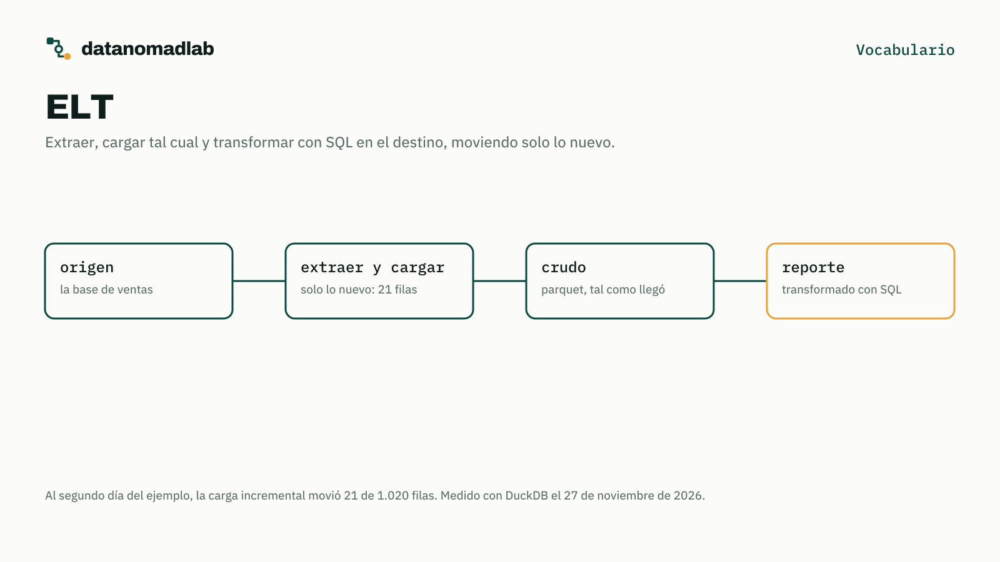

# ELT: cargar primero, transformar después y mover solo lo nuevo

*Qué es extraer, cargar y transformar, en qué se diferencia de ETL y qué significa una carga incremental, con un ejemplo en tu terminal.*

> Este post es parte del **Vocabulario del Lab**: explicaciones cortas de las herramientas que aparecen en los experimentos, pensadas para quien recién parte o nunca usó esa herramienta en particular. Si llegaste desde un experimento, aquí está lo necesario para seguirlo.



## En una frase

ELT es una forma de copiar datos de un sistema a otro: se extraen del origen, se cargan tal como vienen en el destino y ahí se transforman con SQL en las tablas que se consultan.

## El problema que resuelve

Las ventas de una tienda viven en la base de su sistema de ventas, muchas veces [Postgres](postgres.md). Calcular ahí el total del mes hace más lenta la base que registra las ventas, así que los reportes se hacen sobre una copia.

Lo más simple es copiar las tablas completas cada noche, aunque hayan cambiado diez filas. Y si las cuentas se hacen en el script antes de guardar (eso es ETL), cada cálculo nuevo obliga a tocarlo. ELT mueve sin tocar, transforma después y, desde la segunda vez, mueve solo lo que cambió.

## Las cuatro palabras que vas a oír siempre

- **Extraer (la E).** Leer los datos del origen, donde nacen: una base de datos, una planilla o una API (la puerta por la que un programa le pide datos a otro).
- **Cargar (la L, de *load*).** Escribir lo extraído en el destino tal como venía: la capa cruda. El destino puede ser un warehouse (una base de datos en la nube para análisis, como [BigQuery](bigquery.md)) o una carpeta de archivos [Parquet](parquet.md), un formato para tablas.
- **Transformar (la T).** Convertir lo crudo en tablas para consultar: quitar repetidos, sumar, unir. Se hace en el destino con un programa que ejecuta SQL, como [DuckDB](duckdb.md). Si había un error, se rehace sobre lo crudo.
- **Incremental.** Cada corrida trae solo lo nuevo o cambiado, gracias a un cursor: una columna que solo avanza, como la fecha de última modificación. Se piden las filas con fecha mayor a la más alta ya cargada. Lo contrario es la carga completa.

## Pruébalo en 5 minutos

Necesitas DuckDB (`brew install duckdb` en Mac, o la [guía de instalación](https://duckdb.org/docs/installation/)). Un archivo de DuckDB hará de origen y una carpeta, de destino.

Paso 1: crear la carpeta y el origen, con 1.000 ventas. No hace falta entender cada función: solo inventa ventas. `actualizado_en`, cuándo se creó o cambió cada venta, será el cursor.

```bash
mkdir -p elt-prueba/crudo && cd elt-prueba
duckdb origen.duckdb -c "
  CREATE TABLE ventas AS
  SELECT i AS id,
         ['taza', 'vela', 'libreta'][i % 3 + 1] AS producto,
         10 + i % 7 AS monto,
         TIMESTAMP '2026-11-01 09:00' + to_seconds(i * 30) AS actualizado_en
  FROM range(1, 1001) t(i);
  SELECT count(*) AS ventas, min(actualizado_en) AS desde, max(actualizado_en) AS hasta FROM ventas;
"
```

```text
┌────────┬─────────────────────┬─────────────────────┐
│ ventas │        desde        │        hasta        │
│ int64  │      timestamp      │      timestamp      │
├────────┼─────────────────────┼─────────────────────┤
│   1000 │ 2026-11-01 09:00:30 │ 2026-11-01 17:20:00 │
└────────┴─────────────────────┴─────────────────────┘
```

Paso 2: extraer y cargar las ventas tal cual a un Parquet. `COPY` no imprime nada si termina bien.

```bash
duckdb origen.duckdb -c "COPY (SELECT * FROM ventas) TO 'crudo/carga_1.parquet';"
```

Paso 3: transformar. El reporte se arma sobre lo crudo: fíjate que el comando no nombra `origen.duckdb`.

```bash
duckdb -c "
  SELECT producto, count(*) AS ventas, sum(monto) AS total
  FROM 'crudo/*.parquet'
  GROUP BY producto
  ORDER BY producto;
"
```

```text
┌──────────┬────────┬────────┐
│ producto │ ventas │ total  │
│ varchar  │ int64  │ int128 │
├──────────┼────────┼────────┤
│ libreta  │    333 │   4329 │
│ taza     │    333 │   4333 │
│ vela     │    334 │   4341 │
└──────────┴────────┴────────┘
```

Paso 4: el origen cambia. Entran 20 ventas del día siguiente y la venta 7 se corrige a 99. Las dos cosas mueven su `actualizado_en`.

```bash
duckdb origen.duckdb -c "
  INSERT INTO ventas
  SELECT i, 'taza', 12, TIMESTAMP '2026-11-02 09:00' + to_seconds(i * 30)
  FROM range(1001, 1021) t(i);
  UPDATE ventas SET monto = 99, actualizado_en = TIMESTAMP '2026-11-02 12:00' WHERE id = 7;
"
```

Paso 5: la carga incremental. Se pide al origen solo lo posterior a la fecha más alta de lo crudo, en un archivo nuevo, y se cuentan las filas por archivo.

```bash
duckdb origen.duckdb -c "
  COPY (
    SELECT * FROM ventas
    WHERE actualizado_en > (SELECT max(actualizado_en) FROM 'crudo/*.parquet')
  ) TO 'crudo/carga_2.parquet';
"
duckdb -c "SELECT filename, count(*) AS filas FROM read_parquet('crudo/*.parquet', filename = true) GROUP BY filename ORDER BY filename;"
```

```text
┌───────────────────────┬───────┐
│       filename        │ filas │
│        varchar        │ int64 │
├───────────────────────┼───────┤
│ crudo/carga_1.parquet │  1000 │
│ crudo/carga_2.parquet │    21 │
└───────────────────────┴───────┘
```

Se movieron 21 filas, las 20 nuevas y la corregida, no las 1.020 de la tabla.

Paso 6: transformar otra vez. Si repites el paso 3, la venta 7 (una vela) cuenta dos veces, con el monto viejo y el nuevo:

```text
│ vela     │    335 │   4440 │
```

Hay que quedarse con la versión más nueva de cada venta. `WITH vigente AS (...)` nombra una consulta para usarla después; `PARTITION BY id` separa las filas por venta, `ORDER BY actualizado_en DESC` pone primero la más nueva y `QUALIFY ... = 1` deja solo esa:

```bash
duckdb -c "
  WITH vigente AS (
    SELECT * FROM 'crudo/*.parquet'
    QUALIFY row_number() OVER (PARTITION BY id ORDER BY actualizado_en DESC) = 1
  )
  SELECT producto, count(*) AS ventas, sum(monto) AS total
  FROM vigente
  GROUP BY producto
  ORDER BY producto;
"
```

```text
┌──────────┬────────┬────────┐
│ producto │ ventas │ total  │
│ varchar  │ int64  │ int128 │
├──────────┼────────┼────────┤
│ libreta  │    333 │   4329 │
│ taza     │    353 │   4573 │
│ vela     │    334 │   4430 │
└──────────┴────────┴────────┘
```

Son las cifras del origen. Lo crudo guarda todas las versiones; la transformación decide cuál vale.

Paso 7: limpiar.

```bash
cd .. && rm -rf elt-prueba
```

## Dónde lo vas a ver en el Lab

- [Experimento 03 · Pipeline de USD 5 al mes](../03-pipeline-de-usd-5-al-mes/): [dlt](dlt.md), una librería de Python, carga solo lo nuevo de Postgres en Parquet y DuckDB transforma, como en el paso 6. Frente a un script que copia las tablas completas, la corrida diaria movió 2.236 filas en vez de 574.556 (mediana, medido).
- [etl1](../etl1/), entre los antiguos, es un ETL: transforma antes de cargar.

## Errores típicos cuando partes

Cada uno parte de la carpeta del paso 6. Si pruebas varios, borra `crudo/carga_3.parquet` entre uno y otro.

- **Repetir la carga sin cursor.** Copiar otra vez la tabla entera deja 2.041 filas crudas para 1.020 ventas.

  ```bash
  duckdb origen.duckdb -c "COPY (SELECT * FROM ventas) TO 'crudo/carga_3.parquet';"
  duckdb -c "SELECT count(*) AS filas FROM 'crudo/*.parquet';"
  ```

  ```text
  │  2041 │
  ```

- **Usar `>=` en vez de `>`.** Sin cambios en el origen debería traer 0 filas; con `>=` trae otra vez la venta 1020, la más nueva.

  ```bash
  duckdb origen.duckdb -c "COPY (SELECT * FROM ventas WHERE actualizado_en >= (SELECT max(actualizado_en) FROM 'crudo/*.parquet')) TO 'crudo/carga_3.parquet';"
  duckdb -c "SELECT id, monto, actualizado_en FROM 'crudo/carga_3.parquet';"
  ```

  ```text
  │  1020 │    12 │ 2026-11-02 17:30:00 │
  ```

- **Esperar que vea los borrados.** Se borra la venta 10 en el origen y se repite la carga: sigue en lo crudo, porque lo borrado no tiene fecha nueva.

  ```bash
  duckdb origen.duckdb -c "DELETE FROM ventas WHERE id = 10;"
  duckdb origen.duckdb -c "COPY (SELECT * FROM ventas WHERE actualizado_en > (SELECT max(actualizado_en) FROM 'crudo/*.parquet')) TO 'crudo/carga_3.parquet';"
  duckdb -c "SELECT id, producto, monto FROM 'crudo/*.parquet' WHERE id = 10;"
  ```

  ```text
  │    10 │ vela     │    13 │
  ```

- **Agregar una columna con valor por defecto.** En el origen todas las ventas quedan con `canal = 'web'`, pero ninguna cambia su `actualizado_en`, así que la columna nunca llega con datos. Hay que recargar la tabla.

  ```bash
  duckdb origen.duckdb -c "ALTER TABLE ventas ADD COLUMN canal VARCHAR DEFAULT 'web';"
  duckdb origen.duckdb -c "COPY (SELECT * FROM ventas WHERE actualizado_en > (SELECT max(actualizado_en) FROM 'crudo/*.parquet')) TO 'crudo/carga_3.parquet';"
  duckdb -c "SELECT count(canal) AS con_canal FROM read_parquet('crudo/*.parquet', union_by_name = true);"
  ```

  ```text
  │         0 │
  ```

## Lo que suele confundirse

**ELT y ETL.** Los mismos pasos en otro orden. En ETL se transforma antes de cargar y al destino llega solo el resultado. En ELT llega todo crudo y se puede transformar de nuevo sin volver al origen, a cambio de guardar más.

**Incremental y en tiempo real.** Incremental dice qué se mueve, no cada cuánto: una carga diaria deja los números de ayer. Tenerlos al segundo es otro problema, el de [Kafka](kafka.md).

## Cuándo no usarlo

- Si hay datos que no pueden salir crudos del origen, como datos personales, transforma antes de cargar: ETL.
- Si las tablas son chicas, la carga completa cada noche es más simple y sí ve borrados y columnas nuevas.

## Para seguir aprendiendo

- [Carga incremental en dlt](https://dlthub.com/docs/general-usage/incremental-loading): cómo guarda el cursor y retoma.
- [`COPY` en DuckDB](https://duckdb.org/docs/sql/statements/copy): la instrucción que hizo la E y la L del ejemplo.
- [`QUALIFY` en DuckDB](https://duckdb.org/docs/sql/query_syntax/qualify): para quedarse con una fila por `id`.

## Sigue con

- [dlt](dlt.md): la E y la L del experimento 03.
- [Postgres](postgres.md): el origen más común.
- [DuckDB](duckdb.md): el motor de la T.
- [Parquet](parquet.md): el formato de la capa cruda.

---

*Este post lo redactó una IA a partir de los experimentos de Data Nomad Lab. Los comandos se corrieron el 27 de noviembre de 2026 y las salidas que ves son las reales.*
