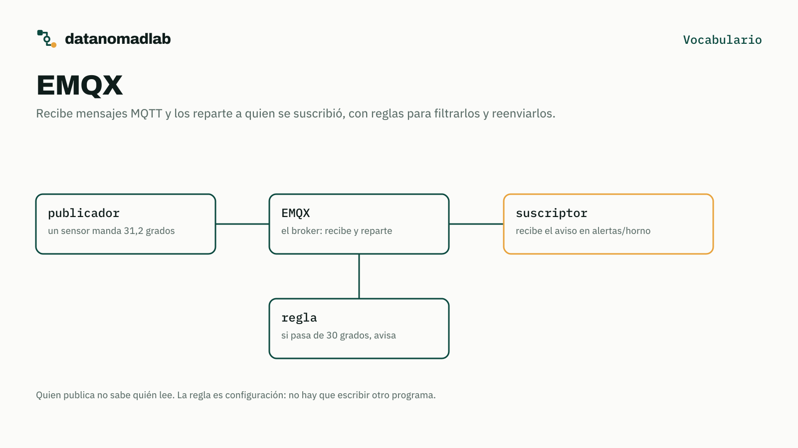

# EMQX: qué hace un broker MQTT y hasta dónde llega gratis

*Qué es un broker, qué trae EMQX además de repartir mensajes y qué deja hacer su licencia gratuita.*

> Este post es parte del **Vocabulario del Lab**: explicaciones cortas de las herramientas que aparecen en los experimentos, pensadas para quien recién parte o nunca usó esa herramienta en particular. Si llegaste desde un experimento, aquí está lo necesario para seguirlo.



## En una frase

EMQX es un broker MQTT: un programa que queda corriendo, recibe los mensajes que unos programas publican y los entrega a los que pidieron recibirlos. Además puede filtrarlos y llevarlos a otros sistemas sin que escribas código.

## El problema que resuelve

Tienes 200 sensores de temperatura y tres programas que quieren sus lecturas. Si cada sensor les hablara directo, sumar un cuarto programa obligaría a tocar los 200.

Con un broker al medio, cada sensor conoce una sola dirección. Publica su lectura en un tema, que es un nombre con forma de ruta como `sensores/horno/temperatura` (más en [MQTT](mqtt.md)), y el broker la entrega a quien esté suscrito a ese tema.

Después llega "avísame solo si pasa de 30 grados" o "guarda todo en [Kafka](kafka.md)", y habría que escribir un programa que se suscriba, filtre y reenvíe. EMQX trae esa parte hecha: se configura, no se programa.

## Lo que trae además de repartir

- **Reglas:** una consulta con forma de SQL que mira cada mensaje. `FROM` dice de qué tema, `WHERE` cuáles, y una acción qué hacer con ellos.
- **Conexión a otros sistemas:** una regla puede escribir en Kafka, en bases de datos o en servicios de nube, y también leer desde Kafka.
- **Panel de administración:** una página web donde ves clientes conectados, suscripciones y reglas.
- **Licencia:** cada EMQX corriendo es un nodo, y varios nodos coordinados forman un clúster. Desde la versión 5.9 un solo nodo es gratis, también en producción, mientras no ofrezcas EMQX a terceros como servicio ni dentro de un producto. Un clúster pide una licencia pagada, y la [página oficial](https://www.emqx.com/en/content/license-faq) no publica su precio.

## Pruébalo en 5 minutos

Necesitas [Docker](docker.md) abierto. Las dos imágenes pesan cerca de 500 MB cada una.

Paso 1: en una carpeta vacía, escribir la configuración; el bloque se pega entero y crea `base.hocon`. La primera línea prende el panel. El resto es la regla: si una lectura de `sensores/<algo>/temperatura` pasa de 30, publica un texto en `alertas/<sensor>`. En ella, `+` vale por cualquier nombre en ese nivel del tema y `payload` es el contenido del mensaje (`qos`: ver el post de MQTT).

```bash
cat > base.hocon <<'EOF'
dashboard.listeners.http.bind = 18083

rule_engine.rules.alerta_calor {
  sql = "SELECT payload.sensor as sensor, payload.temp as temp FROM \"sensores/+/temperatura\" WHERE payload.temp > 30"
  actions = [
    {
      function = republish
      args {
        topic = "alertas/${sensor}"
        payload = "${sensor} marca ${temp} grados"
        qos = 1
      }
    }
  ]
}
EOF
```

Paso 2: crear una red, para que los contenedores se encuentren por nombre, y levantar EMQX con ese archivo. `-p 18201:18083` deja el puerto 18083 del contenedor, el del panel, en el 18201 de tu máquina.

```bash
docker network create vocab-emqx-red
docker run -d --name vocab-emqx-broker --network vocab-emqx-red \
  -p 18201:18083 \
  -v "$PWD/base.hocon:/opt/emqx/etc/base.hocon:ro" \
  emqx/emqx:6.3.3
```

Paso 3: esperar 10 segundos y preguntarle si partió, qué reglas tiene y con qué licencia.

```bash
docker exec vocab-emqx-broker emqx ctl status
docker exec vocab-emqx-broker emqx ctl rules list
docker exec vocab-emqx-broker emqx ctl license info
```

```text
Node 'emqx@172.20.0.2' 6.3.3 is started
Rule{id=alerta_calor, name=, enabled=true, descr=}
max_sessions    : 10000000
expiry_at       : 2029-03-01
type            : community
```

Partió con la regla. Las tres últimas líneas (salida recortada) muestran la licencia gratuita, incluida para un nodo, y su fecha de vencimiento (`expiry_at`); revisa la [página oficial](https://www.emqx.com/en/content/license-faq) de licencias.

Paso 4: dejar un suscriptor escuchando con MQTTX CLI, el cliente de terminal de los mismos autores. `-h` es el broker y `-t` el tema; `#` significa "todo lo que cuelgue de aquí".

```bash
docker run -d --name vocab-emqx-sub --network vocab-emqx-red \
  emqx/mqttx-cli:v1.13.3 mqttx sub -h vocab-emqx-broker -t 'alertas/#'
```

Paso 5: publicar dos lecturas, una de 22,5 grados y otra de 31,2.

```bash
docker run --rm --network vocab-emqx-red emqx/mqttx-cli:v1.13.3 \
  mqttx pub -h vocab-emqx-broker -t 'sensores/bodega/temperatura' \
  -m '{"sensor": "bodega", "temp": 22.5}'
docker run --rm --network vocab-emqx-red emqx/mqttx-cli:v1.13.3 \
  mqttx pub -h vocab-emqx-broker -t 'sensores/horno/temperatura' \
  -m '{"sensor": "horno", "temp": 31.2}'
```

Cada comando responde `Message published`.

Paso 6: ver qué recibió el suscriptor.

```bash
docker logs vocab-emqx-sub
```

```text
✔ Subscribed to alertas/#
received_at: 2026-11-25T21:50:29.123Z, topic: alertas/horno, qos: 0, size: 23B
horno marca 31.2 grados
```

Llegó un solo aviso, y nadie publicó en `alertas/horno`: lo hizo la regla. El panel está en `http://localhost:18201`, con usuario `admin` y clave `public`.

Paso 7: borrar todo.

```bash
docker rm -f vocab-emqx-sub vocab-emqx-broker
docker network rm vocab-emqx-red
rm base.hocon
```

## Dónde lo vas a ver en el Lab

- [02 · Stream a pantallas en vivo](../02-stream-a-pantallas-en-vivo/): EMQX lee un tópico de [Redpanda](redpanda.md), que habla como Kafka (el tópico es el equivalente en Kafka de un tema), y una regla como la del ejemplo publica cada evento en el tema de su cuenta: hay un tema por cada cuenta de cliente. La pantalla se suscribe por MQTT sobre [WebSocket](websocket.md). Son 27 líneas de configuración (medido: salió de correr el experimento), en [base.hocon](../02-stream-a-pantallas-en-vivo/servicios/emqx/base.hocon).

Con 10.000 eventos por segundo, el 99 % llegó a la pantalla en 18 ms o menos y aguantó hasta 40.000 por segundo (medido). Al apagar EMQX de golpe, la pantalla quedó congelada 29 segundos, no se perdió ningún evento y 34.900 llegaron repetidos (medido). Un nodo, 2 núcleos y 2 GB.

## Errores típicos cuando partes

- **"Monté mi `base.hocon` y el panel no abre."** La imagen trae en ese archivo la línea que prende el panel. Si lo reemplazas sin copiarla, EMQX parte sin panel y no avisa.
- **"Publiqué y la regla no hizo nada."** Si el mensaje no es JSON, quien publica ve `Message published` igual. El error (`decode_json_failed`) solo queda en `docker logs vocab-emqx-broker`.
- **"Cualquiera se conecta."** De fábrica EMQX no pide usuario ni clave. Antes de abrirlo a una red, [configura la autenticación](https://docs.emqx.com/en/emqx/latest/access-control/authn/authn.html).
- **"Quise sumar un segundo nodo."** Con la licencia gratuita responde `Failed to join the cluster: "Node emqx@172.23.0.2 has a single node license"`.

## Lo que suele confundirse

**EMQX y MQTT.** MQTT es el protocolo, el acuerdo sobre cómo se entregan los mensajes. EMQX es uno de los programas que lo hablan; Mosquitto es otro.

**EMQX y Kafka.** A los dos les dicen broker. Kafka guarda los mensajes en disco y cada lector puede volver atrás. Un broker MQTT los entrega a quien está suscrito en ese momento.

**Gratis y código abierto.** Desde la 5.9 hay una sola edición, que se presenta como "EMQX Enterprise" aunque no pagues. Su licencia (BSL 1.1) deja leer el código, pero no es de código abierto.

## Cuándo no usarlo

- Si necesitas varios nodos y no vas a pagar: [NATS](nats.md) acepta clientes MQTT 3.1.1 y funciona en clúster, [según su documentación](https://docs.nats.io/running-a-nats-service/configuration/mqtt).
- Si nada de lo tuyo habla MQTT y solo quieres llevar eventos a pantallas: [Centrifugo](centrifugo.md).

## Para seguir aprendiendo

- [EMQX Licensing FAQ](https://www.emqx.com/en/content/license-faq): qué es gratis y qué pide una licencia pagada.
- [Motor de reglas](https://docs.emqx.com/en/emqx/latest/data-integration/rules.html): el SQL y las acciones.
- [Integración con Kafka](https://docs.emqx.com/en/emqx/latest/data-integration/data-bridge-kafka.html): escribir en un tópico o leer desde él.

## Sigue con

- [MQTT](mqtt.md): el protocolo, con temas, niveles de entrega y sesiones.
- [Kafka](kafka.md): de donde EMQX lee en el experimento 02.
- [Centrifugo](centrifugo.md): entrega a pantallas por WebSocket.

---

*Este post lo redactó una IA a partir de los experimentos de Data Nomad Lab. Los comandos se corrieron el 25 de noviembre de 2026 y las salidas que ves son las reales.*
