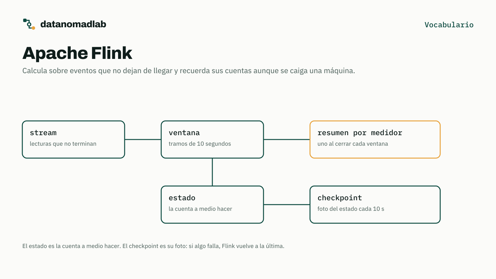

# Apache Flink: calcular sobre eventos que no dejan de llegar

*Stream, estado, ventana y checkpoint, y cómo verlos en Docker con un trabajo escrito en SQL.*

> Este post es parte del **Vocabulario del Lab**: explicaciones cortas de las herramientas que aparecen en los experimentos, pensadas para quien recién parte o nunca usó esa herramienta en particular. Si llegaste desde un experimento, aquí está lo necesario para seguirlo.



Conviene leer antes el post de [Docker](docker.md).

## En una frase

Apache Flink es un motor que calcula sobre eventos a medida que llegan, sin esperar a que terminen, y recuerda lo que lleva calculado aunque se caiga una máquina.

## El problema que resuelve

Tienes medidores que mandan una lectura cada pocos segundos y quieres saber cuánto consumió cada uno en el último minuto. Guardarlas en una tabla y consultarla cada cierto rato es trabajar por **lotes**: la respuesta nace atrasada. Un script que las sume al llegar pierde las sumas si se cae.

Flink lee sin parar, guarda las cuentas a medio hacer y reparte el trabajo entre máquinas.

## Las cuatro palabras que vas a oír siempre

- **Stream:** una secuencia de eventos sin final. Un lote es un archivo cerrado; en un stream siempre puede llegar otro evento.
- **Estado:** lo que el cálculo recuerda entre un evento y el siguiente. Para contar lecturas por medidor, es la cuenta que lleva cada uno.
- **Ventana:** un tramo de tiempo, por ejemplo 10 segundos. Como el stream no termina, se corta en tramos y sale un resultado al cerrar cada uno.
- **Checkpoint** (punto de control): una foto del estado que Flink saca cada cierto tiempo, y de hasta dónde había leído. Si algo falla, vuelve a la última foto.

## Pruébalo en 5 minutos

Necesitas Docker abierto y `curl`.

Paso 1: levantar un JobManager, que coordina, y un TaskManager, que ejecuta, en una red de Docker, donde se encuentran por nombre. `FLINK_PROPERTIES` les dice dónde está el JobManager y `-p 18181:8081` deja su puerto 8081 en el 18181 de tu máquina. La primera vez la descarga tarda: la imagen ocupa 1,7 GB.

```bash
docker network create vocab-flink-red
docker run -d --name vocab-flink-jobmanager --network vocab-flink-red -p 18181:8081 \
  -e FLINK_PROPERTIES="jobmanager.rpc.address: vocab-flink-jobmanager" \
  flink:2.3.0 jobmanager
docker run -d --name vocab-flink-taskmanager --network vocab-flink-red \
  -e FLINK_PROPERTIES="jobmanager.rpc.address: vocab-flink-jobmanager" \
  flink:2.3.0 taskmanager
```

Paso 2: escribir en SQL el trabajo (job) y enviarlo. Pega el bloque entero: crea `medidores.sql`, lo copia al contenedor y lo ejecuta. En Flink una tabla es un stream con nombre: `lecturas` es la entrada y `resumen`, la salida. Su conector (`connector`) es la pieza que lee o escribe en otro sistema: `datagen` inventa 5 lecturas por segundo de 3 medidores y `print` escribe los resultados en el log. La primera línea pide un checkpoint cada 10 segundos; `TUMBLE` arma ventanas de 10.

```bash
cat > medidores.sql <<'SQL'
SET 'execution.checkpointing.interval' = '10s';

CREATE TABLE lecturas (
  medidor INT,
  consumo DOUBLE,
  hora AS PROCTIME()
) WITH (
  'connector' = 'datagen',
  'rows-per-second' = '5',
  'fields.medidor.min' = '1',
  'fields.medidor.max' = '3',
  'fields.consumo.min' = '0',
  'fields.consumo.max' = '10'
);

CREATE TABLE resumen (
  desde TIMESTAMP(3),
  medidor INT,
  lecturas BIGINT,
  consumo_total DOUBLE
) WITH ('connector' = 'print');

INSERT INTO resumen
SELECT window_start, medidor, COUNT(*), ROUND(SUM(consumo), 1)
FROM TABLE(TUMBLE(TABLE lecturas, DESCRIPTOR(hora), INTERVAL '10' SECOND))
GROUP BY window_start, window_end, medidor;
SQL
docker cp medidores.sql vocab-flink-jobmanager:/tmp/medidores.sql
docker exec vocab-flink-jobmanager ./bin/sql-client.sh -f /tmp/medidores.sql
```

```text
[INFO] SQL update statement has been successfully submitted to the cluster:
Job ID: 82c40dc779f983536d6dc5cddac7ed0d
```

El cliente termina y el trabajo sigue corriendo.

Paso 3: medio minuto después, leer el log del TaskManager. `grep '^+I'` deja las líneas que parten con `+I`, la marca de `print` para una fila nueva.

```bash
docker logs vocab-flink-taskmanager 2>&1 | grep '^+I'
```

```text
+I[2026-11-25T21:51:10, 3, 10, 43.3]
+I[2026-11-25T21:51:10, 2, 8, 38.2]
+I[2026-11-25T21:51:10, 1, 12, 52.6]
+I[2026-11-25T21:51:20, 2, 16, 73.2]
+I[2026-11-25T21:51:20, 3, 20, 113.0]
+I[2026-11-25T21:51:20, 1, 14, 65.8]
```

Cada línea trae el inicio de la ventana (hora UTC), el medidor, sus lecturas y su consumo. La ventana de las 21:51:20 tiene 50 lecturas: 5 por segundo durante 10 segundos. La primera tiene 30 porque el trabajo partió a mitad de ella. Las cuentas de una ventana abierta son el estado.

Paso 4: pedirle sus checkpoints a la API de Flink. El primer `grep` saca el identificador del trabajo; el segundo, los contadores.

```bash
JOB=$(curl -s localhost:18181/jobs | grep -o '[0-9a-f]\{32\}')
curl -s localhost:18181/jobs/$JOB/checkpoints | grep -o '"counts":{[^}]*}'
```

```text
"counts":{"restored":0,"total":4,"in_progress":0,"completed":3,"failed":1}
```

Tres fotos completas y ninguna usada (`restored`). La fallida se intentó antes de que el trabajo partiera.

Paso 5: apagar de golpe el TaskManager y levantarlo. Pega las dos primeras líneas, espera medio minuto y recién entonces las otras dos.

```bash
docker kill vocab-flink-taskmanager
docker start vocab-flink-taskmanager
curl -s localhost:18181/jobs/$JOB/checkpoints | grep -o '"counts":{[^}]*}'
docker logs vocab-flink-taskmanager 2>&1 | grep '^+I'
```

```text
"counts":{"restored":1,"total":8,"in_progress":0,"completed":5,"failed":3}
+I[2026-11-25T21:51:40, 2, 14, 76.7]
+I[2026-11-25T21:51:40, 3, 14, 74.3]
+I[2026-11-25T21:51:40, 1, 22, 121.1]
+I[2026-11-25T21:51:40, 2, 10, 47.3]
+I[2026-11-25T21:51:40, 3, 7, 36.8]
+I[2026-11-25T21:51:40, 1, 8, 43.8]
```

`restored` pasó a 1: Flink volvió desde la última foto, que recordaba 25 lecturas de la ventana de las 21:51:40. Por eso esa ventana (el log va recortado a ella) sale dos veces: con 50 lecturas antes del corte y con 25 después. Las otras 25 se perdieron porque `datagen` no puede repetir lo que inventó; con [Kafka](kafka.md) o [Kinesis](kinesis.md), que guardan los eventos, Flink los relee y la ventana sale completa.

Paso 6: borrar todo.

```bash
docker rm -f vocab-flink-jobmanager vocab-flink-taskmanager
docker network rm vocab-flink-red
docker rmi flink:2.3.0
rm medidores.sql
```

## Dónde lo vas a ver en el Lab

- [Experimento 02, stream a pantallas en vivo](../02-stream-a-pantallas-en-vivo/): Flink **no corre**. Una aplicación de Flink administrado (AWS lo opera por ti) por equipo, leyendo el stream de Kinesis, es la línea base: contra su costo se compara lo demás. Da USD 2.428 al mes a 10.000 eventos por segundo (modelo: una proyección con supuestos); de eso, Flink son USD 1.009, con un supuesto de capacidad sin medir. No corre porque, al diseñarse el experimento, Flink 2.3 no tenía conector publicado de Kinesis.

## Errores típicos cuando partes

- **"Se cayó y no volvió."** Los checkpoints vienen apagados, y sin ellos Flink no reinicia el trabajo. Préndelos con `execution.checkpointing.interval`.
- **Fotos en la memoria del JobManager.** Ahí quedan de fábrica, y se pierden si este cae. `execution.checkpointing.dir` las manda a un [bucket](bucket.md).
- **El estado crece sin parar.** Un `GROUP BY` sin ventana guarda una cuenta por clave (aquí, cada medidor) para siempre. Usa ventanas, o `table.exec.state.ttl` para borrar lo que no cambia hace tiempo.
- **No hay conector para tu versión.** Se publican aparte, en la [página de descargas](https://flink.apache.org/downloads/). Al diseñarse el experimento 02, Flink 2.3 no tenía conector publicado de Kinesis; el de Kafka para 2.3 (versión 5.1.0) figura en Maven Central, el repositorio de librerías de Java, con fecha 24 de noviembre de 2026.

## Lo que suele confundirse

**Flink y Kafka.** Kafka, igual que Kinesis, guarda y reparte los eventos. Flink los lee y calcula.

**Checkpoint y savepoint.** El checkpoint es automático, para recuperarse de fallas. El savepoint es la misma foto pedida por ti, antes de actualizar el trabajo.

## Cuándo no usarlo

Si cada evento se trata por separado y no hay nada que recordar, alcanza con un consumidor propio (un programa tuyo que los lee) o una herramienta lista como [Centrifugo](centrifugo.md). Si te sirve una respuesta cada hora, una consulta por lotes con [DuckDB](duckdb.md) es más simple.

## Para seguir aprendiendo

- [Stateful Stream Processing](https://nightlies.apache.org/flink/flink-docs-release-2.3/docs/concepts/stateful-stream-processing/): estado y checkpoints, con diagramas.
- [Flink en Docker](https://nightlies.apache.org/flink/flink-docs-release-2.3/docs/deployment/resource-providers/standalone/docker/): los comandos del paso 1.
- [Precios de Flink administrado en AWS](https://aws.amazon.com/managed-service-apache-flink/pricing/): en qué unidad se cobra y cuánto cuesta.

## Sigue con

- [Kinesis](kinesis.md): el stream que leería en el experimento 02.
- [Kafka](kafka.md): el transporte que más verás a su lado.
- [Docker](docker.md): los contenedores del ejemplo.

---

*Este post lo redactó una IA a partir de los experimentos de Data Nomad Lab. Los comandos se corrieron el 25 de noviembre de 2026 y las salidas que ves son las reales.*
