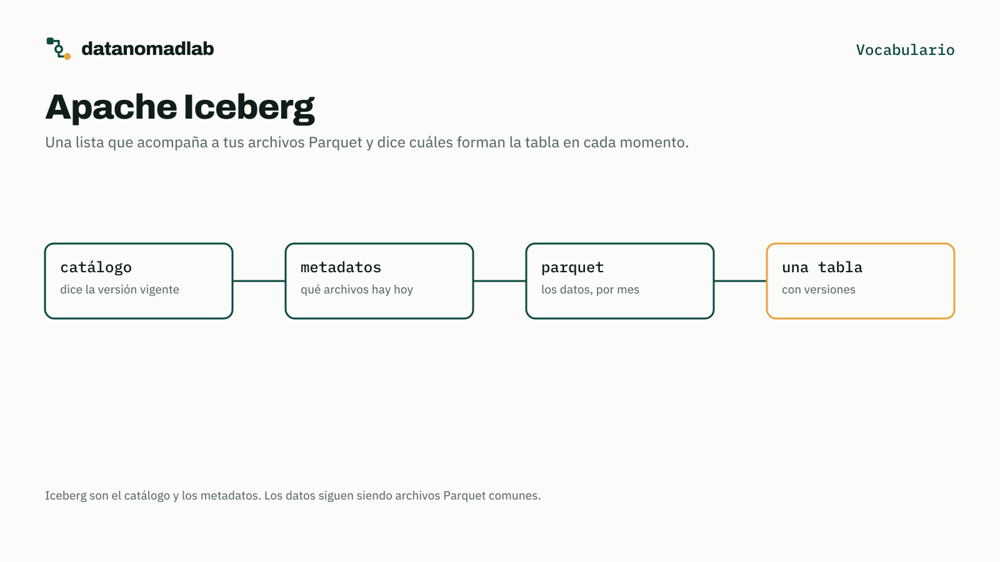

# Apache Iceberg: cómo un montón de archivos se vuelve una tabla

*Qué es un formato de tabla, qué son las versiones y el catálogo, y un ejemplo de 15 líneas para verlo funcionar.*

> Este post es parte del **Vocabulario del Lab**: explicaciones cortas de las herramientas que aparecen en los experimentos, pensadas para quien recién parte o nunca usó esa herramienta en particular. Si llegaste desde un experimento, aquí está lo necesario para seguirlo.



Conviene leer antes el post de [Parquet](parquet.md), porque Iceberg se apoya en él.

## En una frase

Iceberg es una lista ordenada que acompaña a tus archivos Parquet y dice cuáles forman la tabla en cada momento. Con eso la tabla tiene versiones, y varios programas pueden leerla y escribirla sin pisarse. A esa forma de organizar archivos se le llama formato de tabla, y este es abierto: su definición es pública y no pertenece a un proveedor.

## El problema que resuelve

Guardas tus datos como archivos Parquet en una carpeta, un archivo nuevo cada día. Funciona hasta que aparecen preguntas simples:

- ¿Qué archivos forman la tabla hoy? ¿Todos los de la carpeta, o alguno es una prueba que quedó ahí?
- Si una carga falla a la mitad y deja un archivo a medio escribir, ¿quien consulta en ese momento ve datos rotos?
- ¿Cómo estaba la tabla ayer, antes de la carga que salió mal?
- Si quiero agregar una columna, ¿tengo que reescribir todos los archivos?

Con archivos sueltos, las respuestas son convenciones de nombres y buena suerte.

Iceberg guarda, al lado de los datos, unos archivos de anotaciones (metadatos) que dicen exactamente qué archivos componen la tabla en cada momento. Cada cambio crea una versión nueva completa. Quien lee ve la versión anterior o la nueva, nunca algo a medias. Y como el formato es abierto y público, la misma tabla la pueden leer herramientas distintas: [DuckDB](duckdb.md), Spark, Trino o [BigQuery](bigquery.md).

## Las tres palabras que vas a oír siempre

- **Snapshot.** Una versión de la tabla: la lista de archivos que la formaban en un momento. Guardar las versiones permite consultar la tabla como estaba antes, lo que se conoce como viaje en el tiempo.
- **Catálogo.** El registro que dice cuál es la versión vigente de cada tabla. Es lo que consulta un programa antes de leer.
- **Partición.** Una división de los datos según una columna, por ejemplo por mes. Si pides solo marzo, el motor (el programa que ejecuta la consulta, como DuckDB) se salta los archivos de los otros meses sin abrirlos.

La palabra **lakehouse**, que aparece en el nombre del primer experimento, describe justamente esto: datos guardados como archivos baratos en la nube (en un [bucket](bucket.md)), pero ordenados como las tablas de una base de datos de análisis (un warehouse) gracias a un formato como Iceberg.

## Pruébalo en 5 minutos

Necesitas [uv](https://docs.astral.sh/uv/), una herramienta que instala Python y sus librerías en un solo paso. Guarda esto como `probar_iceberg.py`:

```python
import pyarrow as pa
from pyiceberg.catalog.sql import SqlCatalog

catalogo = SqlCatalog("demo", uri="sqlite:///catalogo.db", warehouse="file://./bodega")
catalogo.create_namespace("lab")

lunes = pa.table({"producto": ["café", "té"], "ventas": [10, 4]})
tabla = catalogo.create_table("lab.ventas", schema=lunes.schema)
tabla.append(lunes)                                             # primera versión
tabla.append(pa.table({"producto": ["mate"], "ventas": [7]}))   # segunda versión

print("Ahora:", tabla.scan().to_arrow().num_rows, "filas")
versiones = tabla.snapshots()
print("Versiones guardadas:", len(versiones))
antes = tabla.scan(snapshot_id=versiones[0].snapshot_id).to_arrow()
print("En la primera versión:", antes.num_rows, "filas")
```

Las dos primeras líneas después de los `import` crean el catálogo, que aquí es un archivo llamado `catalogo.db`, y un espacio de nombres `lab` donde vivirá la tabla; los datos quedarán en la carpeta `bodega`. Después se crea la tabla `ventas` y se le agregan datos dos veces. Las últimas líneas la leen como está ahora y como estaba tras la primera carga.

Córrelo:

```bash
uv run --python 3.12 --with 'pyiceberg[sql-sqlite,pyarrow]' python probar_iceberg.py
```

```text
Ahora: 3 filas
Versiones guardadas: 2
En la primera versión: 2 filas
```

Creaste una tabla, le agregaste datos dos veces y luego la leíste como estaba después de la primera carga.

Ahora mira lo que quedó en disco con `find bodega -type f`. Hay dos archivos Parquet en la carpeta `data/`, uno por cada carga, y siete archivos en la carpeta `metadata/`. Esos siete son las anotaciones de Iceberg: ahí está la lista de archivos que corresponde a cada versión (snapshot). Los datos siguen siendo Parquet común.

Para limpiar:

```bash
rm -r bodega catalogo.db probar_iceberg.py
```

## Dónde lo vas a ver en el Lab

- [Experimento 01 · Lakehouse de bolsillo](../01-lakehouse-de-bolsillo/): 9,5 millones de viajes de taxi en una tabla Iceberg particionada por mes. La consulta que pide un solo mes leyó 1 de los 3 archivos de datos.

## Errores típicos cuando partes

- **Creer que reemplaza a Parquet.** Va encima. Sin Parquet no hay datos.
- **Leer los Parquet de `data/` directamente.** Te saltas las anotaciones y puedes leer archivos que ya no pertenecen a la tabla.
- **Olvidar el catálogo.** Sin él nadie sabe cuál es la versión vigente. En el ejemplo es un archivo SQLite en tu disco; en una empresa es un servicio compartido.
- **No limpiar nunca.** Cada cambio deja una versión y sus archivos. Si no se borran las versiones viejas, el almacenamiento crece solo.
- **Particionar y que la escritura falle.** Con PyIceberg, escribir en una tabla particionada exige instalar el extra `pyiceberg-core`. Pasó al armar el experimento 01, y el mensaje de error dice qué instalar.

## Lo que suele confundirse

**Iceberg y Parquet.** Parquet es el formato de cada archivo. Iceberg es el formato de la tabla: dice qué archivos la componen.

**Iceberg, Delta Lake y Hudi.** Son tres formatos de tabla que resuelven el mismo problema con ideas parecidas. Delta Lake nació en Databricks; Iceberg, en Netflix. Hoy la mayoría de los motores lee más de uno.

**Iceberg y una base de datos.** Iceberg no ejecuta consultas. Es una forma de guardar. Para consultar necesitas un motor como DuckDB, Spark o Trino.

## Cuándo no usarlo

Si tus datos son un puñado de archivos que se reemplazan completos una vez al día y los lee una sola herramienta, Parquet en una carpeta alcanza. Iceberg vale la pena cuando hay cargas frecuentes, más de un motor leyendo, o necesidad de volver atrás.

## Para seguir aprendiendo

- [Documentación de Apache Iceberg](https://iceberg.apache.org/docs/latest/), el punto de entrada oficial.
- [PyIceberg](https://py.iceberg.apache.org/), la librería de Python que usa el ejemplo.
- [La especificación del formato](https://iceberg.apache.org/spec/), para quien quiera ver qué hay dentro de cada archivo de metadatos.

## Sigue con

- [Parquet](parquet.md): el formato de los archivos de datos.
- [DuckDB](duckdb.md): el motor que consulta la tabla en el experimento 01.
- [Bucket](bucket.md): dónde vive una tabla Iceberg cuando sale de tu computador.

---

*Este post lo redactó una IA a partir de los experimentos de Data Nomad Lab. Los comandos se corrieron el 17 de noviembre de 2026 y las salidas que ves son las reales.*
