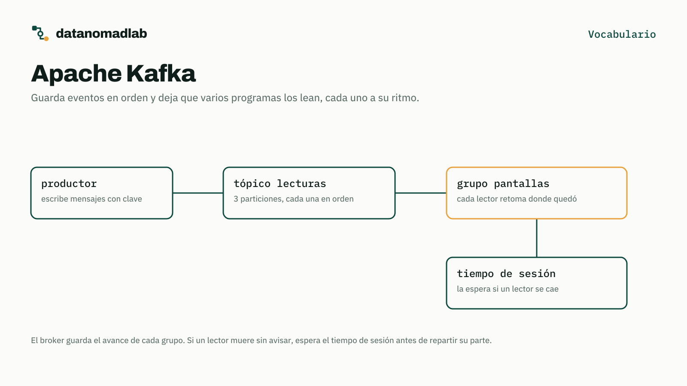

# Apache Kafka: el registro de eventos que cada lector lee a su ritmo

*Qué son un tópico, una partición y un grupo de consumidores, y cuánto tarda Kafka en notar que un lector se cayó.*

> Este post es parte del **Vocabulario del Lab**: explicaciones cortas de las herramientas que aparecen en los experimentos, pensadas para quien recién parte o nunca usó esa herramienta en particular. Si llegaste desde un experimento, aquí está lo necesario para seguirlo.



Conviene leer antes el post de [Docker](docker.md).

## En una frase

Apache Kafka es un programa que recibe eventos (mensajes chicos que dicen "pasó esto"), los guarda en orden y deja que otros programas los lean después, cada uno a su ritmo.

## El problema que resuelve

Tienes sensores de temperatura que mandan lecturas cada pocos segundos y tres programas que las necesitan: una pantalla, una base de datos y unas alarmas. Sin Kafka, quien las recibe llama a los tres, y si uno está caído o lento, se pierden lecturas o se atrasan todos.

Con Kafka, las lecturas se escriben en un solo lugar y quedan guardadas un plazo (de fábrica, siete días). Cada lector avanza por su cuenta y, si se cae, vuelve a donde iba.

El programa de Kafka que queda corriendo es el **broker**. Quienes le escriben son productores; quienes leen, consumidores. A ambos se les llama clientes.

## Las cuatro palabras que vas a oír siempre

- **Tópico:** el nombre bajo el que se guardan mensajes de un mismo tipo, como `lecturas`. Se parece a una tabla donde solo se agregan filas al final.
- **Partición:** cada tópico se divide en varias listas. Cada mensaje puede llevar una clave (aquí, el sensor): los de igual clave caen siempre en la misma lista, y el orden solo se respeta dentro de cada una. El número de un mensaje en su partición es su *offset*.
- **Grupo de consumidores:** programas que leen con el mismo nombre de grupo. El broker les reparte las particiones, así cada mensaje lo procesa uno solo, y guarda hasta qué offset leyó el grupo.
- **Tiempo de sesión:** cada consumidor manda una señal de vida cada pocos segundos. Si pasa este tiempo sin señales, el broker lo da por muerto y entrega sus particiones a otro.

## Pruébalo en 5 minutos

Necesitas Docker abierto. Las herramientas de Kafka vienen en la imagen y se usan con `docker exec`, que ejecuta un comando dentro del contenedor.

Paso 1: levantar un solo broker (la imagen pesa 670 MB). El segundo comando busca el aviso de que partió; si no muestra nada, repítelo.

```bash
docker run -d --name vocab-kafka-broker apache/kafka:4.1.1
docker logs vocab-kafka-broker | grep "Kafka Server started"
```

```text
[2026-11-25 21:50:50,660] INFO [KafkaRaftServer nodeId=1] Kafka Server started (kafka.server.KafkaRaftServer)
```

Paso 2: crear el tópico `lecturas` con 3 particiones. `--bootstrap-server` es la dirección del broker.

```bash
docker exec vocab-kafka-broker /opt/kafka/bin/kafka-topics.sh \
  --bootstrap-server localhost:9092 --create --topic lecturas --partitions 3
```

```text
Created topic lecturas.
```

Paso 3: escribir seis lecturas de tres sensores. Cada línea es `clave:valor` (opciones `--property`). No imprime nada.

```bash
printf 'cocina:21,4\nterraza:14,2\nbodega:9,8\ncocina:21,9\nterraza:13,7\ncocina:22,3\n' | \
  docker exec -i vocab-kafka-broker /opt/kafka/bin/kafka-console-producer.sh \
  --bootstrap-server localhost:9092 --topic lecturas \
  --property parse.key=true --property key.separator=:
```

Paso 4: leerlas con un consumidor del grupo `pantallas`, desde el primer mensaje (`--from-beginning`), que termina al sexto (`--max-messages 6`) y muestra partición, offset y clave.

```bash
docker exec vocab-kafka-broker /opt/kafka/bin/kafka-console-consumer.sh \
  --bootstrap-server localhost:9092 --topic lecturas --group pantallas \
  --from-beginning --max-messages 6 \
  --property print.partition=true --property print.offset=true --property print.key=true
```

```text
Partition:1	Offset:0	terraza	14,2
Partition:1	Offset:1	terraza	13,7
Partition:2	Offset:0	bodega	9,8
Partition:0	Offset:0	cocina	21,4
Partition:0	Offset:1	cocina	21,9
Partition:0	Offset:2	cocina	22,3
Processed a total of 6 messages
```

Cada sensor quedó en una partición, con sus lecturas en orden. Entre sensores no: `terraza` salió antes que `cocina`, escrita primero.

Paso 5: preguntarle al broker hasta dónde leyó el grupo.

```bash
docker exec vocab-kafka-broker /opt/kafka/bin/kafka-consumer-groups.sh \
  --bootstrap-server localhost:9092 --describe --group pantallas
```

```text
GROUP           TOPIC           PARTITION  CURRENT-OFFSET  LOG-END-OFFSET  LAG
pantallas       lecturas        1          2               2               0
pantallas       lecturas        2          1               1               0
pantallas       lecturas        0          3               3               0
```

Son las seis primeras columnas; las otras tres describen al consumidor conectado. `LOG-END-OFFSET` es hasta dónde está escrita la partición; `CURRENT-OFFSET`, hasta dónde leyó el grupo; `LAG`, lo que le falta.

Paso 6: dejar un consumidor del grupo corriendo de fondo (`-d`), darle 10 segundos para entrar al grupo, apagarlo de golpe y pedir el estado del grupo. `pkill -9` no lo deja despedirse; `ConsoleConsumer` es el nombre interno de esa herramienta.

```bash
docker exec -d vocab-kafka-broker /opt/kafka/bin/kafka-console-consumer.sh \
  --bootstrap-server localhost:9092 --topic lecturas --group pantallas
sleep 10
docker exec vocab-kafka-broker pkill -9 -f ConsoleConsumer
docker exec vocab-kafka-broker /opt/kafka/bin/kafka-consumer-groups.sh \
  --bootstrap-server localhost:9092 --describe --group pantallas --state
```

```text
GROUP           COORDINATOR (ID)          ASSIGNMENT-STRATEGY  STATE                #MEMBERS
pantallas       localhost:9092  (1)       range                Stable               1
```

El consumidor ya no existe, pero el broker aún cuenta 1 miembro y ve al grupo estable (`Stable`); `range` es su forma de repartir las particiones. Pregunta de nuevo tras 50 segundos:

```bash
sleep 50
docker exec vocab-kafka-broker /opt/kafka/bin/kafka-consumer-groups.sh \
  --bootstrap-server localhost:9092 --describe --group pantallas --state
```

```text
Consumer group 'pantallas' has no active members.

GROUP           COORDINATOR (ID)          ASSIGNMENT-STRATEGY  STATE                #MEMBERS
pantallas       localhost:9092  (1)       -                    Empty                0
```

Ahora sí lo dio por muerto. El tiempo de sesión de fábrica de esta herramienta es de 45 segundos; mientras, nadie leyó sus particiones.

Paso 7: borrar el contenedor y, con `-v`, los volúmenes que creó.

```bash
docker rm -f -v vocab-kafka-broker
```

Y la imagen: `docker rmi apache/kafka:4.1.1`.

## Dónde lo vas a ver en el Lab

El [experimento 02 · Stream a pantallas en vivo](../02-stream-a-pantallas-en-vivo/) no corre Apache Kafka sino [Redpanda](redpanda.md), otro broker que habla la misma API, con un tópico de 12 particiones y un grupo llamado `pantallas`. Su prueba de corte repite el paso 6: apaga de golpe al lector que entrega los eventos a las pantallas y lo levanta de nuevo.

- **La pantalla quedó congelada** 45 s con el lector escrito en Go y con [Centrifugo](centrifugo.md), y 30 s con el escrito en Node (medido: salió de correr el experimento): el tiempo de sesión de fábrica de cada uno. Con la sesión en 6 s bajó a 5,7 s (medido).
- **En 10 cortes** no se perdió ningún evento y se repitieron entre 7.000 y 34.900 (medido).

## Errores típicos cuando partes

- **"Mi consumidor no muestra nada."** Un grupo nuevo parte desde el final del tópico: solo ve lo que llegue después. Para leer lo anterior: `--from-beginning`, o `auto.offset.reset=earliest` en tu programa.
- **Repetidos después de una caída.** De fábrica, el consumidor anota su avance cada 5 segundos (`auto.commit.interval.ms`), no con cada mensaje. Quien retoma parte de la última anotación: lo leído después llega otra vez.
- **Tu programa conecta y se queda colgado.** El broker le responde con la dirección donde seguir hablándole (`advertised.listeners`); si esa solo vale dentro del contenedor, un programa de fuera queda esperando.

## Lo que suele confundirse

**Kafka y una cola.** En una cola como [SQS](sqs.md), el mensaje se borra una vez procesado. Kafka no borra al leer: otro grupo puede leer el tópico completo.

**Apache Kafka y "la API de Kafka".** Kafka es un programa y también la forma de hablarle. Redpanda entiende esa misma forma: un cliente de Kafka funciona con los dos.

## Cuándo no usarlo

Kafka pide mantener brokers, discos y actualizaciones. Con pocos mensajes y un solo lector, una cola como SQS da menos trabajo; si quieres algo más liviano y propio, [NATS](nats.md).

## Para seguir aprendiendo

- [Introducción](https://kafka.apache.org/41/getting-started/introduction/): los conceptos, con diagramas.
- [Imagen de Docker](https://kafka.apache.org/41/getting-started/docker/): cómo levantarla y configurarla.
- [Configuración del consumidor](https://kafka.apache.org/41/configuration/consumer-configs/): `session.timeout.ms`, `auto.offset.reset` y `auto.commit.interval.ms`.

## Sigue con

- [Redpanda](redpanda.md): el broker del experimento 02.
- [NATS](nats.md): el otro transporte de ese experimento.
- [Kinesis](kinesis.md): el servicio de AWS del que parte ese experimento.

---

*Este post lo redactó una IA a partir de los experimentos de Data Nomad Lab. Los comandos se corrieron el 25 de noviembre de 2026 y las salidas que ves son las reales.*
