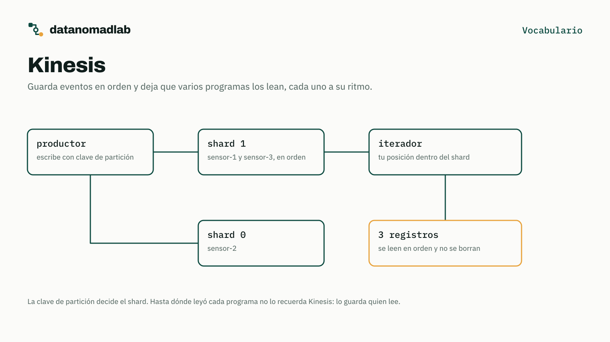

# Kinesis: cómo se escribe y se lee un stream, shard por shard

*Shard, clave de partición e iterador, con un stream que creas y lees en un emulador local.*

> Este post es parte del **Vocabulario del Lab**: explicaciones cortas de las herramientas que aparecen en los experimentos, pensadas para quien recién parte o nunca usó esa herramienta en particular. Si llegaste desde un experimento, aquí está lo necesario para seguirlo.



## En una frase

Amazon Kinesis Data Streams es un servicio de AWS que recibe eventos (datos chicos, como la medición de un sensor), los guarda en orden por un tiempo en una fila llamada stream y deja que varios programas los lean, cada uno a su ritmo.

## El problema que resuelve

Tienes sensores que mandan una medición cada pocos segundos y tres programas que las necesitan. Si cada sensor le hablara directo a cada programa, bastaría que uno se cayera cinco minutos para perderlas.

Con un stream al medio, los sensores escriben en un solo lugar, que guarda cada evento un tiempo (Kinesis lo llama registro). Cada programa anota hasta dónde leyó y, si se cae, retoma desde ahí.

## Las tres palabras que vas a oír siempre

- **Shard:** un stream se reparte en shards, filas independientes que guardan sus registros en orden de llegada. Cada uno acepta una cantidad fija de escrituras y lecturas por segundo: más shards, más capacidad y más costo.
- **Clave de partición:** un texto que acompaña a cada registro y decide en qué shard cae. La misma clave cae siempre en el mismo shard.
- **Iterador de shard:** un marcador de posición dentro de un shard, que vence a los pocos minutos. Pides uno para empezar a leer y cada respuesta trae el siguiente.

## Pruébalo en 5 minutos

**El servicio real pide una cuenta de AWS y cobra. Este ejemplo corre contra un emulador, un programa que imita a Kinesis en tu computador: muestra cómo se usa la API (las operaciones que acepta), pero no cuánto tarda ni cuánto cobra el servicio real.**

Necesitas [Docker](docker.md) abierto y la [CLI de AWS](https://docs.aws.amazon.com/cli/latest/userguide/getting-started-install.html) versión 2, su herramienta para la terminal. El emulador es [kinesis-mock](https://github.com/etspaceman/kinesis-mock).

Paso 1: levantar el emulador. `-p 18160:4568` deja su puerto 4568 (el número donde atiende) en el 18160 de tu máquina. La primera vez descarga la imagen; después imprime el identificador del contenedor.

```bash
docker run -d --name vocab-kinesis-emulador -p 18160:4568 ghcr.io/etspaceman/kinesis-mock:0.6.2
```

Paso 2: preparar la terminal con credenciales de mentira, que la CLI exige y el emulador no revisa. `AWS_PAGER=""` imprime las respuestas directo. Todo lo que sigue va en esta terminal.

```bash
export AWS_ACCESS_KEY_ID=local AWS_SECRET_ACCESS_KEY=local
export AWS_DEFAULT_REGION=us-east-1 AWS_PAGER=""
LOCAL=http://localhost:18160
```

Cada comando lleva `--endpoint-url $LOCAL`, lo único que lo manda al emulador y no a AWS.

Paso 3: crear un stream de 2 shards y esperar a que quede activo. No imprimen nada.

```bash
aws kinesis create-stream --stream-name lecturas --shard-count 2 --endpoint-url $LOCAL
aws kinesis wait stream-exists --stream-name lecturas --endpoint-url $LOCAL
```

Paso 4: escribir una medición con su clave de partición. `--cli-binary-format raw-in-base64-out` avisa que `--data` va como texto.

```bash
aws kinesis put-record --stream-name lecturas --partition-key sensor-1 \
  --data '{"sensor":"sensor-1","temp":21.4}' \
  --cli-binary-format raw-in-base64-out --endpoint-url $LOCAL
```

```text
{
    "ShardId": "shardId-000000000001",
    "SequenceNumber": "49680564290830589695996678862126429861366633217510080530",
    "EncryptionType": "NONE"
}
```

Responde con el shard y el número de secuencia. Tres mediciones más, mostrando solo el shard:

```bash
aws kinesis put-record --stream-name lecturas --partition-key sensor-2 \
  --data '{"sensor":"sensor-2","temp":19.8}' \
  --cli-binary-format raw-in-base64-out --endpoint-url $LOCAL --query ShardId --output text
aws kinesis put-record --stream-name lecturas --partition-key sensor-3 \
  --data '{"sensor":"sensor-3","temp":23.1}' \
  --cli-binary-format raw-in-base64-out --endpoint-url $LOCAL --query ShardId --output text
aws kinesis put-record --stream-name lecturas --partition-key sensor-1 \
  --data '{"sensor":"sensor-1","temp":21.9}' \
  --cli-binary-format raw-in-base64-out --endpoint-url $LOCAL --query ShardId --output text
```

```text
shardId-000000000000
shardId-000000000001
shardId-000000000001
```

`sensor-2` cayó en el shard 0. Las dos mediciones de `sensor-1` cayeron en el 1.

Paso 5: leer el shard 1 con un iterador desde el registro más antiguo (`TRIM_HORIZON`).

```bash
ITERADOR=$(aws kinesis get-shard-iterator --stream-name lecturas \
  --shard-id shardId-000000000001 --shard-iterator-type TRIM_HORIZON \
  --endpoint-url $LOCAL --query ShardIterator --output text)

aws kinesis get-records --shard-iterator $ITERADOR --endpoint-url $LOCAL \
  --query 'Records[].[PartitionKey,Data]' --output text
```

```text
sensor-1	eyJzZW5zb3IiOiJzZW5zb3ItMSIsInRlbXAiOjIxLjR9
sensor-3	eyJzZW5zb3IiOiJzZW5zb3ItMyIsInRlbXAiOjIzLjF9
sensor-1	eyJzZW5zb3IiOiJzZW5zb3ItMSIsInRlbXAiOjIxLjl9
```

Llegan en orden de escritura. El contenido viene en base64, que escribe bytes con letras y números. Para verlo:

```bash
echo eyJzZW5zb3IiOiJzZW5zb3ItMSIsInRlbXAiOjIxLjR9 | base64 --decode
```

```text
{"sensor":"sensor-1","temp":21.4}
```

Paso 6: repetir la lectura con el mismo iterador, contando registros. Si pasaron varios minutos, repite antes el paso 5: el iterador venció.

```bash
aws kinesis get-records --shard-iterator $ITERADOR --endpoint-url $LOCAL --query 'length(Records)'
```

```text
3
```

Siguen los tres: Kinesis no borró nada ni anotó que ya los leíste. Eso le toca a tu programa, que guarda el último número de secuencia leído y con él pide un iterador nuevo.

Paso 7: borrar el emulador, que se lleva el stream. Cierra después la terminal, que quedó con las credenciales de mentira.

```bash
docker rm -f vocab-kinesis-emulador
```

La imagen se borra con `docker rmi ghcr.io/etspaceman/kinesis-mock:0.6.2`.

## Dónde lo vas a ver en el Lab

- [02 · Stream a pantallas en vivo](../02-stream-a-pantallas-en-vivo/): la línea base, contra cuyo costo se compara lo demás, es Kinesis leído con [Flink](flink.md), un motor para procesar streams que aquí opera AWS: USD 2.428 al mes a 10.000 eventos por segundo (modelo: una proyección con supuestos). Además, un programa propio lee Kinesis a 200 eventos por segundo (simulado: contra este mismo emulador). Son 201 líneas (medido: contadas al correr el experimento) que no hacen lo que, más abajo, resuelven KCL o Flink.

## Errores típicos cuando partes

- **Lees otra cosa que la que escribiste.** Sin `--cli-binary-format raw-in-base64-out`, la CLI trata `--data` como base64 y no avisa: en la prueba, `{"sensor":"sensor-3","temp":23.4}` volvió como `sensorsensor3temp234`.
- **Lees con `LATEST` y no llega nada.** Ese iterador parte después del último registro: en la prueba devolvió 0. Usa `TRIM_HORIZON`.
- **Usas una sola clave para todo.** Todo cae en un solo shard. Usa una clave con muchos valores, como el identificador del sensor.
- **Olvidas `--endpoint-url`.** El comando va a AWS: con credenciales de mentira responde `UnrecognizedClientException`; con las reales crea un stream que cobra por hora aunque nadie le escriba.

## Lo que suele confundirse

**Kinesis y [Kafka](kafka.md).** Un shard es lo que Kafka llama partición. Cambia quién lleva la cuenta: en Kafka, el servidor reparte las particiones entre los lectores y guarda el avance de cada uno; en Kinesis, eso le toca a quien lee.

**Leer con la API y leer con KCL o [Flink](flink.md).** El ejemplo lee con la API directa. Para producción faltan tres cosas: repartir los shards entre varias copias del programa, seguir cuando cambia la cantidad de shards (*resharding*) y guardar el avance en un lugar compartido. La Kinesis Client Library (KCL), una librería de Java de AWS, hace las tres; Flink trae su propio lector.

## Cuándo no usarlo

- Fuera de AWS: [Redpanda](redpanda.md) o [NATS](nats.md).
- Para repartir tareas sueltas, sin orden ni relectura: una cola como [SQS](sqs.md), que borra cada mensaje cuando un lector lo confirma.
- Para entregar a pantallas con una herramienta lista: [Centrifugo](centrifugo.md) trae lectores para Kafka, NATS y SQS, no para Kinesis.

## Para seguir aprendiendo

- [Terminología y conceptos](https://docs.aws.amazon.com/streams/latest/dev/key-concepts.html): las definiciones oficiales.
- [Kinesis Client Library](https://docs.aws.amazon.com/streams/latest/dev/kcl.html): qué resuelve KCL.
- [Precios](https://aws.amazon.com/kinesis/data-streams/pricing/) y [cuotas](https://docs.aws.amazon.com/streams/latest/dev/service-sizes-and-limits.html): cuánto cobra y cuánto acepta cada shard.

## Sigue con

- [Kafka](kafka.md): el mismo modelo, con el avance guardado en el servidor.
- [SQS](sqs.md): la cola de AWS, para cuando no necesitas releer.
- [Flink](flink.md): el motor que se suele poner a leer Kinesis.

---

*Este post lo redactó una IA a partir de los experimentos de Data Nomad Lab. Los comandos se corrieron el 25 de noviembre de 2026 y las salidas que ves son las reales.*
