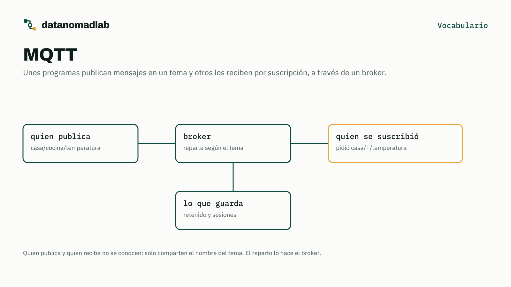

# MQTT: mensajes por temas que te esperan si te desconectas

*Publicar y suscribirse a través de un broker: temas con comodines, tres niveles de QoS, mensaje retenido y sesión persistente.*

> Este post es parte del **Vocabulario del Lab**: explicaciones cortas de las herramientas que aparecen en los experimentos, pensadas para quien recién parte o nunca usó esa herramienta en particular. Si llegaste desde un experimento, aquí está lo necesario para seguirlo.



## En una frase

MQTT es un protocolo (reglas para que dos programas se entiendan por la red) en el que unos publican mensajes en un tema y otros los reciben por haberse suscrito, a través de un intermediario llamado broker.

## El problema que resuelve

Tienes sensores en una casa y tres programas que quieren sus lecturas: una pantalla, una alarma y un script que las guarda. Si cada sensor le envía a cada programa, debe saber dónde está cada uno, y sumar un cuarto obliga a tocar todos los sensores.

Con MQTT nadie se conoce. El sensor entrega su lectura al broker con una etiqueta, `casa/cocina/temperatura`, y cada programa le dice al broker qué etiquetas quiere.

## Las cinco ideas detrás

- **Broker y clientes.** El broker es el programa del medio, que recibe las conexiones, por ejemplo [EMQX](emqx.md); lo demás son clientes.
- **Tema y comodines.** Un tema (*topic*) es un texto con niveles separados por `/`. Al suscribirte, `+` reemplaza un nivel y `#` todos los que sigan: `casa/+/temperatura` recibe la de todas las piezas.
- **QoS** (calidad de servicio). Cuánto se asegura la entrega. QoS 0, a lo más una vez: sin confirmación. QoS 1, al menos una vez: se repite hasta recibir confirmación, así que puede duplicarse. QoS 2: exactamente una vez. Lo pide cada lado, y vale el menor.
- **Mensaje retenido.** El broker guarda el último mensaje marcado así en cada tema y se lo entrega a quien se suscriba después.
- **Sesión persistente.** La sesión es lo que el broker recuerda de un cliente, al que reconoce por su nombre (*client ID*): sus suscripciones y sus mensajes pendientes con QoS 1 o 2. Si la sesión es limpia, se borra al desconectarse; si es persistente, se guarda un tiempo.

## Pruébalo en 5 minutos

Necesitas [Docker](docker.md) abierto. Un broker corre en un contenedor y le hablas desde otros con `mosquitto_sub` y `mosquitto_pub`, los clientes de Mosquitto para la terminal.

Paso 1: crear una red de Docker, para que los contenedores se encuentren por nombre, y levantar el broker (485 MB).

```bash
docker network create vocab-mqtt-red
docker run -d --name vocab-mqtt-broker --network vocab-mqtt-red emqx/emqx:6.3.3
```

Dale unos segundos. `docker exec` corre dentro del contenedor el comando que informa su estado:

```bash
docker exec vocab-mqtt-broker emqx ctl status
```

```text
Node 'emqx@172.20.0.2' 6.3.3 is started
```

Paso 2: dejar un suscriptor de fondo, con comodín. `-h` es la dirección del broker, `-t` el tema y `-v` muestra el tema junto al mensaje.

```bash
docker run -d --name vocab-mqtt-sub --network vocab-mqtt-red eclipse-mosquitto:2.1.4-alpine \
  mosquitto_sub -h vocab-mqtt-broker -t 'casa/+/temperatura' -v
```

Ahora publica tres lecturas (`-m` es el mensaje). La función `mq` solo acorta el comando y vive en esta terminal: sigue en ella. `docker logs` muestra lo que imprimió el suscriptor.

```bash
mq() { docker run --rm --network vocab-mqtt-red eclipse-mosquitto:2.1.4-alpine "$@"; }
mq mosquitto_pub -h vocab-mqtt-broker -t casa/cocina/temperatura -m 21.5
mq mosquitto_pub -h vocab-mqtt-broker -t casa/pieza/temperatura -m 19.0
mq mosquitto_pub -h vocab-mqtt-broker -t casa/cocina/humedad -m 48
docker logs vocab-mqtt-sub
```

```text
casa/cocina/temperatura 21.5
casa/pieza/temperatura 19.0
```

Llegaron las dos temperaturas. La humedad no calza con el comodín.

Paso 3: sesión persistente. `pantalla-1` (`-i` es su nombre) se suscribe con sesión persistente (`-c`) y QoS 1 (`-q 1`), y se va apenas el broker confirma (`-E`). Alguien publica mientras no está. `pantalla-1` vuelve por tres segundos (`-W 3`). Los dos primeros comandos no imprimen.

```bash
mq mosquitto_sub -h vocab-mqtt-broker -i pantalla-1 -c -q 1 -t 'casa/+/temperatura' -E
mq mosquitto_pub -h vocab-mqtt-broker -t casa/pieza/temperatura -m 18.4 -q 1
mq mosquitto_sub -h vocab-mqtt-broker -i pantalla-1 -c -q 1 -t 'casa/+/temperatura' -v -W 3
```

```text
casa/pieza/temperatura 18.4
Timed out
```

El broker le guardó el 18.4; sin `-c` no lo habría hecho. `Timed out`: pasaron los tres segundos.

Paso 4: mensaje retenido. Un suscriptor nuevo pide todo con `#`, se publica una lectura retenida (`-r`) y se suscribe otro.

```bash
mq mosquitto_sub -h vocab-mqtt-broker -t 'casa/#' -v -W 3
mq mosquitto_pub -h vocab-mqtt-broker -t casa/cocina/temperatura -m 22.0 -r
mq mosquitto_sub -h vocab-mqtt-broker -t 'casa/#' -v -W 3
```

```text
Timed out
casa/cocina/temperatura 22.0
Timed out
```

El primero no recibió nada (primer `Timed out`): lo anterior ya pasó. Publicar no imprime. El segundo sí recibió el 22.0 (las otras dos líneas).

Paso 5: borrar todo.

```bash
docker rm -f vocab-mqtt-sub vocab-mqtt-broker
docker network rm vocab-mqtt-red
```

Y las imágenes: `docker rmi emqx/emqx:6.3.3 eclipse-mosquitto:2.1.4-alpine`.

## Dónde lo vas a ver en el Lab

En el [experimento 02](../02-stream-a-pantallas-en-vivo/), una de las combinaciones que compara entrega eventos a pantallas en vivo con EMQX, que los lee de [Redpanda](redpanda.md), compatible con [Kafka](kafka.md). Cada pantalla se suscribe al tema de la cuenta de cliente que muestra (`cuenta:7`, un tema de un solo nivel), con tres decisiones:

- **Sobre WebSocket.** Una página web no puede abrir la conexión directa que MQTT usa normalmente, así que va dentro de un [WebSocket](websocket.md).
- **QoS 1.** Un evento puede llegar repetido, pero no se da por entregado sin confirmación.
- **Sesión persistente.** Cada pantalla tiene nombre fijo y el broker guarda su sesión 30 segundos tras la desconexión. Si se cae el broker, la sesión se pierde con él.

A 10.000 eventos por segundo, el 99 % llegó en 18 ms o menos (medido: salió de correr el experimento). Al matar el broker, la pantalla pasó 29 segundos sin recibir nada (medido) y aun así no se perdió ningún evento (medido): al volver, EMQX releyó de Redpanda desde el último punto que había anotado. Por eso 34.900 llegaron repetidos (medido).

## Errores típicos cuando partes

- **"Publiqué y nadie recibió nada."** MQTT no guarda historial: un mensaje común llega solo a quienes están suscritos en ese instante. Para lo demás están el mensaje retenido y la sesión persistente con QoS 1.
- **Sesión sin nombre fijo.** Si tu librería inventa un nombre en cada conexión, el broker nunca encuentra la sesión anterior.
- **Comodines mal puestos.** `#` solo va al final: `casa/#/temperatura` responde `Error: Invalid subscription topic`.

## Lo que suele confundirse

**MQTT y Kafka.** Los dos tienen broker y temas. Kafka guarda los mensajes en un registro que se puede releer. Un broker MQTT reparte y olvida: solo conserva los retenidos y lo pendiente de cada sesión.

**MQTT y WebSocket.** WebSocket es un canal entre una página y un servidor, y no dice qué significan los mensajes. MQTT es lo que se dice por ese canal: suscríbeme, publica esto, recibido.

## Cuándo no usarlo

- Si necesitas volver a leer lo de ayer: Kafka o Redpanda.
- Si solo envías del servidor a la página: [SSE](sse.md).

## Para seguir aprendiendo

- [Especificaciones de MQTT](https://mqtt.org/mqtt-specification/), la página oficial con las versiones 3.1.1 y 5.0.
- [Página de manual de MQTT](https://mosquitto.org/man/mqtt-7.html) de Mosquitto: un resumen corto.
- [mosquitto_sub](https://mosquitto.org/man/mosquitto_sub-1.html), con las opciones del cliente del ejemplo.

## Sigue con

- [EMQX](emqx.md): el broker del ejemplo.
- [WebSocket](websocket.md): cómo llega MQTT a una página web.
- [Kafka](kafka.md): el registro que guarda lo que MQTT no guarda.

---

*Este post lo redactó una IA a partir de los experimentos de Data Nomad Lab. Los comandos se corrieron el 25 de noviembre de 2026 y las salidas que ves son las reales.*
