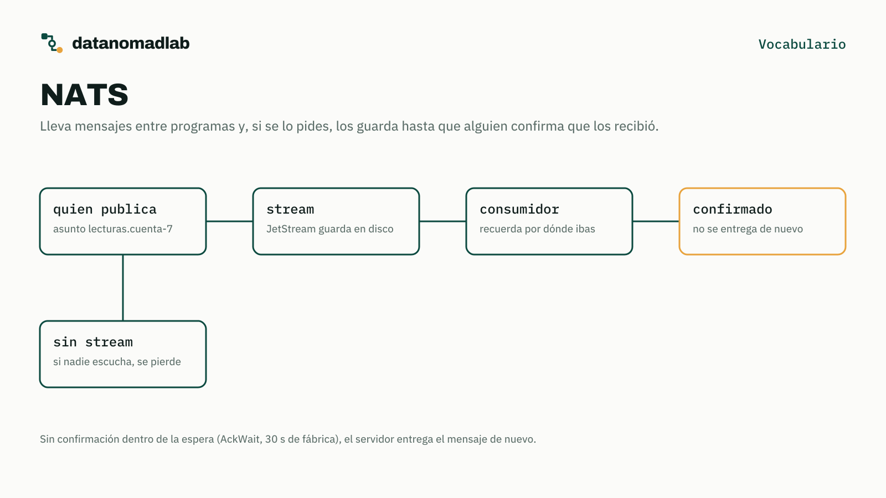

# NATS y JetStream: cuándo un mensaje se pierde y cuándo se guarda

*Qué es NATS, qué le agrega JetStream y por qué una confirmación que no llega atrasa un mensaje 30 segundos.*

> Este post es parte del **Vocabulario del Lab**: explicaciones cortas de las herramientas que aparecen en los experimentos, pensadas para quien recién parte o nunca usó esa herramienta en particular. Si llegaste desde un experimento, aquí está lo necesario para seguirlo.



## En una frase

NATS es un servidor de mensajería: un programa que queda corriendo, recibe mensajes de unos programas y los reparte a los que los pidieron. JetStream es la parte de NATS que además los guarda en disco y anota cuáles recibió cada lector.

## El problema que resuelve

Tienes medidores de luz que mandan una lectura cada pocos segundos y una pantalla que debe mostrarlas al llegar. Si el programa que las recibe le habla directo a la pantalla, tiene que conocer a cada destinatario y decidir qué hacer si uno no contesta.

NATS se pone al medio: el que publica le entrega el mensaje con una etiqueta, y cada interesado pide las etiquetas que quiere.

NATS a secas entrega solo a quien esté conectado; JetStream guarda los mensajes y los entrega cuando el lector vuelve.

## Las cuatro palabras que vas a oír siempre

- **Asunto** (*subject*): la etiqueta del mensaje, con puntos, como `lecturas.cuenta-7`. El comodín `lecturas.>` pide todo lo que empiece con `lecturas.`.
- **Stream:** un registro en disco donde JetStream guarda, en orden de llegada, los mensajes de los asuntos que elijas.
- **Consumidor durable:** un marcador de lectura con nombre que vive en el servidor. Si tu programa se cae, al volver sigue desde ahí.
- **Confirmación** (*ack*) **y su espera** (`AckWait`): al terminar con un mensaje, el lector le avisa al servidor. Si el aviso no llega dentro de la espera (30 segundos de fábrica), el servidor lo entrega otra vez.

## Pruébalo en 5 minutos

Necesitas [Docker](docker.md) abierto.

Paso 1: levantar el servidor. La red de Docker deja que este contenedor y el del paso 2 se encuentren por su nombre; `-js` activa JetStream, que viene apagado.

```bash
docker network create vocab-nats-red
docker run -d --name vocab-nats-servidor --network vocab-nats-red nats:2.15.3 -js
```

Paso 2: abrir una terminal con `nats`, el programa de línea de comandos que habla con el servidor (`NATS_URL` le dice dónde está). El indicador de la terminal cambia: hasta el `exit` del paso 8 todo corre en ese contenedor, que `--rm` borra al salir.

```bash
docker run --rm -it --name vocab-nats-cli --network vocab-nats-red \
  -e NATS_URL=nats://vocab-nats-servidor:4222 natsio/nats-box:0.20.2
```

Paso 3: publicar una lectura cuando nadie escucha.

```bash
nats pub lecturas.cuenta-7 '{"medidor":"m-01","kwh":12.4}'
```

```text
21:48:50 Published 29 bytes to "lecturas.cuenta-7"
```

NATS la publicó, pero nadie estaba suscrito ni la guardó un stream: esa lectura ya no existe.

Paso 4: crear un stream que guarde en disco todo lo que llegue a `lecturas.>`. `--defaults` deja lo demás con sus valores de fábrica.

```bash
nats stream add LECTURAS --subjects 'lecturas.>' --storage file --defaults
```

```text
Stream LECTURAS was created
...
                     Subjects: lecturas.>
                      Storage: File
...
                     Messages: 0
```

`Messages: 0`: la primera lectura se perdió.

Paso 5: publicar tres lecturas de dos cuentas. `--jetstream` espera la respuesta del stream.

```bash
nats pub --jetstream lecturas.cuenta-7 '{"medidor":"m-01","kwh":12.9}'
nats pub --jetstream lecturas.cuenta-7 '{"medidor":"m-02","kwh":3.1}'
nats pub --jetstream lecturas.cuenta-9 '{"medidor":"m-40","kwh":7.7}'
```

```text
21:48:50 Published 29 bytes to "lecturas.cuenta-7"
21:48:50 Stored in Stream: LECTURAS Sequence: 1
21:48:50 Published 28 bytes to "lecturas.cuenta-7"
21:48:50 Stored in Stream: LECTURAS Sequence: 2
21:48:50 Published 28 bytes to "lecturas.cuenta-9"
21:48:50 Stored in Stream: LECTURAS Sequence: 3
```

Paso 6: crear el consumidor durable `pantallas`. Con `--pull` el lector pide los mensajes, con `--ack explicit` confirma cada uno, y `--wait 5s` baja el `AckWait` de 30 a 5 segundos.

```bash
nats consumer add LECTURAS pantallas --pull --ack explicit --wait 5s --defaults
```

```text
              Ack Policy: Explicit
                Ack Wait: 5.00s
...
    Unprocessed Messages: 3
```

Paso 7: leer tres veces. La primera no confirma (`--no-ack`), la segunda sí, y la tercera espera seis segundos.

```bash
nats consumer next LECTURAS pantallas --no-ack
nats consumer next LECTURAS pantallas
sleep 6
nats consumer next LECTURAS pantallas
```

```text
[21:48:50] subj: lecturas.cuenta-7 / tries: 1 / cons seq: 1 / str seq: 1 / pending: 2

{"medidor":"m-01","kwh":12.9}
[21:48:50] subj: lecturas.cuenta-7 / tries: 1 / cons seq: 2 / str seq: 2 / pending: 1

{"medidor":"m-02","kwh":3.1}

Acknowledged message

[21:48:56] subj: lecturas.cuenta-7 / tries: 2 / cons seq: 3 / str seq: 1 / pending: 1

{"medidor":"m-01","kwh":12.9}

Acknowledged message
```

La tercera vez no llegó la lectura de la cuenta 9, sino la primera de nuevo (`str seq: 1`), en su segundo intento (`tries: 2`): nadie la confirmó en 5 segundos y el servidor la entregó otra vez. `cons seq` numera las entregas del consumidor; `pending: 1` es la de la cuenta 9, que sigue esperando. Como cada comando fue una conexión nueva, quien recordó por dónde ibas fue el servidor.

Paso 8: salir y borrar el resto; el stream se va con el servidor.

```bash
exit
docker rm -f vocab-nats-servidor
docker network rm vocab-nats-red
```

Las imágenes (133 MB y 24,4 MB) se borran con `docker rmi natsio/nats-box:0.20.2 nats:2.15.3`.

## Dónde lo vas a ver en el Lab

En [02-stream-a-pantallas-en-vivo](../02-stream-a-pantallas-en-vivo/), cuatro rutas usan NATS con JetStream (una ruta es por dónde viaja un evento más el programa que lo entrega a la pantalla). Cada evento se publica en un asunto por cada cuenta; el stream `EVENTOS` los guarda y los lee un consumidor durable llamado `pantallas`: uno escrito a mano o el que trae [Centrifugo](centrifugo.md).

- Al apagar de golpe el programa que entrega, en tres de ellas la pantalla volvió en menos de 0,4 segundos (medido: salió de correr el experimento). Pero en su peor prueba no llegaron entre 2.121 y 4.016 eventos (medido): el lector los mandó a pantallas que aún no se reconectaban y los confirmó igual. Y los mensajes sin confirmar volvieron a los 30 segundos (medido), al cumplirse el `AckWait` de fábrica y fuera de orden, como en el paso 7.
- La cuarta suma [Redis](redis.md), donde Centrifugo guarda el historial: volvió igual de rápido y sin perder nada en 7 de 8 pruebas; en la otra quedó congelada 30 segundos y no llegaron 208 de 750.000 eventos (medido).

## Errores típicos cuando partes

- **`no responders available for request`.** Sale al crear un stream si el servidor partió sin `-js`, y al publicar con `--jetstream` en un asunto sin stream.
- **"Borré el contenedor y perdí el stream."** JetStream guarda dentro del contenedor. Para conservarlo, elige la carpeta con `-sd` y conéctale un volumen (una carpeta que sobrevive al contenedor).

## Lo que suele confundirse

**NATS y JetStream.** JetStream no es otro producto: viene dentro del mismo servidor. NATS a secas entrega a lo más una vez; JetStream, al menos una vez, y eso incluye repetir: haz que un repetido no haga daño.

**NATS y [Kafka](kafka.md).** Los dos guardan mensajes en orden y cada lector avanza a su ritmo. En Kafka el lector anota hasta qué posición leyó; en JetStream confirma cada mensaje, y el que queda sin confirmar vuelve solo.

## Cuándo no usarlo

Si no quieres operar un servidor propio: un servicio administrado como [SQS](sqs.md) o [Kinesis](kinesis.md). Si tu equipo ya usa herramientas de Kafka: Kafka o Redpanda. Si te bastan avisos en vivo que pueden perderse: no actives JetStream.

## Para seguir aprendiendo

- [What is NATS?](https://docs.nats.io/concepts/what-is-nats), la presentación oficial.
- [Subjects](https://docs.nats.io/concepts/subjects), para armar asuntos y comodines.
- [Ack responses and redelivery](https://docs.nats.io/learn/jetstream/acknowledgment), las formas de confirmar y cómo ajustar `AckWait`.

## Sigue con

- [Kafka](kafka.md): la otra forma de guardar mensajes en orden.
- [Redpanda](redpanda.md): el otro transporte del experimento 02.
- [Centrifugo](centrifugo.md): lee de JetStream y entrega a las pantallas.

---

*Este post lo redactó una IA a partir de los experimentos de Data Nomad Lab. Los comandos se corrieron el 25 de noviembre de 2026 y las salidas que ves son las reales.*
