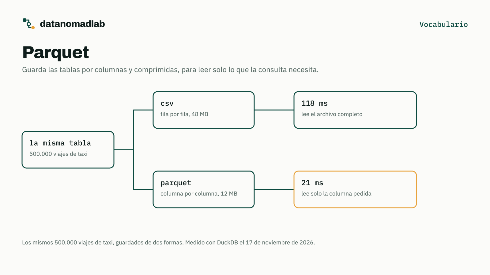

# Parquet: por qué los datos grandes no se guardan en CSV

*Qué significa guardar por columnas, cuánto espacio y tiempo ahorra, y una comparación que puedes repetir en tu computador.*

> Este post es parte del **Vocabulario del Lab**: explicaciones cortas de las herramientas que aparecen en los experimentos, pensadas para quien recién parte o nunca usó esa herramienta en particular. Si llegaste desde un experimento, aquí está lo necesario para seguirlo.



## En una frase

Parquet es un formato de archivo para tablas que guarda los datos por columnas y comprimidos, de modo que una consulta lee solo las columnas que necesita.

## El problema que resuelve

Un CSV guarda fila por fila, como texto. Eso lo hace fácil de abrir y difícil de analizar:

- Para sumar una sola columna de un archivo de 20 columnas, el programa tiene que leer el archivo entero.
- Cada número está escrito como texto y hay que convertirlo antes de sumar.
- El archivo no dice de qué tipo es cada columna. Quien lo lee tiene que adivinar si `01/02/2024` es una fecha, y si es el 1 de febrero o el 2 de enero.

Parquet ordena lo mismo de otra forma. Mira esta tabla de dos filas, primero como la guarda un CSV y después como la ordena Parquet (es un dibujo de la idea, no el contenido real del archivo):

```text
CSV, fila por fila        Parquet, columna por columna
1,ana,10                  1,2
2,luis,20                 ana,luis
                          10,20
```

Parquet junta todos los valores de una columna, los comprime y anota al final del archivo qué columnas hay, de qué tipo es cada una y dónde empieza. Con ese índice, el programa salta directo a lo que le pidieron.

## Las tres ideas detrás

- **Columnar.** Los datos se guardan columna por columna. Los valores de una misma columna se parecen entre sí (todos son fechas, o todos son precios), y lo parecido se comprime bien.
- **Esquema incluido.** La lista de columnas con su tipo viaja dentro del archivo. Nadie adivina nada.
- **Grupos de filas.** El archivo se divide en bloques, y de cada bloque se anota el valor mínimo y máximo de cada columna. Si buscas viajes de marzo y un bloque solo tiene fechas de enero, el programa se lo salta sin leerlo.

## Pruébalo en 5 minutos

Necesitas [DuckDB](duckdb.md) (`brew install duckdb` en Mac). Vas a guardar los mismos 500.000 viajes de taxi de Nueva York como CSV y como Parquet, y a comparar.

Paso 1: bajar 500.000 viajes y guardarlos como CSV. Los datos públicos ya vienen en Parquet, así que primero se pasan a CSV para tener con qué comparar. Los archivos quedan en la carpeta donde estás parado.

```bash
duckdb -c "COPY (SELECT * FROM 'https://d37ci6vzurychx.cloudfront.net/trip-data/yellow_tripdata_2024-01.parquet' LIMIT 500000) TO 'viajes.csv';"
```

Paso 2: convertir ese CSV a Parquet.

```bash
duckdb -c "COPY (SELECT * FROM 'viajes.csv') TO 'viajes.parquet' (FORMAT parquet);"
```

Paso 3: comparar el tamaño.

```bash
ls -lh viajes.*
```

```text
48M viajes.csv
12M viajes.parquet
```

Paso 4: hacerle la misma pregunta a cada archivo.

```bash
time duckdb -c "SELECT round(avg(total_amount), 2) FROM 'viajes.csv';"
time duckdb -c "SELECT round(avg(total_amount), 2) FROM 'viajes.parquet';"
```

Los dos responden 27,81. El tiempo total es la última cifra que imprime `time` en cada caso: el CSV tardó 118 milisegundos y el Parquet 21. Con los mismos datos, el Parquet pesa la cuarta parte y respondió unas cinco veces más rápido, porque leyó una columna de diecinueve.

Paso 5: limpiar.

```bash
rm viajes.csv viajes.parquet
```

Con medio millón de filas la diferencia son milisegundos. Con miles de millones la diferencia se nota en la factura: muchos servicios de la nube cobran por la cantidad de datos que lee cada consulta, así que leer menos es pagar menos.

## Dónde lo vas a ver en el Lab

- [Experimento 01 · Lakehouse de bolsillo](../01-lakehouse-de-bolsillo/): los datos de origen vienen en Parquet y la tabla [Apache Iceberg](iceberg.md) del experimento los guarda en Parquet. Los 9,5 millones de viajes ocupan 164 MB. Sin comprimir serían cerca de 1.378 MB (es una estimación), que es el tamaño por el que cobraría [BigQuery](bigquery.md), un servicio de consultas en la nube.
- [duckdbpoc](../duckdbpoc/), entre los experimentos antiguos, lee un archivo Parquet para armar un tablero.

## Errores típicos cuando partes

- **Abrirlo con un editor de texto.** Es un archivo binario y se ve como basura. Para mirarlo, usa `duckdb -c "DESCRIBE SELECT * FROM 'archivo.parquet'"`.
- **Querer agregar una fila.** Un Parquet no se edita: se escribe completo. Para sumar datos se agrega otro archivo.
- **Miles de archivos diminutos.** Abrir cada archivo tiene un costo fijo. Mil archivos de 100 KB se leen mucho más lento que uno de 100 MB.
- **Pedir `SELECT *`.** Pierdes la ventaja principal, porque obligas a leer todas las columnas.

## Lo que suele confundirse

**Parquet e Iceberg.** Parquet es un archivo. Cuando tienes cientos de archivos Parquet que juntos forman una tabla, hace falta algo que diga cuáles pertenecen a la tabla hoy y cuáles ya no. Eso es un formato de tabla, como Iceberg o Delta Lake. Va encima de Parquet; no lo reemplaza.

**Parquet y una base de datos.** Un Parquet no tiene usuarios, permisos ni transacciones. Es solo un archivo bien organizado. Para consultarlo necesitas un motor, como DuckDB.

**Parquet, ORC y Avro.** ORC es otro formato por columnas, parecido en idea. Avro guarda por filas y se usa más para mover datos entre sistemas que para analizarlos.

## Cuándo no usarlo

Para pasarle un archivo chico a alguien que lo va a abrir en Excel, CSV sigue siendo lo práctico. Y para datos que cambian fila a fila todo el tiempo, como un carrito de compras o un saldo, lo que corresponde es una base de datos como Postgres.

## Para seguir aprendiendo

- [Documentación de Apache Parquet](https://parquet.apache.org/docs/), con el detalle del formato.
- [Parquet en DuckDB](https://duckdb.org/docs/data/parquet/overview), para leerlo y escribirlo con SQL.
- [PyArrow](https://arrow.apache.org/docs/python/), la librería para leerlo y escribirlo desde Python.

## Sigue con

- [DuckDB](duckdb.md): el motor que se usó aquí para leerlo.
- [Apache Iceberg](iceberg.md): qué hacer cuando un archivo ya no alcanza.
- [Bucket](bucket.md): dónde viven estos archivos en la nube y por qué se pueden leer por partes.
- [ELT](elt.md): cómo se llena una carpeta de Parquet cada día, moviendo solo lo nuevo.

---

*Este post lo redactó una IA a partir de los experimentos de Data Nomad Lab. Los comandos se corrieron el 17 de noviembre de 2026 y las salidas que ves son las reales.*
