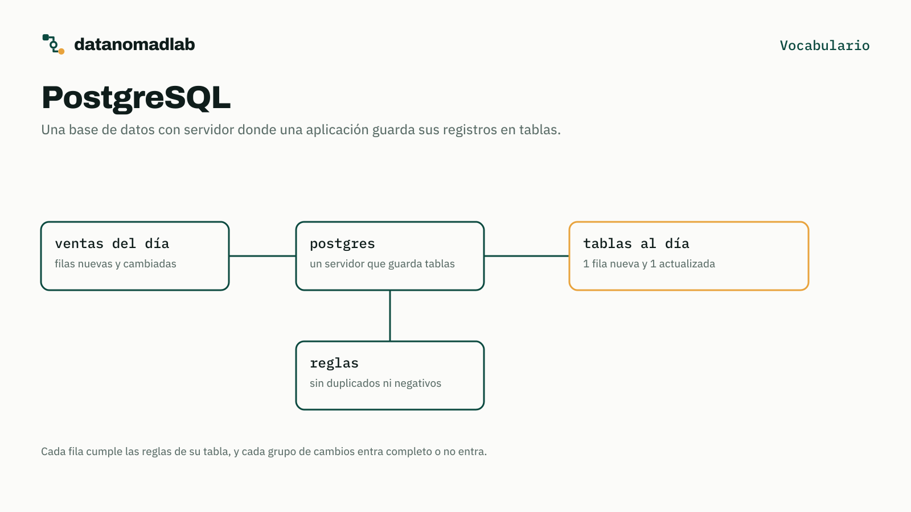

# Postgres: dónde viven los datos de una aplicación y cómo los protege

*Qué es una base de datos con servidor, qué son una llave primaria y una transacción, y cómo cargar ventas sin duplicarlas, en cinco minutos y con Docker.*

> Este post es parte del **Vocabulario del Lab**: explicaciones cortas de las herramientas que aparecen en los experimentos, pensadas para quien recién parte o nunca usó esa herramienta en particular. Si llegaste desde un experimento, aquí está lo necesario para seguirlo.



Conviene leer antes el post de [Docker](docker.md): el ejemplo corre dentro de un contenedor.

## En una frase

PostgreSQL, o Postgres, es una base de datos gratuita donde una aplicación guarda sus registros en tablas, y que deja a muchos programas leer y escribir al mismo tiempo sin que los datos se pierdan ni se mezclen.

## El problema que resuelve

Una tienda anota sus ventas en una planilla compartida. Tarde o temprano dos personas la editan a la vez y una pisa el cambio de la otra, o alguien pega la misma venta dos veces, y el informe del mes no cuadra.

Postgres es un servidor: un programa que queda prendido esperando conexiones. Las aplicaciones le piden en SQL que guarde o busque algo, y él decide si se puede. Si una venta repite su número o trae una cantidad negativa, la rechaza. Si diez puntos de venta escriben en el mismo segundo, ninguna venta se pierde.

## Las cuatro palabras que vas a oír siempre

- **Tabla:** filas y columnas, como una planilla, pero cada columna tiene un tipo fijo (número, texto, fecha).
- **Llave primaria:** la columna que identifica cada fila, como el número de una factura. No puede repetirse.
- **Restricción:** una regla que cada fila debe cumplir para entrar, como "la cantidad es mayor que cero".
- **Transacción:** un grupo de cambios que entra completo o no entra. Si uno falla, los anteriores se deshacen.

## Pruébalo en 5 minutos

Necesitas Docker Desktop abierto.

Paso 1: levantar Postgres 18.7, igual que en el post de Docker, más un volumen (`-v`) para que los datos sobrevivan al contenedor. La imagen crea el usuario `postgres`; la clave y el puerto 55432 sirven para conectarse desde fuera, por ejemplo desde Python. La segunda línea espera a que acepte conexiones.

```bash
docker run -d --name vocab-postgres -e POSTGRES_PASSWORD=lab -p 55432:5432 \
  -v vocab-postgres-datos:/var/lib/postgresql postgres:18.7
until docker exec vocab-postgres pg_isready -h 127.0.0.1 -U postgres; do sleep 1; done
```

```text
127.0.0.1:5432 - no response
127.0.0.1:5432 - accepting connections
```

`no response` es la espera, no un error. La primera vez se descarga la imagen (701 MB).

Paso 2: crear dos tablas con `psql`, el programa de la imagen que le manda SQL al servidor. En `productos` el código es la llave primaria y `numeric(10,2)` es un número con dos decimales. Cada fila de `lineas` debe apuntar a un producto que exista (`REFERENCES`) y tener cantidad mayor que cero (`CHECK`). `NOT NULL` obliga a llenar la columna.

```bash
docker exec vocab-postgres psql -U postgres -c "
CREATE TABLE productos (
  codigo text PRIMARY KEY,
  descripcion text NOT NULL,
  precio numeric(10,2) NOT NULL CHECK (precio >= 0)
);
CREATE TABLE lineas (
  id_linea bigint PRIMARY KEY,
  codigo text NOT NULL REFERENCES productos (codigo),
  cantidad integer NOT NULL CHECK (cantidad > 0)
);
INSERT INTO productos VALUES
  ('TAZA-01', 'taza esmaltada', 4.50),
  ('VELA-02', 'vela aromática', 2.95);
INSERT INTO lineas VALUES (1, 'TAZA-01', 6), (2, 'VELA-02', 12);"
```

```text
CREATE TABLE
CREATE TABLE
INSERT 0 2
INSERT 0 2
```

`INSERT 0 2` quiere decir que entraron dos filas; el 0 se ignora.

Paso 3: una carga diaria suele traer el catálogo entero, con filas que ya están. La taza subió de precio, la vela sigue igual y hay una caja nueva. Un `INSERT` simple fallaría con la taza, cuyo código ya existe. `ON CONFLICT` dice qué hacer entonces: actualizar el precio solo si es distinto (`IS DISTINCT FROM`) del guardado; `EXCLUDED` es la fila que llega. Esto se llama *upsert*: actualizar o insertar.

```bash
docker exec vocab-postgres psql -U postgres -c "
INSERT INTO productos VALUES
  ('TAZA-01', 'taza esmaltada', 4.95),
  ('VELA-02', 'vela aromática', 2.95),
  ('CAJA-03', 'caja de regalo', 1.25)
ON CONFLICT (codigo) DO UPDATE SET precio = EXCLUDED.precio
WHERE productos.precio IS DISTINCT FROM EXCLUDED.precio;" \
  -c "SELECT * FROM productos ORDER BY codigo;"
```

```text
INSERT 0 2
 codigo  |  descripcion   | precio
---------+----------------+--------
 CAJA-03 | caja de regalo |   1.25
 TAZA-01 | taza esmaltada |   4.95
 VELA-02 | vela aromática |   2.95
(3 rows)
```

Llegaron tres filas y Postgres escribió dos: agregó la caja y actualizó la taza. La vela no cambió y no se tocó.

Paso 4: un dato malo dentro de una transacción, que `BEGIN` abre y `COMMIT` intenta confirmar. La segunda línea trae una cantidad negativa. Esta vez el SQL va entre `<<'SQL'` y `SQL` (con `-i`), y `psql` lo lee línea a línea, como si lo escribieras tú.

```bash
docker exec -i vocab-postgres psql -U postgres <<'SQL'
BEGIN;
INSERT INTO lineas VALUES (3, 'CAJA-03', 10);
INSERT INTO lineas VALUES (4, 'TAZA-01', -5);
COMMIT;
SELECT count(*) AS lineas FROM lineas;
SQL
```

```text
BEGIN
INSERT 0 1
ERROR:  new row for relation "lineas" violates check constraint "lineas_cantidad_check"
DETAIL:  Failing row contains (4, TAZA-01, -5).
ROLLBACK
 lineas
--------
      2
(1 row)
```

La restricción rechazó la línea 4 y Postgres deshizo también la 3, que era buena: `COMMIT` terminó en `ROLLBACK`.

Paso 5: dejar la máquina como estaba. El contenedor y el volumen se borran por separado.

```bash
docker rm -f vocab-postgres
docker volume rm vocab-postgres-datos
```

```text
vocab-postgres
vocab-postgres-datos
```

Para recuperar también el espacio de la imagen: `docker rmi postgres:18.7`.

## Dónde lo vas a ver en el Lab

- [Experimento 03 · Pipeline de USD 5 al mes](../03-pipeline-de-usd-5-al-mes/): Postgres 18.7 en Docker es la base de ventas de una pyme. Sus cuatro tablas (clientes, productos, facturas y líneas) reciben las ventas día a día con el `ON CONFLICT` del paso 3 y pesan 46 MB (medido). De ahí [dlt](dlt.md) copia solo lo nuevo a archivos [Parquet](parquet.md), la primera parte de un [ELT](elt.md).
- Entre los experimentos antiguos: [psqlvector](../psqlvector/) y [psqlpower](../psqlpower/) prueban extensiones, complementos que le suman funciones (búsqueda por significado, mapas); [dbtpsql](../dbtpsql/) y [dbtbetweenbbdds](../dbtbetweenbbdds/) transforman tablas con SQL dentro de Postgres; en [etl1](../etl1/) es la base de donde salen los datos.

## Errores típicos cuando partes

- **Conectarte apenas lo levantas.** Postgres tarda unos segundos más que el contenedor. Espera con `pg_isready`.

  ```text
  psql: error: connection to server on socket "/var/run/postgresql/.s.PGSQL.5432" failed: No such file or directory
  ```

- **Cargar dos veces lo mismo con un `INSERT` simple.** La llave primaria lo frena y la carga se cae. Si la carga se repite, usa `ON CONFLICT`.

  ```text
  ERROR:  duplicate key value violates unique constraint "productos_pkey"
  DETAIL:  Key (codigo)=(TAZA-01) already exists.
  ```

- **Copiar la ruta del volumen de un tutorial antiguo.** Hasta la versión 17 era `/var/lib/postgresql/data`; desde la 18 el contenedor no arranca con esa ruta. Usa `/var/lib/postgresql`.

  ```text
  Error: in 18+, these Docker images are configured to store database data in a
         format which is compatible with "pg_ctlcluster" (specifically, using
         major-version-specific directory names).
  ```

## Lo que suele confundirse

**Postgres y psql.** Postgres es el servidor que guarda los datos. `psql` es un cliente que se conecta a él, como una librería de Python.

**Postgres y [DuckDB](duckdb.md).** Los dos entienden SQL. Postgres atiende a una aplicación: muchas operaciones chicas de muchos usuarios. DuckDB atiende al análisis: pocas consultas grandes, sin servidor. En el experimento 03 trabajan juntos.

## Cuándo no usarlo

- Para informes sobre años de ventas: consulta una copia con DuckDB, o con un warehouse como [BigQuery](bigquery.md), y no frenas a la aplicación.
- Para un programa de una sola persona: SQLite, un archivo sin servidor.
- Para datos de corta vida leídos miles de veces por segundo: [Redis](redis.md), en memoria.

## Para seguir aprendiendo

- [Tutorial oficial](https://www.postgresql.org/docs/18/tutorial.html), que parte de cero con tablas y consultas.
- [Restricciones](https://www.postgresql.org/docs/18/ddl-constraints.html): llaves primarias, `CHECK` y referencias entre tablas.
- [INSERT y ON CONFLICT](https://www.postgresql.org/docs/18/sql-insert.html), con todas las formas del upsert.
- [Versiones vigentes](https://www.postgresql.org/support/versioning/) y hasta cuándo recibe arreglos cada una.

## Sigue con

- [Docker](docker.md): cómo se levanta Postgres sin instalarlo.
- [dlt](dlt.md): la librería que lee de Postgres solo lo nuevo.
- [ELT](elt.md): por qué los datos salen de Postgres antes de transformarse.
- [DuckDB](duckdb.md): dónde se analizan después.

---

*Este post lo redactó una IA a partir de los experimentos de Data Nomad Lab. Los comandos se corrieron el 27 de noviembre de 2026 y las salidas que ves son las reales.*
