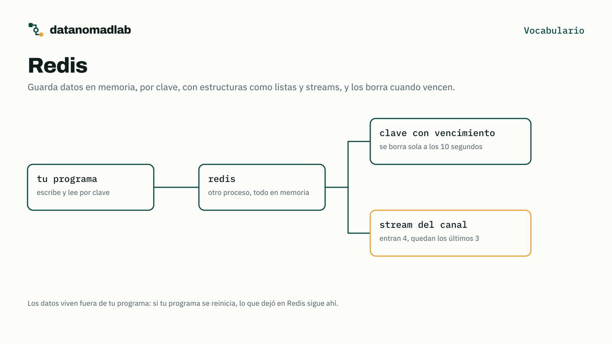

# Redis: datos en memoria que sobreviven al reinicio de tu programa

*Qué es un almacén en memoria y cómo guardar un valor que vence solo y el historial corto de un canal.*

> Este post es parte del **Vocabulario del Lab**: explicaciones cortas de las herramientas que aparecen en los experimentos, pensadas para quien recién parte o nunca usó esa herramienta en particular. Si llegaste desde un experimento, aquí está lo necesario para seguirlo.



## En una frase

Redis es un programa que queda corriendo (un servidor) y guarda datos en memoria, cada uno bajo un nombre, para que otros programas los escriban y los lean por la red.

## El problema que resuelve

Tienes un programa que recibe lecturas de sensores de temperatura y las muestra en pantallas. Guarda en una variable los últimos mensajes de cada sala, para la pantalla que se conecta tarde. Cuando el programa se reinicia, la variable desaparece. Y si levantas una segunda copia para repartir el trabajo, ninguna ve lo que guardó la otra.

Con Redis esos datos quedan en otro programa, también en memoria: el tuyo puede caerse y volver, todas las copias ven lo mismo y cada dato puede llevar un plazo para borrarse solo.

## Las cuatro palabras que vas a oír siempre

- **Clave:** el nombre bajo el que guardas algo, como `sensor:7:temperatura`. No hay tablas: todo se pide por su clave.
- **Estructura:** detrás de una clave puede haber un texto, una lista, un diccionario o un stream: un registro al que solo se le agregan mensajes al final.
- **Vencimiento (TTL):** los segundos de vida de una clave. Cuando se cumplen, Redis la borra.
- **Persistencia:** cómo copia Redis su memoria al disco para no partir vacío tras un reinicio. De fábrica guarda una foto cada cierto tiempo; la otra opción es anotar cada escritura.

## Pruébalo en 5 minutos

Necesitas [Docker](docker.md) abierto; ese post explica qué es un contenedor.

Paso 1: levantar Redis 8 de fondo (`-d`) y con nombre.

```bash
docker run -d --name vocab-redis-demo redis:8-alpine
```

Paso 2: abrir `redis-cli`, el cliente de terminal que viene en la misma imagen.

```bash
docker exec -it vocab-redis-demo redis-cli
```

```text
127.0.0.1:6379>
```

Lo que sigue se escribe ahí, un comando a la vez.

Paso 3: guardar un valor con 10 segundos de vida (`EX 10`), leerlo y preguntar cuánto le queda.

```text
SET sensor:7:temperatura 21.5 EX 10
GET sensor:7:temperatura
TTL sensor:7:temperatura
```

```text
OK
"21.5"
(integer) 10
```

Espera 10 segundos y pídelo de nuevo.

```text
GET sensor:7:temperatura
```

```text
(nil)
```

`(nil)` es «no existe». Nadie la borró: venció.

Paso 4: guardar el historial de un canal (aquí, una sala) en un stream. `XADD` agrega un mensaje de pares campo-valor (`sensor 7 temperatura 21.5`), `MAXLEN 3` conserva los 3 más nuevos y `*` deja que Redis ponga el identificador. `XLEN` los cuenta y `XRANGE` los muestra del primero (`-`) al último (`+`).

```text
XADD canal:sala-a MAXLEN 3 * sensor 7 temperatura 21.5
XADD canal:sala-a MAXLEN 3 * sensor 9 temperatura 19.2
XADD canal:sala-a MAXLEN 3 * sensor 7 temperatura 21.7
XADD canal:sala-a MAXLEN 3 * sensor 9 temperatura 19.4
XLEN canal:sala-a
XRANGE canal:sala-a - +
```

```text
"1795643378338-0"
"1795643378339-0"
"1795643378340-0"
"1795643378340-1"
(integer) 3
1) 1) "1795643378339-0"
   2) 1) "sensor"
      2) "9"
      3) "temperatura"
      4) "19.2"
2) 1) "1795643378340-0"
   2) 1) "sensor"
      2) "7"
      3) "temperatura"
      4) "21.7"
3) 1) "1795643378340-1"
   2) 1) "sensor"
      2) "9"
      3) "temperatura"
      4) "19.4"
```

Entraron cuatro y quedan tres: el de 21.5 salió solo. Los identificadores los pone Redis (los tuyos serán otros); con ellos, un lector pide lo que vino después del último que vio.

Paso 5: darle 60 segundos de vida al canal y salir.

```text
EXPIRE canal:sala-a 60
exit
```

```text
(integer) 1
```

`1`: el plazo quedó puesto.

Paso 6: borrar el contenedor, con sus datos.

```bash
docker rm -f vocab-redis-demo
```

## Dónde lo vas a ver en el Lab

En el [experimento 02 · Stream a pantallas en vivo](../02-stream-a-pantallas-en-vivo/), Redis no guarda los datos del negocio, solo el historial de cada canal de [Centrifugo](centrifugo.md), la pieza que empuja eventos a las pantallas: hasta 300 mensajes por 60 segundos. Sin Redis, Centrifugo lo tiene en su memoria y lo pierde al reiniciarse.

La prueba fue el corte: apagar de golpe a Centrifugo y levantarlo de inmediato, con [NATS](nats.md) trayendo los eventos. Con Redis se hizo 8 veces; sin Redis, 2:

- **Con Redis** no perdió nada en 7 de 8 cortes: las pantallas pidieron el historial y Redis seguía vivo. En uno se congeló 30 segundos y no llegaron 208 eventos (medido: salió de correr el experimento).
- **Sin Redis**, hasta 4.016 eventos no llegaron a ninguna pantalla (medido).
- **El costo:** con Redis aguantó 10.000 eventos por segundo y no 20.000; sin Redis, los 80.000 del tope de la prueba (medido).

Apagar a Redis mismo quedó sin medir.

## Errores típicos cuando partes

- **«Se cayó Redis y perdí lo último.»** Si se detiene con aviso (`docker restart`), guarda antes de salir; si lo apagan de golpe (`docker kill`), se pierde lo escrito desde la última foto. Para evitarlo, activa el registro de cada escritura (`--appendonly yes` al partir `redis-server`) y monta en `/data` un volumen: una carpeta que Docker guarda fuera del contenedor.
- **Claves que no vencen.** Sin vencimiento quedan para siempre (`TTL` responde `-1`), y un `SET` sobre una clave que lo tenía se lo quita.
- **La memoria se llena.** Sin tope, como viene, crece hasta agotar la memoria de la máquina. Con tope (`maxmemory`), al llenarse rechaza escrituras (`OOM command not allowed`) o bota claves, según la política que elijas.
- **Abrirlo hacia fuera.** La imagen viene sin contraseña: si publicas su puerto (`-p 6379:6379` en el `docker run`), quien llegue a tu máquina lee y borra todo.

## Lo que suele confundirse

**Redis y Postgres.** Postgres escribe en disco, en tablas, y se consulta con SQL: es el registro oficial. Redis tiene los datos en memoria y los entrega por clave; suele acompañarlo como caché: una copia de lo que cuesta calcular.

**Un stream de Redis y [Kafka](kafka.md).** En los dos los mensajes se agregan al final. Kafka los escribe en disco y hace de transporte: mueve eventos entre sistemas. El stream vive en memoria, dentro de una clave.

**Redis y «código abierto».** Desde Redis 8 puedes elegir la licencia (las condiciones de uso) AGPLv3, que es de código abierto; entre la 7.4 y la 8, las licencias disponibles no lo eran.

## Cuándo no usarlo

- Si el dato es el registro oficial o no cabe en memoria: una base de datos en disco, como Postgres.
- Si hay una sola copia de tu programa y da lo mismo perder el dato: basta una variable.

## Para seguir aprendiendo

- [Tipos de datos](https://redis.io/docs/latest/develop/data-types/): las estructuras y sus comandos.
- [Persistencia](https://redis.io/docs/latest/operate/oss_and_stack/management/persistence/): qué se pierde con cada forma de guardar en disco.
- [Licencias](https://redis.io/legal/licenses/): cuál aplica a cada versión y qué permite.

## Sigue con

- [Centrifugo](centrifugo.md): quien guarda su historial en Redis.
- [NATS](nats.md): quien trae los eventos en esa prueba.
- [Kafka](kafka.md): el registro en disco con el que se confunde un stream.

---

*Este post lo redactó una IA a partir de los experimentos de Data Nomad Lab. Los comandos se corrieron el 25 de noviembre de 2026 y las salidas que ves son las reales.*
