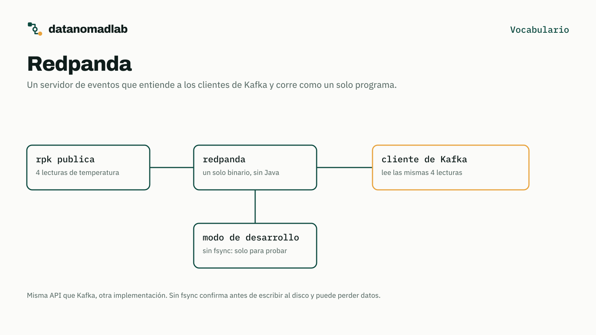

# Redpanda: cómo probar la API de Kafka con un solo contenedor

*Qué es frente a Apache Kafka, cómo usarlo con rpk, qué apaga su modo de desarrollo y cómo es su licencia hoy.*

> Este post es parte del **Vocabulario del Lab**: explicaciones cortas de las herramientas que aparecen en los experimentos, pensadas para quien recién parte o nunca usó esa herramienta en particular. Si llegaste desde un experimento, aquí está lo necesario para seguirlo.



Conviene leer antes el post de [Kafka](kafka.md).

## En una frase

Redpanda es un broker de eventos (un servidor que recibe mensajes de unos programas, los guarda en orden y se los entrega a otros) que entiende la misma API (las mismas órdenes) que Apache Kafka sin ser Kafka.

## El problema que resuelve

Quieres probar una idea que necesita Kafka: un programa publica lecturas de sensores y otro las lee. Lo habitual es Apache Kafka, que corre sobre Java: fuera de Docker, su guía oficial pide instalar antes Java 17 o superior.

Redpanda escribe ese servidor de nuevo, como un solo programa, y deja igual lo que ven los programas clientes: tu código se conecta sin enterarse del cambio.

## Las tres ideas detrás

- **Misma API, otra implementación.** Redpanda implementa con código propio las órdenes de Kafka (crear un tópico, publicar, leer). Según su documentación, sirven los clientes hechos para Kafka 0.11 o posterior.
- **Un solo binario.** Un binario es el archivo ejecutable de un programa. Redpanda es uno solo y no necesita Java.
- **rpk.** Su herramienta de línea de comandos. Viene en la misma imagen de [Docker](docker.md).

## Pruébalo en 5 minutos

Necesitas Docker abierto y, para el paso 5, [uv](https://docs.astral.sh/uv/), que baja Python y sus librerías y corre código con ellas.

Paso 1: levantar Redpanda con la imagen del experimento 02, en modo de desarrollo (paso 6), con un núcleo de procesador (`--smp 1`; sin eso los toma todos) y 1 GB de memoria. `-p` deja el puerto 18120 del contenedor en el mismo de tu equipo; `--kafka-addr` es donde escucha el broker; `--advertise-kafka-addr`, la dirección que da a los clientes, y `--default-log-level=warn` limita el registro a avisos y errores.

```bash
docker run -d --name vocab-redpanda-broker -p 18120:18120 \
  docker.redpanda.com/redpandadata/redpanda:v26.3.1 \
  redpanda start --mode dev-container --smp 1 --memory 1G \
  --kafka-addr 0.0.0.0:18120 --advertise-kafka-addr localhost:18120 \
  --default-log-level=warn
```

La imagen pesa 526 MB. Parte en unos cinco segundos: si el paso 2 responde `OK`, partió; si falla, repítelo.

Paso 2: crear el tópico `lecturas` con 3 particiones. `docker exec` corre `rpk` dentro del contenedor.

```bash
docker exec vocab-redpanda-broker rpk topic create lecturas -p 3
```

```text
TOPIC     STATUS
lecturas  OK
```

Paso 3: publicar cuatro lecturas. En cada línea, la primera palabra es la clave (qué sensor) y el resto, el valor.

```bash
printf 'bodega {"temp": 4.2}\npatio {"temp": 18.6}\nbodega {"temp": 4.5}\npatio {"temp": 18.9}\n' \
  | docker exec -i vocab-redpanda-broker rpk topic produce lecturas -f '%k %v\n'
```

```text
Produced to partition 1 at offset 0 with timestamp 1795643593049.
Produced to partition 1 at offset 1 with timestamp 1795643593049.
Produced to partition 2 at offset 0 with timestamp 1795643593049.
Produced to partition 2 at offset 1 with timestamp 1795643593049.
```

Las líneas salen agrupadas por partición, no en el orden escrito: las dos primeras son de `patio` (paso 4).

Paso 4: leerlas con `rpk`. Sin `--num 4` se queda esperando mensajes nuevos.

```bash
docker exec vocab-redpanda-broker rpk topic consume lecturas --num 4 \
  -f 'partición %p, posición %o, %k: %v\n'
```

```text
partición 2, posición 0, bodega: {"temp": 4.2}
partición 2, posición 1, bodega: {"temp": 4.5}
partición 1, posición 0, patio: {"temp": 18.6}
partición 1, posición 1, patio: {"temp": 18.9}
```

Cada clave quedó en una partición, en orden.

Paso 5: leerlas desde tu equipo con `kafka-python`, una librería de Python escrita para Kafka; `python-snappy` descomprime lo que `rpk` publicó comprimido. Pega el bloque entero, hasta `EOF`: no crea archivos, y el programa termina solo tras 3 segundos sin mensajes.

```bash
uv run --no-project --with kafka-python --with python-snappy python - <<'EOF'
from kafka import KafkaConsumer

lector = KafkaConsumer(
    "lecturas",
    bootstrap_servers="localhost:18120",
    auto_offset_reset="earliest",
    consumer_timeout_ms=3000,
)
for m in lector:
    print(m.partition, m.offset, m.key.decode(), m.value.decode())
EOF
```

```text
2 0 bodega {"temp": 4.2}
2 1 bodega {"temp": 4.5}
1 0 patio {"temp": 18.6}
1 1 patio {"temp": 18.9}
```

Una librería que no conoce Redpanda leyó lo mismo: eso es «misma API».

Paso 6: ver qué activa `--mode dev-container`, el modo de desarrollo (salida recortada).

```bash
docker exec vocab-redpanda-broker rpk redpanda start --mode help
```

```text
--mode dev-container
    Bundled flags:
        * --overprovisioned
        * --reserve-memory 0M
        * --check=false
        * --unsafe-bypass-fsync
    ...
    Bundled cluster properties:
        * auto_create_topics_enabled: true
        ...
        * write_caching_default: true
```

`fsync` es la llamada con que un programa pide al sistema operativo escribir de verdad en el disco. Importan dos líneas: `--unsafe-bypass-fsync` se la salta, y `write_caching_default: true` confirma cada mensaje sin esperar al disco. Si se corta la luz, se pierden mensajes ya confirmados: es solo para pruebas.

Paso 7: borrar el contenedor y, con `-v`, el volumen que la imagen crea para los datos.

```bash
docker rm -f -v vocab-redpanda-broker
```

## Dónde lo vas a ver en el Lab

En el [experimento 02, Stream a pantallas en vivo](../02-stream-a-pantallas-en-vivo/), Redpanda es el broker de 6 de las 13 rutas (una ruta es el broker por donde viaja un evento más el programa que lo entrega a la pantalla): lo entregan consumidores propios en Go y Node, [Centrifugo](centrifugo.md), [Zilla](zilla.md) y [EMQX](emqx.md). A 10.000 eventos por segundo, el 99 % llegó a la pantalla en 22 ms o menos en las seis (p99, medido: salió de correr el experimento), y Redpanda ocupó entre 0,08 y 0,12 núcleos (medido).

**Por qué esas cifras tienen un límite.** El experimento corre en modo de desarrollo (paso 6). En producción, si quien publica pide que el mensaje esté guardado antes de confirmárselo (`acks=all`), Redpanda hace `fsync` de cada escritura; eso cuesta tiempo y CPU, y aquí no ocurre. Las cifras sirven para comparar rutas en la misma máquina, no para un broker que conserva lo confirmado aunque se corte la luz.

## Errores típicos cuando partes

- **El cliente conecta y después se queda colgado.** Desde otro contenedor, `rpk cluster info` respondió y `rpk topic consume` quedó esperando sin error: el broker manda al cliente a `localhost:18120`, que ahí es ese otro contenedor. Pon en `--advertise-kafka-addr` un nombre que el cliente alcance.
- **`UnsupportedCodecError: Libraries for snappy compression codec not found`.** Sale en el paso 5 sin `python-snappy`.

## Lo que suele confundirse

**Redpanda y Kafka.** Comparten la API, no el código: Redpanda acepta algunas configuraciones de tópico de Kafka sin que tengan efecto, para que las herramientas no fallen.

**Redpanda y código abierto.** Kafka tiene licencia Apache 2.0. Redpanda no es código abierto: usa la Redpanda Community Edition License. Según su página oficial al 25 de noviembre de 2026:

- Es gratis, también en producción, hasta 50 núcleos sumando todos los clústeres (varios brokers trabajando juntos) de tu organización, incluidos los de prueba. Sobre eso pide una llave de licencia.
- No puedes ofrecerlo a terceros como servicio comercial de streaming o de colas, ni modificarlo.
- Desde la versión 26.3 cada clúster revisa el límite: si lo pasa sigue funcionando, pero registra avisos y rechaza actualizarse.

## Cuándo no usarlo

- Si exiges código abierto o pasas de 50 núcleos sin pagar: Apache Kafka.
- Si no necesitas la API de Kafka: [NATS](nats.md), más liviano.
- Si no quieres operar brokers: un servicio administrado como [Kinesis](kinesis.md) o [SQS](sqs.md).

## Para seguir aprendiendo

- [Kafka Compatibility](https://docs.redpanda.com/streaming/current/develop/kafka-clients/): clientes probados y excepciones.
- [rpk redpanda start](https://docs.redpanda.com/streaming/current/reference/rpk/rpk-redpanda/rpk-redpanda-start/): lo que activa `dev-container`.
- [Licencias](https://docs.redpanda.com/streaming/current/get-started/licensing/overview/) y [límite de núcleos](https://docs.redpanda.com/streaming/current/get-started/licensing/core-limit/): qué puedes correr sin pagar.

## Sigue con

- [Kafka](kafka.md): tópico, partición y grupo de consumidores.
- [NATS](nats.md): el otro transporte del experimento 02.
- [Centrifugo](centrifugo.md): quien lee de Redpanda y entrega a las pantallas.

---

*Este post lo redactó una IA a partir de los experimentos de Data Nomad Lab. Los comandos se corrieron el 25 de noviembre de 2026 y las salidas que ves son las reales.*
