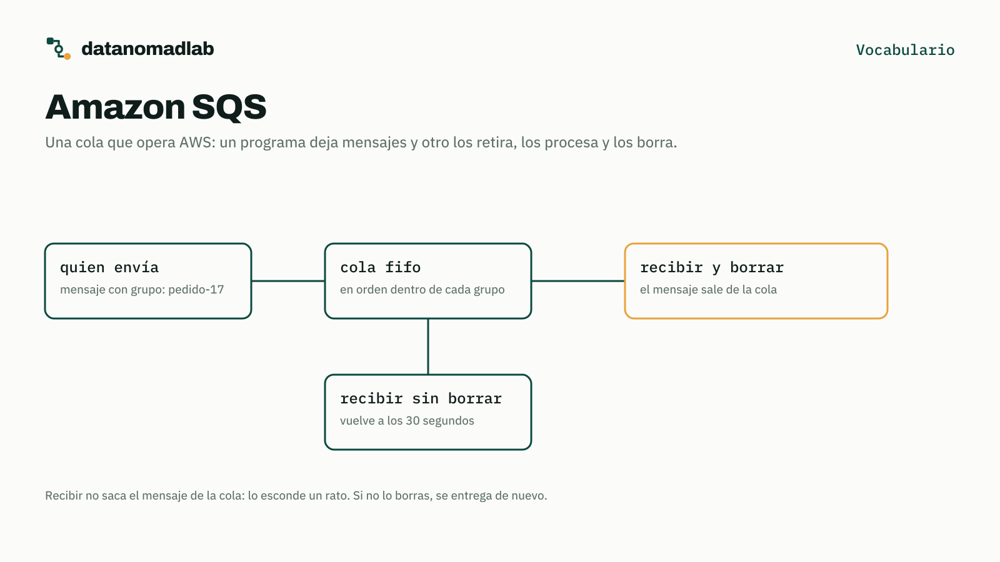

# SQS: una cola que cobra por solicitud y, si es FIFO, entrega en orden

*Qué es una cola de mensajes, qué agrega una FIFO y cómo probarla contra un emulador.*

> Este post es parte del **Vocabulario del Lab**: explicaciones cortas de las herramientas que aparecen en los experimentos, pensadas para quien recién parte o nunca usó esa herramienta en particular. Si llegaste desde un experimento, aquí está lo necesario para seguirlo.



## En una frase

Amazon SQS es una cola de mensajes que opera AWS: un programa deja mensajes y otro los retira, los procesa y los borra, sin que ambos tengan que estar disponibles a la vez.

## El problema que resuelve

Tu tienda en línea recibe un pedido y tiene que avisarle a bodega. Si llama directo al programa de bodega y está caído, el aviso se pierde. Con una cola al medio, deja un mensaje ("pedido 17 creado") y sigue; bodega lo retira cuando puede.

## Las cuatro ideas detrás

- **Cola estándar y cola FIFO.** La estándar aguanta casi cualquier volumen, pero puede repetir un mensaje y no garantiza el orden. La FIFO (*first in, first out*: sale primero lo que entró primero) respeta el orden y descarta envíos repetidos, a cambio de un tope de llamadas por segundo.
- **Grupo de mensajes.** Una etiqueta que pones al enviar a una cola FIFO, como el número del pedido. El orden vale dentro de cada grupo, no entre grupos.
- **Tiempo de visibilidad.** Recibir un mensaje no lo saca de la cola: lo esconde un rato. Si lo borras en ese plazo, desaparece; si no, se entrega de nuevo.
- **Cobro por solicitud.** SQS cobra por cada solicitud (cada llamada a la API, las operaciones del servicio), y una solicitud puede llevar hasta 10 mensajes. Las tarifas están en la [página oficial de precios](https://aws.amazon.com/sqs/pricing/).

## Pruébalo en 5 minutos

**Este ejemplo corre contra un emulador, no contra SQS**, porque el servicio real pide una cuenta de AWS. [ElasticMQ](https://github.com/softwaremill/elasticmq) imita a SQS en tu computador: **muestra cómo se usa la API, pero no cuánto tarda ni cuánto cobra el servicio real.**

Necesitas [Docker](docker.md) abierto y la [CLI de AWS](https://docs.aws.amazon.com/cli/latest/userguide/getting-started-install.html), su herramienta para la terminal.

Paso 1: levantar el emulador. `-p 18170:9324` deja su puerto 9324 (el número donde atiende) en el 18170 de tu máquina.

```bash
docker run -d --name vocab-sqs-emulador -p 18170:9324 softwaremill/elasticmq-native:1.7.1
```

Paso 2: apuntar la CLI al emulador con `AWS_ENDPOINT_URL`, solo en esta terminal. Las credenciales son inventadas: el emulador no las revisa. `AWS_PAGER=""` imprime las respuestas directo.

```bash
export AWS_ACCESS_KEY_ID=local AWS_SECRET_ACCESS_KEY=local
export AWS_DEFAULT_REGION=us-east-1
export AWS_ENDPOINT_URL=http://localhost:18170
export AWS_PAGER=""
```

Paso 3: crear una cola FIFO, con nombre terminado en `.fifo` y 30 segundos de tiempo de visibilidad.

```bash
aws sqs create-queue --queue-name pedidos.fifo --attributes FifoQueue=true,VisibilityTimeout=30
```

```text
{
    "QueueUrl": "http://localhost:9324/000000000000/pedidos.fifo"
}
```

La respuesta trae el puerto de adentro, el 9324. Desde tu máquina, el 18170:

```bash
COLA=http://localhost:18170/000000000000/pedidos.fifo
```

Paso 4: enviar dos mensajes del pedido 17 y uno del 18. `--message-group-id` es el grupo; `--message-deduplication-id`, un identificador por mensaje para que un reintento no lo duplique. Así responde cada envío:

```bash
aws sqs send-message --queue-url "$COLA" --message-group-id pedido-17 \
  --message-deduplication-id p17-1 --message-body "pedido 17 creado"
aws sqs send-message --queue-url "$COLA" --message-group-id pedido-17 \
  --message-deduplication-id p17-2 --message-body "pedido 17 pagado"
aws sqs send-message --queue-url "$COLA" --message-group-id pedido-18 \
  --message-deduplication-id p18-1 --message-body "pedido 18 creado"
```

```text
{
    "MD5OfMessageBody": "4bba7563738064ba09f6435e38befbd0",
    "MessageId": "c589d0dd-6a45-4f05-a813-df3f634a7e1e",
    "SequenceNumber": "0"
}
```

Paso 5: recibir tres veces seguidas sin borrar. Pega las tres líneas juntas, para que quepan en los 30 segundos. `--query` deja solo el texto del mensaje.

```bash
aws sqs receive-message --queue-url "$COLA"
aws sqs receive-message --queue-url "$COLA" --query 'Messages[].Body' --output text
aws sqs receive-message --queue-url "$COLA" --query 'Messages[].Body' --output text
```

```text
{
    "Messages": [
        {
            "MessageId": "d539e1f6-db9e-466c-aaa5-712b0787261c",
            "ReceiptHandle": "d539e1f6-db9e-466c-aaa5-712b0787261c#fdf65264-fea5-4dba-9578-545de11ea7ad",
            "MD5OfBody": "c3638b20e841dd222e4dd530aaa229c3",
            "Body": "pedido 18 creado"
        }
    ]
}
pedido 17 creado
```

Salió primero el pedido 18, enviado al final: el orden vale dentro de un grupo, no entre grupos. Los dos mensajes recibidos quedaron escondidos 30 segundos. La tercera llamada no imprimió nada, aunque "pedido 17 pagado" sigue en la cola: espera a que "creado" se borre. `ReceiptHandle` es el recibo que se presenta para borrar.

Paso 6: pega el bloque entero, que tarda 30 segundos sin mostrar nada: espera el tiempo de visibilidad y luego hace lo que un consumidor (el programa que lee la cola): recibir, procesar y borrar. `M` guarda el texto, el número de entregas y el recibo.

```bash
sleep 30
for i in 1 2 3; do
  M=$(aws sqs receive-message --queue-url "$COLA" \
        --message-system-attribute-names ApproximateReceiveCount \
        --query 'Messages[0].[Body, Attributes.ApproximateReceiveCount, ReceiptHandle]' \
        --output text)
  echo "$M" | cut -f1,2
  aws sqs delete-message --queue-url "$COLA" --receipt-handle "$(echo "$M" | cut -f3)"
done
```

```text
pedido 18 creado	2
pedido 17 creado	2
pedido 17 pagado	1
```

Los dos mensajes sin borrar volvieron, en su segunda entrega; "pedido 17 pagado" salió después de "creado". La cola quedó vacía.

Paso 7: borrar el contenedor, que se lleva la cola, y las variables. La imagen se borra con `docker rmi softwaremill/elasticmq-native:1.7.1`.

```bash
docker rm -f vocab-sqs-emulador
unset AWS_ACCESS_KEY_ID AWS_SECRET_ACCESS_KEY AWS_DEFAULT_REGION AWS_ENDPOINT_URL AWS_PAGER
```

## Dónde lo vas a ver en el Lab

En el [experimento 02](../02-stream-a-pantallas-en-vivo/), SQS FIFO es uno de los cuatro transportes (por donde viajan los eventos a las pantallas), con [Redpanda](redpanda.md), [NATS](nats.md) y [Kinesis](kinesis.md), contra este mismo emulador.

- El grupo de mensajes es el emisor de cada evento. Leen la cola un consumidor propio de 149 líneas (medido: contadas al correr el experimento) y [Centrifugo](centrifugo.md), una herramienta lista.
- En el modelo de costos, a 10.000 eventos por segundo y un evento en cada mensaje da USD 9.705 al mes (modelo: una proyección con supuestos), contra USD 2.428 de la línea base, el punto de comparación: Kinesis con [Flink](flink.md), un motor que calcula sobre eventos. Empaquetando 10 eventos dentro de cada mensaje baja a USD 1.190 (modelo), pero Centrifugo no sabe desempaquetarlos y pide un consumidor propio.

## Errores típicos cuando partes

- **Enviar a una cola FIFO sin grupo.** La rechaza:

```text
aws: [ERROR]: An error occurred (MissingParameter) when calling the SendMessage operation: The request must contain the parameter MessageGroupId.
```

- **Reusar un id de deduplicación.** En el emulador, "pedido 19 pagado" enviado con el id de "pedido 19 creado" no dio error y nunca salió.
- **Leer sin pausa.** Cada lectura cuenta como solicitud, también la vacía. `--wait-time-seconds` hace que la llamada espere hasta ese plazo a que llegue un mensaje.
- **Abrir otra terminal.** Faltan las variables del paso 2: con una cuenta real configurada, el comando crea la cola en AWS.

## Lo que suele confundirse

**Una cola y un registro de eventos, como [Kafka](kafka.md) o Kinesis.** En la cola, cada mensaje lo recibe un solo lector y se borra al procesarlo. En un registro, los eventos quedan guardados y varios lectores los recorren a su ritmo.

**"FIFO" y "nunca dos veces".** La cola FIFO descarta repetidos al enviar. Al recibir, un mensaje que no se borra a tiempo se entrega otra vez.

## Cuándo no usarlo

Si varios lectores necesitan los mismos eventos, o quieres releer lo pasado, conviene un registro como Kafka o Kinesis. Con muchos eventos chicos por segundo pesa el cobro por solicitud, como en el modelo del experimento 02.

## Para seguir aprendiendo

- [Tipos de cola](https://docs.aws.amazon.com/AWSSimpleQueueService/latest/SQSDeveloperGuide/sqs-queue-types.html): estándar y FIFO, lado a lado.
- [Tiempo de visibilidad](https://docs.aws.amazon.com/AWSSimpleQueueService/latest/SQSDeveloperGuide/sqs-visibility-timeout.html): cómo elegirlo y alargarlo.
- [Cuotas](https://docs.aws.amazon.com/AWSSimpleQueueService/latest/SQSDeveloperGuide/sqs-quotas.html): límites de mensajes y de llamadas por segundo.

## Sigue con

- [Kinesis](kinesis.md): el otro transporte de AWS del experimento 02.
- [Kafka](kafka.md): qué es un registro de eventos.
- [Centrifugo](centrifugo.md): lee de SQS y empuja a las pantallas.

---

*Este post lo redactó una IA a partir de los experimentos de Data Nomad Lab. Los comandos se corrieron el 25 de noviembre de 2026 y las salidas que ves son las reales.*
