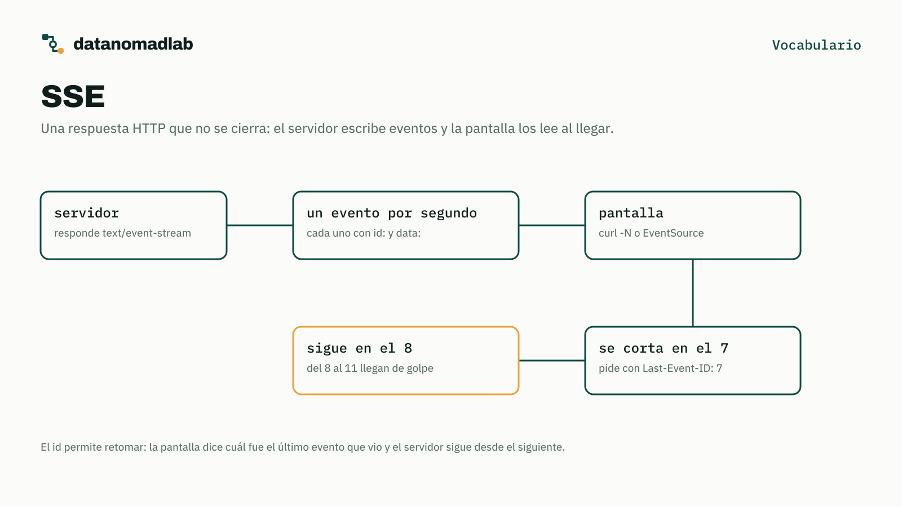

# SSE: cómo mandar eventos en vivo a una pantalla con HTTP común

*Qué son los Server-Sent Events, en qué se diferencian de WebSocket y cómo se retoma después de un corte.*

> Este post es parte del **Vocabulario del Lab**: explicaciones cortas de las herramientas que aparecen en los experimentos, pensadas para quien recién parte o nunca usó esa herramienta en particular. Si llegaste desde un experimento, aquí está lo necesario para seguirlo.



## En una frase

SSE (Server-Sent Events, "eventos enviados por el servidor") es una forma de que un servidor, el programa que responde los pedidos de una página web, le mande datos a esa página a medida que ocurren, por una respuesta que no se cierra.

## El problema que resuelve

Tienes una pantalla con la temperatura de unos sensores y quieres que el número cambie apenas llega una lectura. HTTP, el protocolo (las reglas de conversación) con que un navegador pide páginas, va por turnos: el navegador pide, el servidor responde y ahí termina. El servidor no puede avisar por su cuenta.

Sin otra herramienta, la página pregunta cada pocos segundos, y entre preguntas muestra un dato viejo.

Con SSE la página pide una vez y el servidor deja la respuesta abierta: cada lectura nueva llega al momento, como unas líneas de texto.

## Las cuatro piezas del protocolo

- **`text/event-stream`:** el tipo de contenido con que responde el servidor. Avisa que viene un flujo de eventos y no una página.
- **Evento:** líneas de texto `campo: valor`, cerradas por una línea vacía; sin ella, el navegador sigue esperando el resto. `data:` lleva el contenido, casi siempre JSON (un formato de texto para datos), e `id:` lo numera.
- **`EventSource`:** lo que la página usa para abrir el flujo. Si la conexión se cae, se reconecta solo.
- **`Last-Event-ID`:** una cabecera (un dato que acompaña al pedido) que `EventSource` manda al reconectarse, con el `id` del último evento que recibió.

## Pruébalo en 5 minutos

Necesitas [uv](https://docs.astral.sh/uv/getting-started/installation/), que corre Python sin instalar nada más, y `curl`.

Paso 1: pega el bloque entero, hasta el `EOF` final: crea la carpeta `prueba-sse` y, dentro, `servidor.py`. El servidor produce una lectura numerada por segundo desde que se prende, así que puede volver a darte cualquiera que te hayas perdido.

```bash
mkdir prueba-sse && cd prueba-sse
cat > servidor.py <<'EOF'
import json
import time
from http.server import BaseHTTPRequestHandler, ThreadingHTTPServer

INICIO = time.time()  # la lectura número n existe n segundos después de partir


class Flujo(BaseHTTPRequestHandler):
    protocol_version = "HTTP/1.1"

    def do_GET(self):
        self.send_response(200)
        self.send_header("Content-Type", "text/event-stream")
        self.send_header("Cache-Control", "no-cache")
        self.send_header("Connection", "close")
        self.end_headers()
        ultimo = self.headers.get("Last-Event-ID", "")
        # Con Last-Event-ID sigue desde la lectura siguiente; sin ella parte en vivo.
        n = int(ultimo) + 1 if ultimo.isdigit() else int(time.time() - INICIO) + 1
        try:
            while True:
                while time.time() - INICIO < n:  # espera a que exista la lectura n
                    time.sleep(0.05)
                lectura = {"sensor": "s-1", "temperatura": 20 + n % 7}
                self.wfile.write(f"id: {n}\ndata: {json.dumps(lectura)}\n\n".encode())
                self.wfile.flush()
                n += 1
        except (BrokenPipeError, ConnectionResetError):
            pass  # la pantalla cerró la conexión


try:
    ThreadingHTTPServer(("127.0.0.1", 18220), Flujo).serve_forever()
except KeyboardInterrupt:
    pass
EOF
```

Paso 2: prender el servidor. `--no-project` hace que uv corra el archivo suelto, sin buscar un proyecto. No imprime nada y la terminal queda ocupada: es normal.

```bash
uv run --no-project servidor.py
```

Paso 3: en otra terminal, hacer de pantalla con `curl`. `-N` muestra cada dato apenas llega, `-i` muestra las cabeceras y `--max-time 5` corta a los 5 segundos, como una pantalla que pierde la conexión.

```bash
curl -N -i --max-time 5 http://localhost:18220/
```

```text
HTTP/1.1 200 OK
Server: BaseHTTP/0.6 Python/3.12.15
Date: Wed, 25 Nov 2026 21:49:55 GMT
Content-Type: text/event-stream
Cache-Control: no-cache
Connection: close

id: 3
data: {"sensor": "s-1", "temperatura": 23}

id: 4
data: {"sensor": "s-1", "temperatura": 24}

id: 5
data: {"sensor": "s-1", "temperatura": 25}

id: 6
data: {"sensor": "s-1", "temperatura": 26}

id: 7
data: {"sensor": "s-1", "temperatura": 20}

curl: (28) Operation timed out after 5005 milliseconds with 250 bytes received
```

De las cabeceras, la que importa es `Content-Type: text/event-stream`. Llegó un evento por segundo hasta que `curl` cortó: eso avisa la última línea. Tus números serán otros; aquí el último fue el 7.

Paso 4: esperar unos segundos y volver a pedir con la cabecera `Last-Event-ID`, que agrega `-H`. Cambia el 7 por tu último número.

```bash
curl -N -H "Last-Event-ID: 7" --max-time 3 http://localhost:18220/
```

```text
id: 8
data: {"sensor": "s-1", "temperatura": 21}

id: 9
data: {"sensor": "s-1", "temperatura": 22}

id: 10
data: {"sensor": "s-1", "temperatura": 23}

id: 11
data: {"sensor": "s-1", "temperatura": 24}

id: 12
data: {"sensor": "s-1", "temperatura": 25}

id: 13
data: {"sensor": "s-1", "temperatura": 26}

id: 14
data: {"sensor": "s-1", "temperatura": 20}

curl: (28) Operation timed out after 3002 milliseconds with 355 bytes received
```

Los eventos 8 al 11 llegaron de golpe: ocurrieron mientras nadie escuchaba. Desde el 12 volvió a llegar uno por segundo. `EventSource` hace esto mismo sin que escribas nada. El protocolo solo lleva el número: el historial lo tenía el servidor.

Paso 5: limpiar, en la terminal del servidor, la única donde funciona el `cd ..`: Ctrl+C y borrar la carpeta.

```bash
cd .. && rm -r prueba-sse
```

## Dónde lo vas a ver en el Lab

- [Experimento 02 · Stream a pantallas en vivo](../02-stream-a-pantallas-en-vivo/): una de las combinaciones de herramientas que compara entrega por SSE. [Zilla](zilla.md) lee los eventos de [Redpanda](redpanda.md), que habla el protocolo de [Kafka](kafka.md), y los reparte en un flujo SSE por cada cuenta de cliente (1.000 en total), con 57 líneas de configuración (medido: salió de correr el experimento).
- La sonda, la pieza que hace de pantallas ([sse.go](../02-stream-a-pantallas-en-vivo/servicios/go/cmd/sonda/sse.go)), vuelve a pedir con `Last-Event-ID` cuando el flujo se corta, como en el paso 4.

Con 10.000 eventos por segundo, 99 de cada 100 llegaron en 22 ms o menos (medido). Al matar Zilla dos veces, una no se perdió nada; la otra no llegaron 28.669 eventos (medido): 44 de los 1.000 flujos no volvieron a abrirse en los 85 segundos siguientes, y no quedó establecido por qué.

## Errores típicos cuando partes

- **"Los eventos llegan de a montones."** Algo en el camino los acumula. En `curl` se arregla con `-N`; en el servidor, con el `flush()` del ejemplo.
- **"La séptima pestaña se queda cargando."** Sobre HTTP/1.1 el navegador permite 6 conexiones por dominio (la dirección del sitio), sumando todas las pestañas. La salida es HTTP/2, que lleva muchos pedidos por una conexión, o un solo flujo con todo.
- **"Se cortó y perdí lo que pasó mientras tanto."** El servidor no manda `id:` o no mira `Last-Event-ID`. Reconectar viene incluido; recuperar, no: alguien tiene que guardar el historial.
- **"La conexión quedó colgada."** `EventSource` reconecta si la conexión se cierra; si queda abierta y muda, espera sin límite. Haz que el servidor mande cada 15 segundos una línea de comentario (empieza con `:`) y reabre el flujo si deja de llegar.

## Lo que suele confundirse

**SSE y [WebSocket](websocket.md).** Los dos dejan una conexión abierta. WebSocket va en los dos sentidos, cambia de HTTP a un protocolo propio, y la reconexión la escribes tú. SSE va solo del servidor a la pantalla, sigue siendo HTTP, y el navegador reconecta por su cuenta.

**SSE y Kafka.** Kafka guarda eventos y los mueve entre sistemas; SSE es el último tramo, hasta el navegador.

## Cuándo no usarlo

- La pantalla también manda datos todo el tiempo, como en un chat, o los datos son binarios, como audio: WebSocket.
- Quien recibe es un dispositivo con una red que se corta seguido: [MQTT](mqtt.md).

## Para seguir aprendiendo

- [Utilizando eventos enviados por el servidor](https://developer.mozilla.org/es/docs/Web/API/Server-sent_events/Using_server-sent_events), la guía de MDN en español, con el formato campo por campo.
- [EventSource](https://developer.mozilla.org/es/docs/Web/API/EventSource), la referencia de MDN, que advierte del límite de 6 conexiones.
- [Server-sent events](https://html.spec.whatwg.org/multipage/server-sent-events.html), la especificación (en inglés), con las reglas de reconexión.

## Sigue con

- [WebSocket](websocket.md): la alternativa cuando la pantalla también tiene que hablar.
- [Zilla](zilla.md): la herramienta que en el experimento 02 entrega por SSE.
- [MQTT](mqtt.md): otro protocolo con que el experimento 02 llega a las pantallas.

---

*Este post lo redactó una IA a partir de los experimentos de Data Nomad Lab. Los comandos se corrieron el 25 de noviembre de 2026 y las salidas que ves son las reales.*
