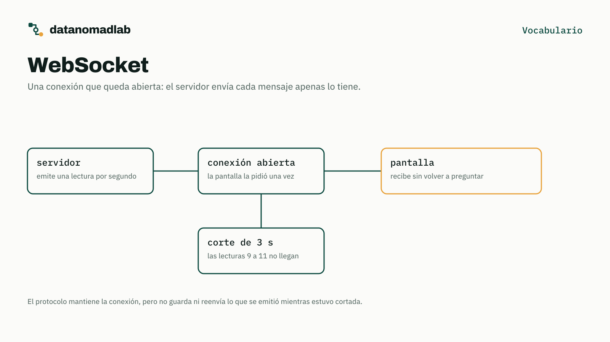

# WebSocket: cómo recibe datos una pantalla sin volver a pedirlos

*Qué es una conexión que queda abierta, en qué se diferencia de preguntar por HTTP cada pocos segundos y qué pasa con los mensajes cuando se corta.*

> Este post es parte del **Vocabulario del Lab**: explicaciones cortas de las herramientas que aparecen en los experimentos, pensadas para quien recién parte o nunca usó esa herramienta en particular. Si llegaste desde un experimento, aquí está lo necesario para seguirlo.



## En una frase

WebSocket es un protocolo (un conjunto de reglas para que dos programas conversen por la red) que deja abierta una conexión entre una página web y un servidor, de modo que cualquiera de los dos envía un mensaje cuando quiere, sin esperar a que el otro pregunte.

## El problema que resuelve

Tienes una pantalla que muestra la temperatura de una sala y quieres que cambie apenas llegue una lectura nueva. HTTP, el protocolo con que el navegador pide páginas, funciona por turnos: el navegador pregunta, el servidor (el programa que espera pedidos del otro lado) responde y la conversación termina. El servidor no puede avisar nada por su cuenta.

La salida de siempre es preguntar cada pocos segundos. Cada 5, el dato llega hasta 5 segundos tarde. Cada segundo, casi todas las respuestas dicen "nada nuevo".

Con WebSocket la pantalla se conecta una sola vez, la conexión queda abierta y el servidor escribe por ella cada lectura cuando la tiene.

## Las cuatro palabras que vas a oír siempre

- **Handshake:** el saludo inicial. La conexión parte como un pedido HTTP que propone cambiar de protocolo; el servidor acepta y desde ahí esa conexión deja de hablar HTTP.
- **`ws://` y `wss://`:** así empiezan las direcciones. La segunda viaja cifrada, como `https://`.
- **Mensaje:** lo que viaja. Es texto o bytes, y llega completo y en el orden en que se envió.
- **Ping y pong:** mensajes de control con que cada lado comprueba que el otro sigue ahí.

## Pruébalo en 5 minutos

Necesitas instalar [uv](https://docs.astral.sh/uv/getting-started/installation/), que corre scripts de Python con sus librerías sin instalarlas en tu sistema.

Paso 1: en una carpeta vacía, guarda el servidor como `servidor.py`. Emite una lectura numerada por segundo, haya o no alguien conectado.

```python
import asyncio
import json
import random

from websockets.asyncio.server import broadcast, serve

pantallas = set()  # las conexiones abiertas en este momento


async def atender(pantalla):
    pedido = json.loads(await pantalla.recv())  # lo único que envía la pantalla
    print(f"pantalla conectada, pide {pedido['suscribir']}", flush=True)
    pantallas.add(pantalla)
    try:
        await pantalla.wait_closed()  # la conexión queda abierta hasta que alguien la cierre
    finally:
        pantallas.remove(pantalla)
        print("pantalla desconectada", flush=True)


async def main():
    async with serve(atender, "localhost", 18100):
        n = 0
        while True:
            await asyncio.sleep(1)
            n += 1
            lectura = {"n": n, "sensor": "sala-1", "temperatura": round(random.uniform(20, 22), 1)}
            broadcast(pantallas, json.dumps(lectura))  # el servidor empuja, nadie se lo pidió
            print(f"lectura {n} enviada a {len(pantallas)} pantallas", flush=True)


try:
    asyncio.run(main())
except KeyboardInterrupt:
    print("servidor detenido")
```

Paso 2: déjalo corriendo en una terminal. `--with` indica la librería que necesita el script.

```bash
uv run --with websockets==17.4 servidor.py
```

```text
lectura 1 enviada a 0 pantallas
lectura 2 enviada a 0 pantallas
```

Paso 3: guarda la pantalla, un script que hace de página, como `pantalla.py`. Se conecta, manda un solo mensaje con el sensor que quiere ver, recibe 4 lecturas, corta la conexión, espera 3 segundos y vuelve.

```python
import json
import time

from websockets.sync.client import connect


def escuchar(cuantas):
    with connect("ws://localhost:18100") as conexion:
        conexion.send(json.dumps({"suscribir": "sala-1"}))
        print("conectada: mandé un solo mensaje y ahora solo escucho")
        for _ in range(cuantas):
            lectura = json.loads(conexion.recv())
            print(time.strftime("%H:%M:%S"), lectura)


escuchar(4)
print("se cortó la conexión; reconecto en 3 segundos")
time.sleep(3)
escuchar(3)
```

Paso 4: córrela en otra terminal, en la misma carpeta.

```bash
uv run --with websockets==17.4 pantalla.py
```

```text
conectada: mandé un solo mensaje y ahora solo escucho
18:48:41 {'n': 5, 'sensor': 'sala-1', 'temperatura': 20.2}
18:48:42 {'n': 6, 'sensor': 'sala-1', 'temperatura': 21.3}
18:48:43 {'n': 7, 'sensor': 'sala-1', 'temperatura': 20.9}
18:48:44 {'n': 8, 'sensor': 'sala-1', 'temperatura': 21.5}
se cortó la conexión; reconecto en 3 segundos
conectada: mandé un solo mensaje y ahora solo escucho
18:48:48 {'n': 12, 'sensor': 'sala-1', 'temperatura': 20.7}
18:48:49 {'n': 13, 'sensor': 'sala-1', 'temperatura': 21.7}
18:48:50 {'n': 14, 'sensor': 'sala-1', 'temperatura': 21.1}
```

Llegó una lectura por segundo sin volver a pedir nada. Tus números serán otros, pero también faltarán tres: aquí siguió desde la 12 y faltan la 9, la 10 y la 11.

Paso 5: mira en la terminal del servidor dónde quedaron.

```text
pantalla desconectada
lectura 9 enviada a 0 pantallas
lectura 10 enviada a 0 pantallas
lectura 11 enviada a 0 pantallas
pantalla conectada, pide sala-1
lectura 12 enviada a 1 pantallas
```

El servidor las emitió sin nadie conectado. WebSocket no guarda mensajes ni los reenvía: lo que se envía durante un corte se pierde.

Paso 6: detén el servidor con `Ctrl+C` (responde `servidor detenido`) y borra los dos archivos.

```bash
rm servidor.py pantalla.py
```

`uv cache clean websockets` borra la librería que uv descargó.

## Dónde lo vas a ver en el Lab

En el [experimento 02, Stream a pantallas en vivo](../02-stream-a-pantallas-en-vivo/), WebSocket es el último tramo: lleva los eventos a las pantallas.

- **El programa escrito a mano que lee los eventos y los reparte (el consumidor)**, en dos versiones, Go y Node, abre un servidor WebSocket como el del ejemplo: la pantalla manda un mensaje con lo que quiere ver y después recibe un evento por mensaje.
- **Las herramientas listas** también lo usan: [Centrifugo](centrifugo.md) entrega por WebSocket y [EMQX](emqx.md) entrega [MQTT](mqtt.md) sobre WebSocket.
- **En el corte** pasa lo de las lecturas 9 a 11. Se mata el programa que reparte y las pantallas reconectan a los 100 ms. Con [NATS](nats.md) y el consumidor en Go la pantalla se congeló menos de 0,4 segundos (medido: salió de correr el experimento), pero 2.121 eventos (medido) no llegaron: el consumidor volvió primero y los repartió con las pantallas aún desconectadas, a 10.000 eventos por segundo. Con Centrifugo y [Redis](redis.md) no faltó ninguno en 7 de 8 cortes, porque la pantalla pide el historial al volver; en uno se congeló 30 segundos y no llegaron 208 eventos (medido). El historial lo pone Centrifugo, no el protocolo.

## Errores típicos cuando partes

- **Creer que reconectar recupera lo perdido.** Numera los mensajes y, al volver, pide desde el último que viste a un servidor que guarde historial.
- **Abrir la dirección con el navegador o con `curl`.** El servidor responde `426 Upgrade Required` y "You need a WebSocket client": espera un cliente que haga el handshake.
- **"address already in use" al levantar el servidor.** Otro programa ya usa el puerto (el número `18100`), a menudo una copia anterior del servidor. Ciérrala o cambia ese número en los dos archivos.
- **No cortar a la pantalla lenta.** Si lee más lento de lo que el servidor escribe, los mensajes se acumulan en la memoria de este. El consumidor del experimento 02 la desconecta cuando acumula demasiado.

## Lo que suele confundirse

**WebSocket y [SSE](sse.md).** Los dos dejan una conexión abierta. SSE va solo del servidor al navegador, sobre HTTP normal, y el navegador reconecta solo. WebSocket va en los dos sentidos y la reconexión la escribes tú.

**WebSocket y MQTT.** WebSocket solo da el canal. No tiene temas ni suscripciones: el `suscribir` del ejemplo es un invento nuestro. MQTT sí los define, y en el navegador viaja dentro de un WebSocket.

## Cuándo no usarlo

Si el dato cambia cada varios minutos, preguntar por HTTP cada tanto basta. Si solo habla el servidor, SSE da lo mismo con reconexión incluida. Y si necesitas recuperar lo perdido en un corte, usa una herramienta que ya trae historial, como Centrifugo.

## Para seguir aprendiendo

- [RFC 6455](https://www.rfc-editor.org/rfc/rfc6455.html), la norma del protocolo, con el handshake y los códigos de cierre.
- [WebSockets Standard](https://websockets.spec.whatwg.org/), el objeto `WebSocket` con que una página abre la conexión.
- [websockets](https://websockets.readthedocs.io/en/stable/), la librería de Python del ejemplo.

## Sigue con

- [SSE](sse.md): la alternativa cuando solo habla el servidor.
- [MQTT](mqtt.md): temas y suscripciones, que en el navegador viajan por WebSocket.
- [Centrifugo](centrifugo.md): un servidor listo que agrega historial.

---

*Este post lo redactó una IA a partir de los experimentos de Data Nomad Lab. Los comandos se corrieron el 25 de noviembre de 2026 y las salidas que ves son las reales.*
