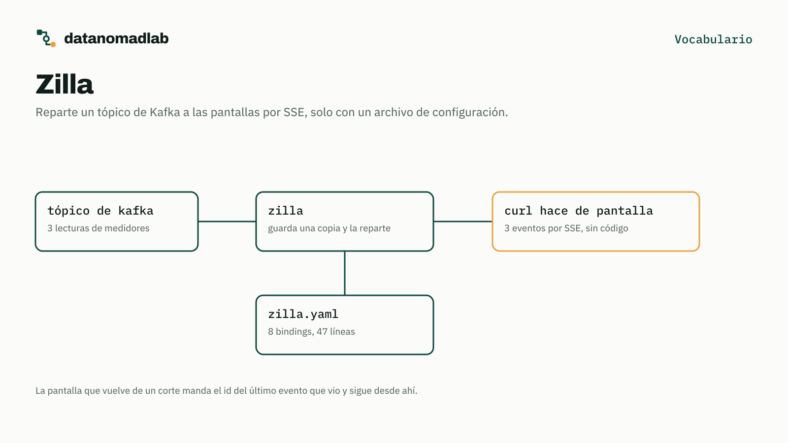

# Zilla: cómo llevar un tópico de Kafka a una pantalla sin código

*Qué hace este proxy, cómo se configura con un archivo y qué condiciones pone al repartir un tópico por SSE.*

> Este post es parte del **Vocabulario del Lab**: explicaciones cortas de las herramientas que aparecen en los experimentos, pensadas para quien recién parte o nunca usó esa herramienta en particular. Si llegaste desde un experimento, aquí está lo necesario para seguirlo.



## En una frase

Zilla, de la empresa Aklivity, es un proxy: un programa que se pone entre dos partes que hablan protocolos (reglas de conversación) distintos y traduce. En el Lab lee un tópico de [Kafka](kafka.md), la lista con nombre donde se guardan los mensajes en orden, y lo reparte a las pantallas por [SSE](sse.md).

## El problema que resuelve

Tienes lecturas de medidores llegando a un tópico y quieres verlas en una página web al instante. El navegador no habla el protocolo de Kafka, y lo habitual es escribir un programa intermedio, un consumidor, que lee el tópico, mantiene la conexión con cada pantalla y sabe qué hacer cuando una se corta. En el [experimento 02](../02-stream-a-pantallas-en-vivo/) ocupa 135 líneas en Go y 88 en Node (medido: salió de correr el experimento).

Con Zilla, ese programa pasa a ser un archivo de configuración: dices de qué tópico sale cada dirección web, y Zilla lee, guarda una copia y la entrega.

## Las tres palabras que vas a oír siempre

- **`zilla.yaml`:** el archivo con todo lo que Zilla hace, en YAML, un formato de texto con sangrías.
- **Binding:** cada eslabón de la cadena por la que pasa un dato. Entiende un protocolo (`tcp`, `http`, `sse`, `kafka`) y con `exit` dice a qué eslabón se lo entrega.
- **Caché:** la copia del tópico que Zilla guarda en memoria. Las pantallas leen de ahí y no del broker, el servidor de Kafka.

## Pruébalo en 5 minutos

Necesitas [Docker](docker.md) abierto, `curl` y dos terminales.

Paso 1: crear una red de Docker, para que los contenedores se encuentren por nombre, y levantar [Redpanda](redpanda.md), un broker que habla el protocolo de Kafka. `--advertise-kafka-addr` es la dirección que anuncia a sus clientes.

```bash
docker network create vocab-zilla-red
docker run -d --name vocab-zilla-broker --network vocab-zilla-red \
  docker.redpanda.com/redpandadata/redpanda:v26.3.1 \
  redpanda start --mode dev-container --smp 1 --memory 1G \
  --kafka-addr 0.0.0.0:9092 --advertise-kafka-addr vocab-zilla-broker:9092
```

Paso 2: crear el tópico con `rpk`, la línea de comandos de Redpanda.

```bash
docker exec vocab-zilla-broker rpk topic create lecturas
```

```text
TOPIC     STATUS
lecturas  OK
```

Paso 3: escribir la configuración; el bloque se pega entero y crea una carpeta con `zilla.yaml`. Son ocho eslabones: cuatro de entrada (`tcp`, `http`, `sse` y `sse-kafka`) y cuatro hacia Kafka (dos de caché, `kafka` y `tcp`). Lo tuyo son tres datos: la dirección `/lecturas`, el tópico `lecturas` y la dirección del broker.

```bash
mkdir vocab-zilla && cd vocab-zilla
cat > zilla.yaml <<'EOF'
name: lecturas
bindings:
  entrada_tcp:
    type: tcp
    kind: server
    options:
      host: 0.0.0.0
      port: 7114
    exit: entrada_http
  entrada_http:
    type: http
    kind: server
    exit: entrada_sse
  entrada_sse:
    type: sse
    kind: server
    exit: sse_a_kafka
  sse_a_kafka:
    type: sse-kafka
    kind: proxy
    routes:
      - when:
          - path: /lecturas
        exit: cache_cliente
        with:
          topic: lecturas
  cache_cliente:
    type: kafka
    kind: cache_client
    exit: cache_servidor
  cache_servidor:
    type: kafka
    kind: cache_server
    options:
      bootstrap:
        - lecturas
    exit: kafka
  kafka:
    type: kafka
    kind: client
    options:
      servers:
        - vocab-zilla-broker:9092
    exit: salida_tcp
  salida_tcp:
    type: tcp
    kind: client
EOF
```

Paso 4: levantar Zilla con ese archivo. `-p 18190:7114` deja el puerto 7114 del contenedor en el 18190 de tu máquina.

```bash
docker run -d --name vocab-zilla-proxy --network vocab-zilla-red -p 18190:7114 \
  -v "$PWD/zilla.yaml:/etc/zilla/zilla.yaml:ro" \
  ghcr.io/aklivity/zilla:2.7.1 start -v -e
```

Paso 5: en la primera terminal, hacer de pantalla. `-N` muestra cada dato apenas llega. `curl` queda esperando sin mostrar nada.

```bash
curl -N http://localhost:18190/lecturas
```

Paso 6: en la segunda terminal, escribir tres lecturas. `-z none` las manda sin comprimir (ver errores).

```bash
printf '%s\n' '{"medidor":"m-01","kwh":1.2}' '{"medidor":"m-02","kwh":0.8}' '{"medidor":"m-01","kwh":1.4}' \
  | docker exec -i vocab-zilla-broker rpk topic produce lecturas -z none
```

```text
Produced to partition 0 at offset 0 with timestamp 1795709803082.
Produced to partition 0 at offset 1 with timestamp 1795709803082.
Produced to partition 0 at offset 2 with timestamp 1795709803082.
```

En la primera terminal aparecen las tres. `data` trae el mensaje e `id`, su posición en el tópico (el `offset`), codificada por Zilla:

```text
id:AQIAAg==
data:{"medidor":"m-01","kwh":1.2}

id:AQIABA==
data:{"medidor":"m-02","kwh":0.8}

id:AQIABg==
data:{"medidor":"m-01","kwh":1.4}
```

Paso 7: corta el `curl` con Ctrl+C y vuelve a pedir con `Last-Event-ID`, un dato del pedido que dice cuál fue el último evento que viste: el `id` de tu segunda lectura.

```bash
curl -N -H 'Last-Event-ID: AQIABA==' http://localhost:18190/lecturas
```

```text
id:AQIABg==
data:{"medidor":"m-01","kwh":1.4}
```

Llegó solo la tercera: la pantalla dice desde dónde seguir.

Paso 8: cortar el `curl` con Ctrl+C y borrar todo.

```bash
docker rm -f -v vocab-zilla-proxy vocab-zilla-broker
docker network rm vocab-zilla-red
cd .. && rm -r vocab-zilla
```

## Dónde lo vas a ver en el Lab

En el [experimento 02, Stream a pantallas en vivo](../02-stream-a-pantallas-en-vivo/), Zilla es una de las tres herramientas que entregan solo con configuración, junto a [Centrifugo](centrifugo.md) y [EMQX](emqx.md): 57 líneas (medido) en [servicios/zilla](../02-stream-a-pantallas-en-vivo/servicios/zilla/zilla.yaml).

- A 10.000 eventos por segundo, 99 de cada 100 llegaron en 22 ms o menos; aguantó 20.000 y no 40.000 (medido).
- Al apagar Zilla de golpe dos veces, una no perdió nada; en la otra, 28.669 eventos no llegaron y la pantalla estuvo 19 segundos congelada (medido).

## Errores típicos cuando partes

- **Lo comprimido con snappy no llega y nada avisa.** Snappy es la compresión de fábrica de `rpk` y de muchos clientes de Kafka. Al repetir el paso 6 con cuatro lecturas sin `-z none`, `curl` no recibió nada y Zilla no anotó errores.
- **Una pantalla nueva recibe primero todo lo que la caché tiene.** Otro `curl` sin `Last-Event-ID` recibió de nuevo las tres lecturas; con un tópico que guarda días, es el histórico completo.
- **Un `exit` mal escrito da un 404 mudo.** Con `exit: cache_client` (le falta la `e` final de `cache_cliente`), Zilla partió sin errores y `curl` recibió `HTTP/1.1 404 Not Found`.
- **El broker anuncia una dirección inalcanzable.** Con `--advertise-kafka-addr localhost:9092`, `curl` esperó 10 segundos sin recibir nada y Zilla no anotó errores: en un contenedor, `localhost` es el propio contenedor.

## Lo que suele confundirse

**Zilla y un consumidor de Kafka.** Un consumidor común le pide al broker que anote hasta dónde leyó (un grupo de consumidores). Zilla no: lee el tópico completo a su caché y cada pantalla dice desde dónde seguir.

**Zilla y Centrifugo.** Los dos reemplazan al programa intermedio; Centrifugo habla [WebSocket](websocket.md) y reparte por canales. En el experimento 02, sobre Redpanda, Centrifugo aguantó el tope de la prueba, 80.000 eventos por segundo (medido).

**Código a la vista y código abierto.** El repositorio es público, pero su licencia general, la Aklivity Community License, deja usarlo, modificarlo y distribuirlo gratis salvo como servicio en línea que compita con Aklivity.

## Cuándo no usarlo

- Si no controlas a quien escribe en el tópico (puede comprimir con snappy), o si el tópico retiene mucho (cada pantalla nueva lo recibe entero): conviene un consumidor propio. En el experimento 02, el de Go no perdió nada en 2 cortes (medido).
- Si no puedes perder eventos en un corte: Centrifugo con [Redis](redis.md) no perdió nada en 7 de 8 cortes; en uno se congeló 30 segundos y no llegaron 208 eventos (medido).

## Para seguir aprendiendo

- [SSE Kafka Proxy](https://docs.aklivity.io/latest/concepts/proxy/sse/kafka.html), conceptos: filtros, caché y reconexión.
- [Binding sse-kafka](https://docs.aklivity.io/latest/reference/2.x/config/bindings/sse-kafka/proxy.html) y [kafka cache_server](https://docs.aklivity.io/latest/reference/2.x/config/bindings/kafka/cache_server.html), la referencia de cada opción.
- [sse.kafka.fanout](https://github.com/aklivity/zilla/tree/2.7.1/examples/sse.kafka.fanout), el ejemplo oficial.
- [Licensing](https://docs.aklivity.io/latest/reference/editions/licensing.html) y el [LICENSE](https://github.com/aklivity/zilla/blob/2.7.1/LICENSE) del repositorio: qué permite la licencia.

## Sigue con

- [SSE](sse.md): el protocolo que Zilla habla con la pantalla.
- [Kafka](kafka.md): tópicos y grupos de consumidores.
- [Redpanda](redpanda.md): el broker del ejemplo.
- [Centrifugo](centrifugo.md): la alternativa por WebSocket.

---

*Este post lo redactó una IA a partir de los experimentos de Data Nomad Lab. Los comandos se corrieron el 26 de noviembre de 2026 y las salidas que ves son las reales.*
